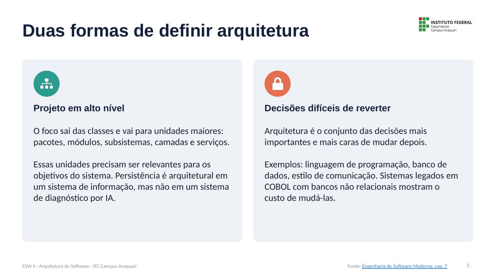
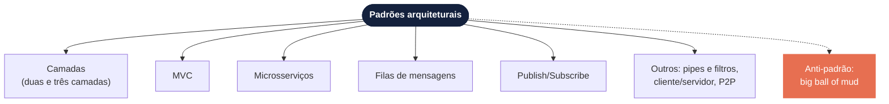
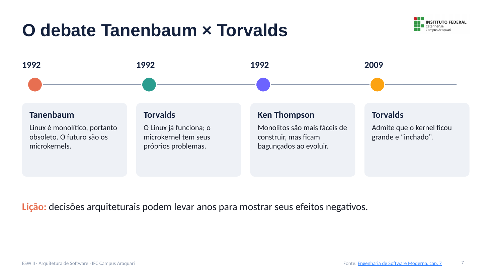

# Fundamentos de Arquitetura de Software: Notas de Aula

**Disciplina:** Engenharia de Software II
**Professor:** Mehran Misaghi · IFC Campus Araquari

> **1. Fundamentos** · [2. Camadas](02-camadas.md) · [3. MVC](03-mvc.md) · [4. Microsserviços](04-microsservicos.md) · [5. Comunicação assíncrona](05-comunicacao-assincrona.md) · [6. Anti-padrões e evolução](06-antipadroes-e-evolucao.md) · [Exercícios](exercicios.md)

> As notas de aula foram criadas com auxílio de IA e revisadas pelo professor.
---

## Sumário

1. [Arquitetura é sobre o que importa](#1-arquitetura-é-sobre-o-que-importa)
2. [Duas definições de arquitetura](#2-duas-definições-de-arquitetura)
3. [Padrões arquiteturais](#3-padrões-arquiteturais)
4. [O debate Tanenbaum × Torvalds](#4-o-debate-tanenbaum--torvalds)
5. [Material para estudar](#6-material-para-estudar)

---

## 1. Arquitetura é sobre o que importa

O capítulo 7 do livro *Engenharia de Software Moderna* abre com uma frase de Ralph Johnson:

> “Architecture is about the important stuff. Whatever that is.”

A frase é provocativa de propósito. Arquitetura **não trata de classes isoladas**, e sim das unidades e das decisões que moldam o sistema inteiro. E o que é “importante” muda de sistema para sistema: não existe uma lista universal.

---

## 2. Duas definições de arquitetura

### 2.1 Arquitetura como projeto em alto nível

O foco sai das unidades pequenas (classes) e vai para unidades maiores: **pacotes, módulos, subsistemas, camadas e serviços**.

Essas unidades precisam ser **relevantes para os objetivos do sistema**. Um exemplo do livro:

| Sistema | Módulo de persistência é arquitetural? |
|---|---|
| Sistema de informação (ex.: acadêmico, bancário) | ✅ Sim: os dados são o centro do sistema |
| Sistema de diagnóstico médico por IA | ❌ Não necessariamente: o essencial são os modelos e algoritmos |

### 2.2 Arquitetura como conjunto de decisões importantes

Arquitetura também é o conjunto das **decisões de projeto mais importantes e mais difíceis de reverter**. Exemplos:

- a **linguagem de programação**;
- o **banco de dados**;
- o **estilo de comunicação** entre os módulos (chamadas locais, REST, filas...);
- adotar um **monolito** ou **microsserviços**.

Sistemas legados em COBOL, com bancos de dados não relacionais, mostram como essas decisões custam caro para mudar décadas depois.

---

## 3. Padrões arquiteturais

**Padrões arquiteturais** são modelos pré-definidos que dizem quais são os módulos principais de um sistema e **quais relações entre eles são permitidas** (o módulo A pode usar o módulo B? E o contrário?).

> **Padrão ou estilo?** Alguns autores (Taylor et al.) distinguem *padrões* (soluções para problemas específicos) de *estilos* (princípios gerais de organização). Nesta disciplina, assim como no livro, usamos “padrões” para os dois.

Nesta série vamos estudar:

---

## 4. O debate Tanenbaum × Torvalds

Um episódio histórico mostra como decisões arquiteturais demoram para mostrar seus efeitos.

| Ano | Quem | O que disse |
|---|---|---|
| 1992 | **Andrew Tanenbaum** | O Linux, com núcleo **monolítico** (todas as funções do SO em um único executável), seria obsoleto. O futuro seriam os **microkernels**, que mantêm só o básico no núcleo. |
| 1992 | **Linus Torvalds** | O Linux já funcionava; o microkernel tinha seus próprios problemas. |
| 1992 | **Ken Thompson** | Núcleos monolíticos são mais fáceis de construir, mas tendem a ficar bagunçados à medida que evoluem. |
| 2009 | **Linus Torvalds** | Admitiu que o kernel tinha ficado grande e “inchado”. |

> **Lição:** decisões arquiteturais podem levar **anos** para mostrar seus efeitos negativos. A previsão de Ken Thompson se confirmou quase duas décadas depois.

---

## 5. Material para estudar

- [Engenharia de Software Moderna, cap. 7, seção 7.1 (Introdução)](https://engsoftmoderna.info/cap7.html)

---

**Próxima página:** [2. Arquitetura em camadas →](02-camadas.md)
