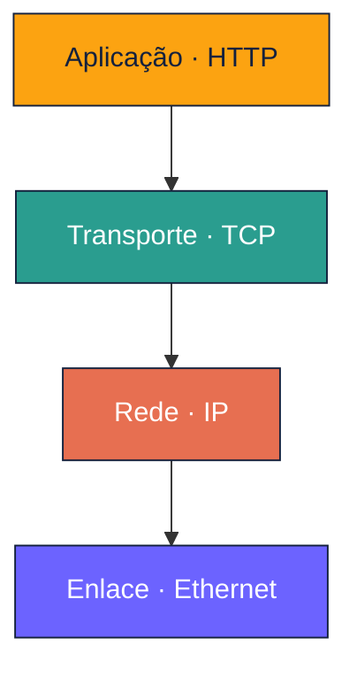
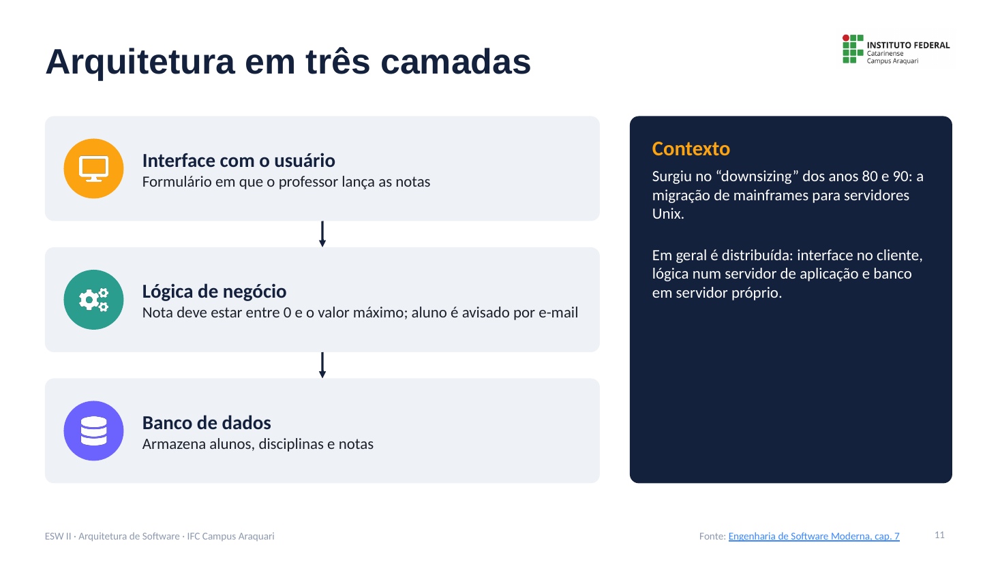
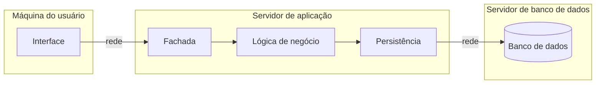

# Arquitetura em Camadas: Notas de Aula

**Disciplina:** Engenharia de Software II
**Professor:** Mehran Misaghi · IFC Campus Araquari
**Série:** Arquitetura de Software, página 2 de 6

> **Nesta série:** [1. Fundamentos](01-fundamentos.md) · **2. Camadas** · [3. MVC](03-mvc.md) · [4. Microsserviços](04-microsservicos.md) · [5. Comunicação assíncrona](05-comunicacao-assincrona.md) · [6. Anti-padrões e evolução](06-antipadroes-e-evolucao.md) · [Exercícios](exercicios.md)

---

## Sumário

1. [A regra das camadas](#1-a-regra-das-camadas)
2. [Por que usar camadas?](#2-por-que-usar-camadas)
3. [Arquitetura em três camadas](#3-arquitetura-em-três-camadas)
4. [Arquitetura em duas camadas](#4-arquitetura-em-duas-camadas)
5. [Pontos-chave para revisão](#5-pontos-chave-para-revisão)
6. [Material para estudar](#6-material-para-estudar)

---

## 1. A regra das camadas

Na arquitetura em camadas, as classes são organizadas em **camadas dispostas de forma hierárquica**. A regra é simples:

> A camada **n** só pode usar serviços da camada **n − 1**.

O exemplo clássico é a pilha de protocolos de rede:

A arquitetura em camadas é muito usada em redes de computadores e em sistemas distribuídos.

> **Nota histórica:** em 1968, Edsger Dijkstra organizou o sistema operacional **THE** em cinco camadas, da multiprogramação (camada 0) até os programas do usuário (camada 4).

---

## 2. Por que usar camadas?

É o velho princípio de **dividir para conquistar**:

| Vantagem | Explicação | Exemplo |
|---|---|---|
| **Quebra a complexidade** | Cada camada resolve uma parte do problema | A aplicação não precisa saber como os bits trafegam |
| **Facilita o entendimento** | As dependências ficam disciplinadas e previsíveis | Só se olha para a camada de baixo |
| **Facilita a troca** | Uma camada pode ser substituída sem afetar as de cima | Trocar TCP por UDP sem mexer na aplicação |
| **Facilita o reúso** | Uma camada atende várias camadas superiores | HTTP, SMTP e DHCP usam o mesmo transporte |

---

## 3. Arquitetura em três camadas

É a variação mais comum em **sistemas de informação corporativos**. Surgiu no processo de *downsizing* dos anos 80 e 90, quando as empresas migraram de mainframes para servidores rodando Unix.

| Camada | Responsabilidade | Exemplo (sistema acadêmico) |
|---|---|---|
| **Interface com o usuário** (apresentação) | Exibir informações e receber entradas (GUI ou Web) | Formulário em que o professor lança as notas |
| **Lógica de negócio** (aplicação) | Aplicar as regras de negócio | A nota deve estar entre 0 e o valor máximo; o aluno é avisado por e-mail |
| **Banco de dados** | Armazenar os dados de forma persistente | Tabelas de alunos, disciplinas e notas |

Em geral, a arquitetura em três camadas é **distribuída**:

A camada de aplicação pode ter uma **fachada** (ponto único de entrada para a interface) e um **módulo de persistência** (que conversa com o banco).

---

## 4. Arquitetura em duas camadas

É uma versão mais simples: interface e lógica de negócio ficam juntas no cliente.

| | Duas camadas | Três camadas |
|---|---|---|
| **Cliente** | Interface + lógica de negócio | Só a interface |
| **Servidor** | Banco de dados | Servidor de aplicação (lógica) + servidor de BD |
| **Vantagem** | Mais simples de construir | Regras centralizadas e clientes mais leves |
| **Desvantagem** | Todo o processamento fica no cliente, que precisa de mais recursos | Mais componentes para implantar e operar |

> Hoje a interface costuma ser Web ou mobile, mas a separação em três camadas continua valendo.

---

## 5. Pontos-chave para revisão

- Em camadas, a camada **n** só usa a camada **n − 1**.
- Camadas quebram a complexidade e facilitam o entendimento, a troca e o reúso.
- Três camadas: **interface**, **lógica de negócio** e **banco de dados**, normalmente em máquinas diferentes.
- Duas camadas: interface e lógica no cliente; mais simples, mas o cliente faz todo o processamento.

---

## 6. Material para estudar

- [Engenharia de Software Moderna, cap. 7, seção 7.2 (Arquitetura em Camadas)](https://engsoftmoderna.info/cap7.html)
- FOWLER, M. *Patterns of Enterprise Application Architecture*, 2002 (citado no livro)

---

**Página anterior:** [← 1. Fundamentos](01-fundamentos.md) · **Próxima página:** [3. MVC e suas evoluções →](03-mvc.md)
