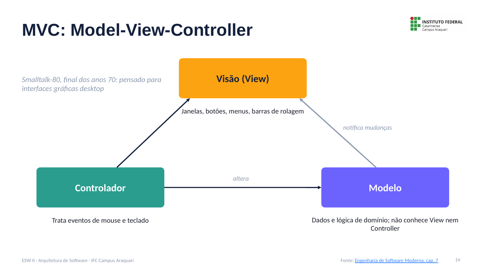
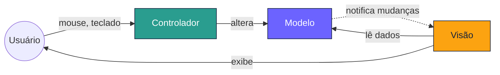
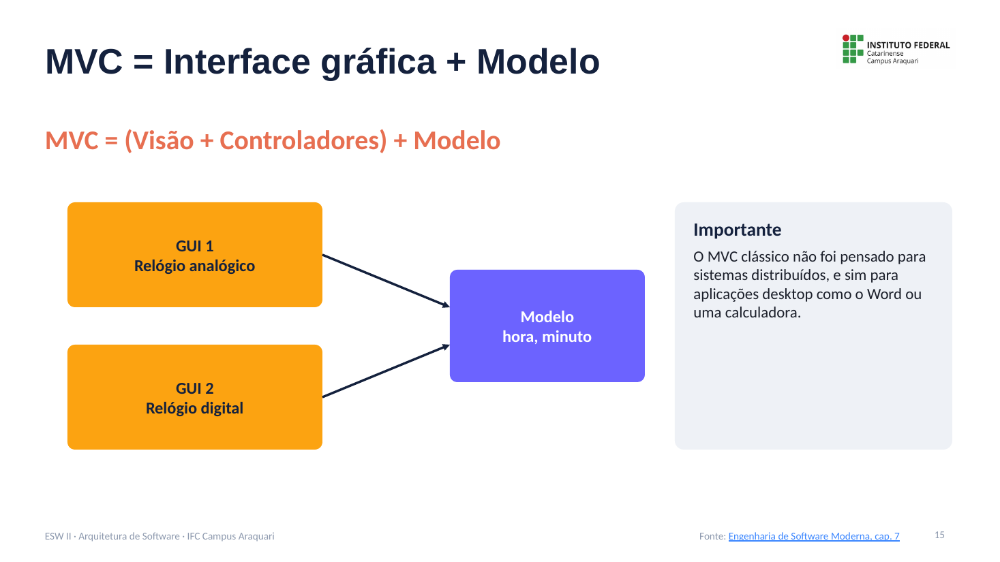
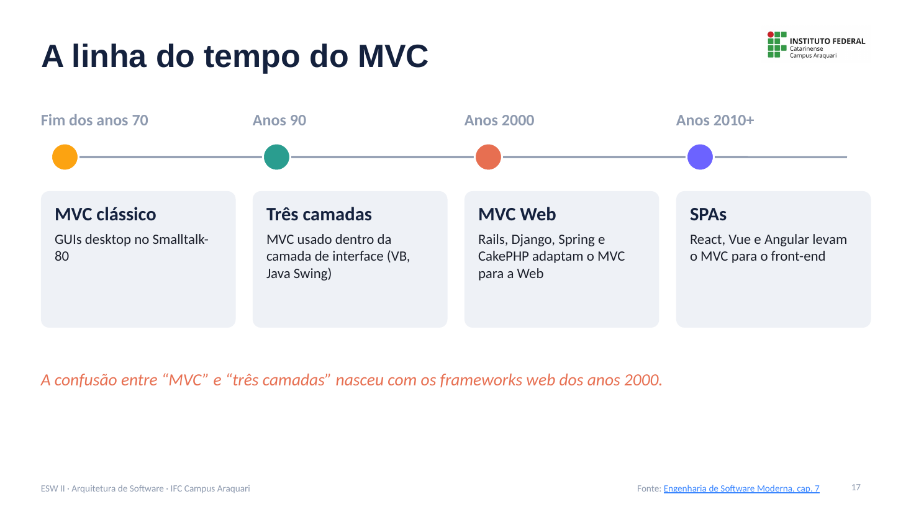
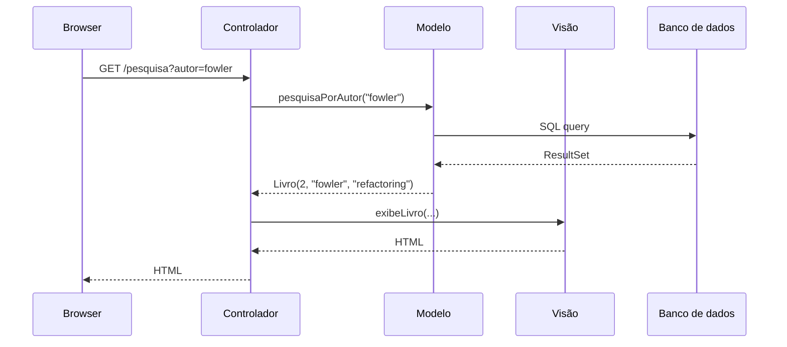
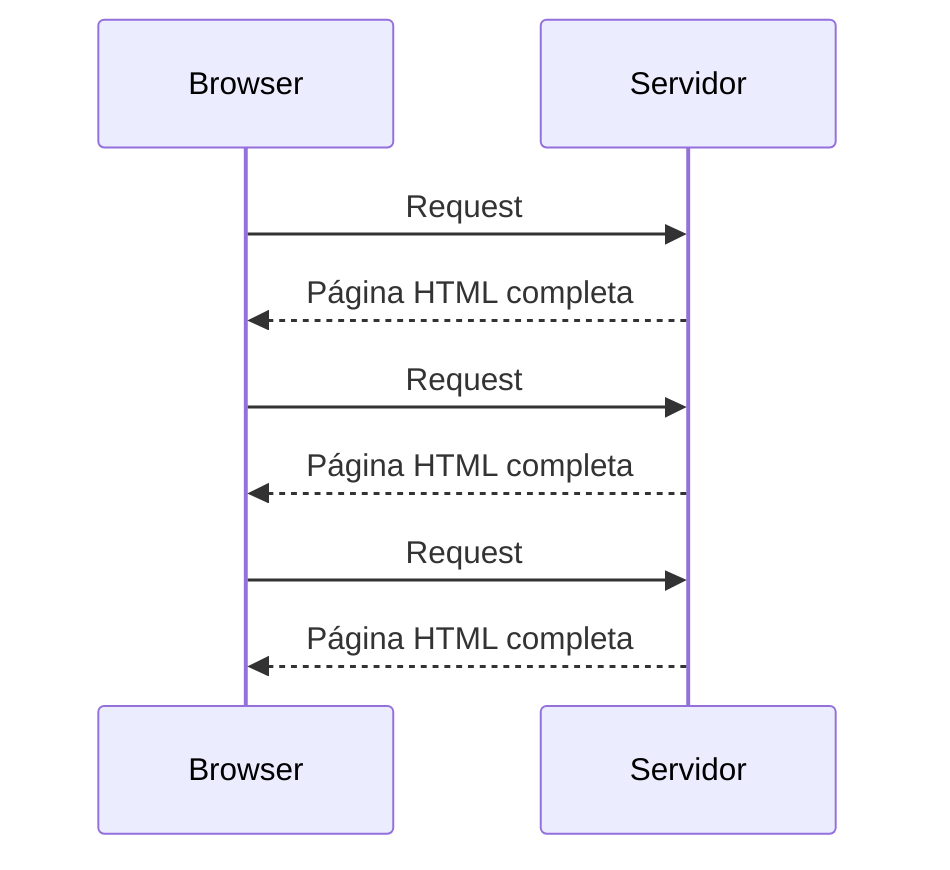
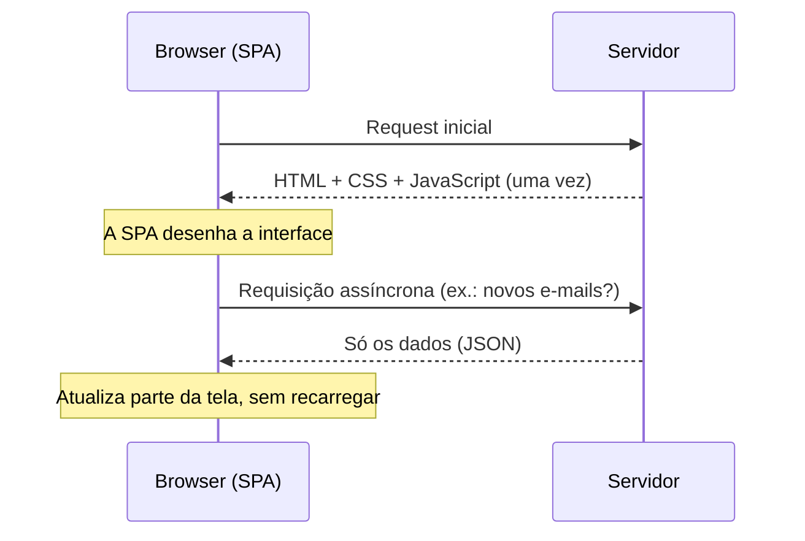
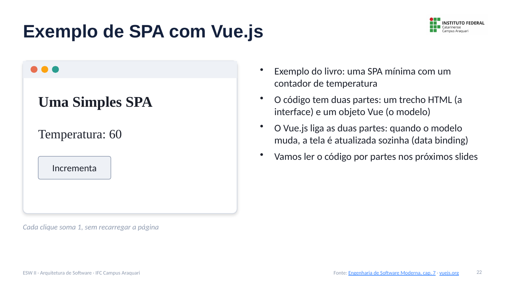
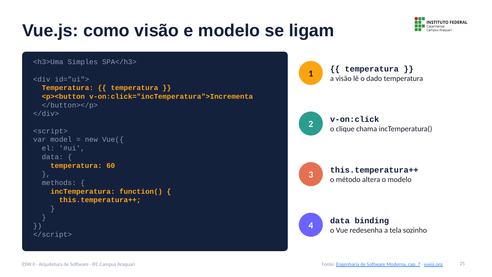
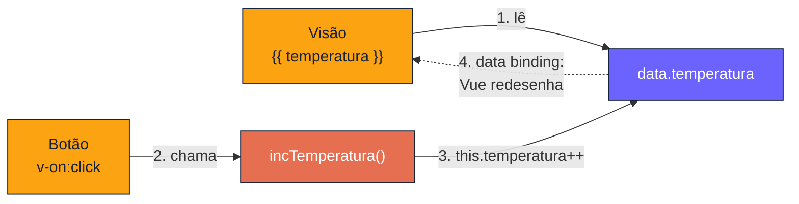

# MVC e suas Evoluções: Notas de Aula

**Disciplina:** Engenharia de Software II
**Professor:** Mehran Misaghi · IFC Campus Araquari
**Série:** Arquitetura de Software, página 3 de 6

> [1. Fundamentos](01-fundamentos.md) · [2. Camadas](02-camadas.md) · **3. MVC** · [4. Microsserviços](04-microsservicos.md) · [5. Comunicação assíncrona](05-comunicacao-assincrona.md) · [6. Anti-padrões e evolução](06-antipadroes-e-evolucao.md) · [Exercícios](exercicios.md)

---

## Sumário

1. [MVC clássico](#1-mvc-clássico)
2. [Vantagens do MVC](#2-vantagens-do-mvc)
3. [A linha do tempo do MVC](#3-a-linha-do-tempo-do-mvc)
4. [MVC Web](#4-mvc-web)
5. [Single Page Applications (SPAs)](#5-single-page-applications-spas)
6. [Exemplo em React](#6-exemplo-em-react)
7. [Exemplo em Vue.js](#7-exemplo-em-vuejs)
8. [Resumo: três sabores de MVC](#8-resumo-três-sabores-de-mvc)
10. [Material para estudar](#10-material-para-estudar)

---

## 1. MVC clássico

O padrão **Model-View-Controller** foi proposto no fim dos anos 70 e usado no **Smalltalk-80**, uma das primeiras linguagens orientadas a objetos e pioneira em interfaces gráficas. Ele foi pensado para implementar **GUIs** de aplicações desktop.



| Parte | Responsabilidade | Exemplos |
|---|---|---|
| **Visão (View)** | Apresentação | Janelas, botões, menus, barras de rolagem |
| **Controlador (Controller)** | Tratar eventos de dispositivos de entrada e pedir mudanças ao modelo ou à visão | Clique no botão “+” de uma calculadora; ativar o modo escuro |
| **Modelo (Model)** | Dados e lógica de domínio | Valores e operações da calculadora |

O **Modelo não depende** da Visão nem do Controlador. Visão e Controlador juntos formam a interface gráfica:

> **MVC = (Visão + Controladores) + Modelo = Interface Gráfica + Modelo**

A interface **observa** o modelo: quando o modelo muda, a interface é atualizada.



> **Importante:** o MVC clássico **não foi pensado para sistemas distribuídos**, e sim para aplicações desktop monolíticas, como o Word ou uma calculadora.

---

## 2. Vantagens do MVC



1. **Especialização:** desenvolvedores de front-end trabalham na interface enquanto outros cuidam do modelo.
2. **Reúso:** um mesmo modelo pode ter várias visões. Exemplo do livro: um relógio **analógico** e um **digital** mostrando a mesma hora.
3. **Testabilidade:** objetos do modelo não são visuais, então são mais fáceis de testar.

> Fowler e Beck resumem a essência do MVC: separar o código de interface da lógica de domínio, para que cada parte mude com facilidade e a mesma lógica possa ter várias apresentações.

---

## 3. A linha do tempo do MVC



| Época | Variante | Características |
|---|---|---|
| Fim dos anos 70 | **MVC clássico** | GUIs desktop no Smalltalk-80 |
| Anos 90 | **Três camadas** | Sistemas distribuídos; o MVC era usado **dentro da camada de interface** (Visual Basic, Java Swing) |
| Anos 2000 | **MVC Web** | Frameworks como Spring, Ruby on Rails, Django e CakePHP adaptam o MVC para a Web |
| Anos 2010+ | **SPAs** | React, Vue e Angular levam as ideias do MVC para o front-end, no browser |

> A confusão entre “MVC” e “três camadas” nasceu nos anos 2000, quando frameworks web passaram a se chamar “frameworks MVC”.

---

## 4. MVC Web

Os frameworks MVC Web organizam um sistema em três partes:

| Parte | No MVC Web |
|---|---|
| **Visão** | Páginas HTML, CSS e JavaScript: o que o usuário vê |
| **Controlador** | Recebe a requisição HTTP, aciona o modelo e devolve uma nova visão |
| **Modelo** | Regras de negócio e acesso ao banco de dados |

Exemplos: Ruby on Rails, Django, Spring MVC, Laravel, ASP.NET MVC. Esses frameworks continuam relevantes.

### MVC Web passo a passo

Uma busca de livros por autor em uma aplicação MVC Web:



---

## 5. Single Page Applications (SPAs)

### Aplicações web tradicionais (MPAs)

Em uma aplicação web tradicional (*Multiple Page Application*), cada evento do usuário (por exemplo, clicar em “Gravar”) gera uma requisição e o servidor devolve **uma página HTML inteira**:



**Problema:** a interface fica menos responsiva e mais lenta.

### SPAs

Uma **SPA** carrega para o browser, de uma vez, todo o código (HTML, CSS e JavaScript). Depois disso:

- ela **roda no browser**: manipula a própria interface e guarda estado;
- busca **apenas dados** no servidor, de forma **assíncrona**;
- o usuário tem a impressão de estar usando uma aplicação desktop.

Exemplos: Gmail, Google Docs, Figma. Tecnologias: React, Vue, Angular.



> **Por que assíncrona?** O Gmail precisa atualizar a caixa de entrada quando chega um e-mail, sem recarregar a página e sem travar o usuário.

---

## 6. Exemplo em React

```jsx
import { useState } from 'react';

function MyButton() {
  const [count, setCount] = useState(0);

  function handleClick() {
    setCount(count + 1);
  }

  return (
    <button onClick={handleClick}>
      Clicado {count} vezes
    </button>
  );
}
```

*Adaptado de [react.dev/learn](https://react.dev/learn).*

| Papel | No código |
|---|---|
| **Modelo** | O estado `count`. `useState()` devolve o valor atual e a função que o altera. |
| **Visão + controle** | O JSX desenha o botão; `onClick` trata o evento. Quando o estado muda, o React redesenha o componente. |

É a ideia do MVC (o modelo muda, a visão é atualizada) aplicada ao front-end.

---

## 7. Exemplo em Vue.js

Este é o exemplo do livro: uma SPA mínima com um contador de temperatura. Cada clique em **Incrementa** soma 1, sem recarregar a página.



```html
<h3>Uma Simples SPA</h3>

<div id="ui">
  Temperatura: {{ temperatura }}
  <p><button v-on:click="incTemperatura">Incrementa
  </button></p>
</div>

<script>
var model = new Vue({
  el: '#ui',
  data: {
    temperatura: 60
  },
  methods: {
    incTemperatura: function() {
      this.temperatura++;
    }
  }
})
</script>
```

### 7.1 A interface (visão)

O trecho `<div id="ui">...</div>` é HTML comum com marcações do Vue:

- `{{ temperatura }}` mostra um dado do modelo;
- `v-on:click="incTemperatura"` liga o clique do botão a um método do modelo.

### 7.2 O modelo

O objeto criado com `new Vue({...})` é o modelo:

| Propriedade | Papel |
|---|---|
| `el: '#ui'` | Qual parte do HTML esse modelo controla |
| `data` | Os **dados** (estado): `temperatura` começa em 60 |
| `methods` | Os **métodos**: `incTemperatura()` soma 1 à temperatura |

### 7.3 Como visão e modelo se ligam





Essa atualização automática da visão quando o modelo muda chama-se **data binding**. O livro observa que o Vue também faz o caminho inverso (da visão para o modelo, por exemplo com campos de formulário), o que se chama *two-way data binding*.

### 7.4 O mesmo exemplo em Vue 3

O código do livro usa a sintaxe do **Vue 2** (`new Vue`), que chegou ao fim do suporte em dezembro de 2023. Em **Vue 3**, o mesmo exemplo fica assim:

```html
<div id="ui">
  Temperatura: {{ temperatura }}
  <button @click="temperatura++">
    Incrementa
  </button>
</div>

<script type="module">
import { createApp, ref } from 'vue'

createApp({
  setup() {
    const temperatura = ref(60)
    return { temperatura }
  }
}).mount('#ui')
</script>
```

| Vue 2 | Vue 3 |
|---|---|
| `new Vue({...})` | `createApp({...}).mount('#ui')` |
| `data: { temperatura: 60 }` | `ref(60)`: estado reativo |
| `v-on:click` | `@click` (forma abreviada) |

A ideia de ligar modelo e visão continua a mesma.

---

## 8. Resumo: três sabores de MVC

| Variante | Onde roda | Uso |
|---|---|---|
| **MVC clássico** | Desktop | Smalltalk; aplicações gráficas antes da Web |
| **MVC Web** | Servidor (full stack) | Adaptação do MVC para a Web: Rails, Django, Spring |
| **SPA** | Browser (front-end) | Adaptação do MVC para o front-end: React, Vue, Angular |

> Nos três casos, a ideia central é a mesma: **separar a interface dos dados e das regras**.

---

## 9. Material para estudar

- [Engenharia de Software Moderna, cap. 7, seção 7.3 (MVC)](https://engsoftmoderna.info/cap7.html)

---

**Página anterior:** [← 2. Camadas](02-camadas.md) · **Próxima página:** [4. Microsserviços →](04-microsservicos.md)
