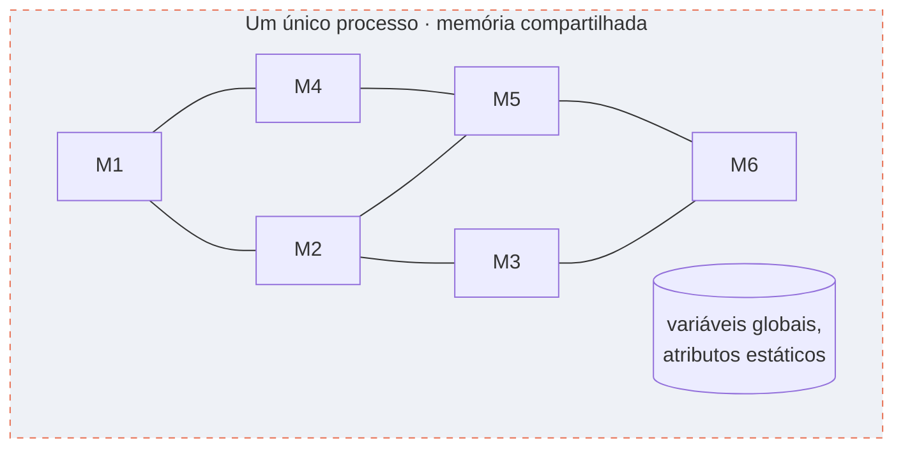
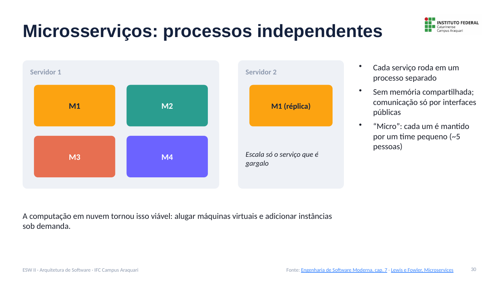
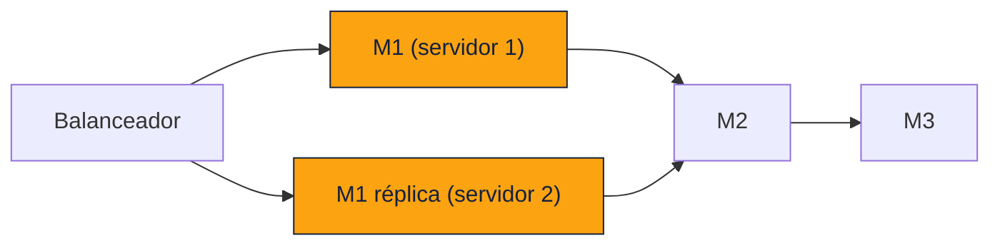
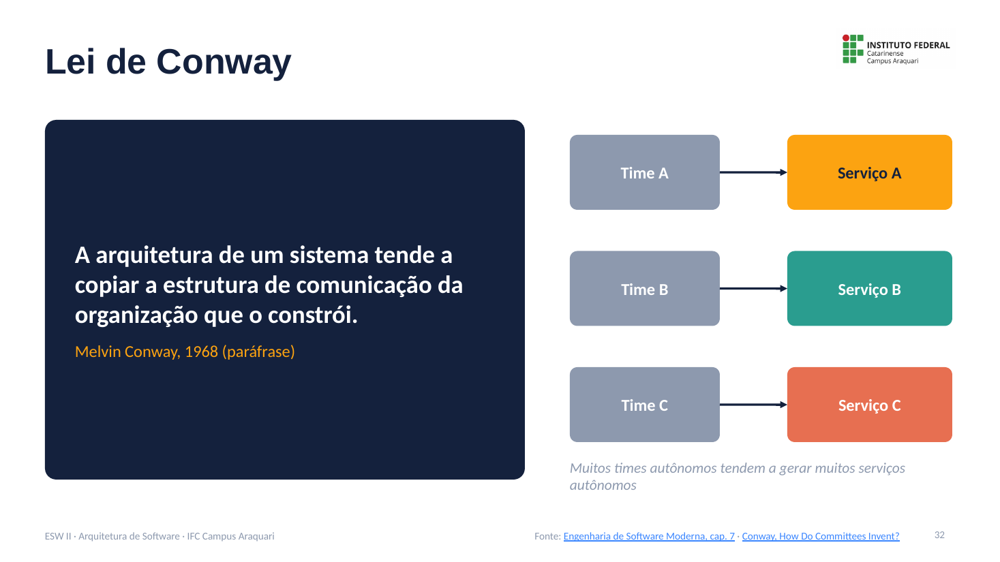
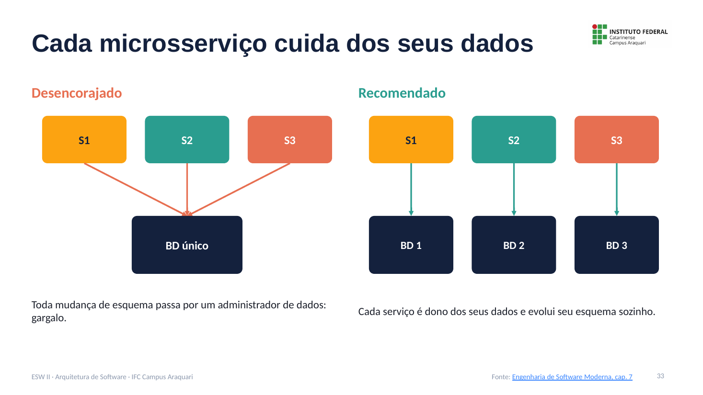
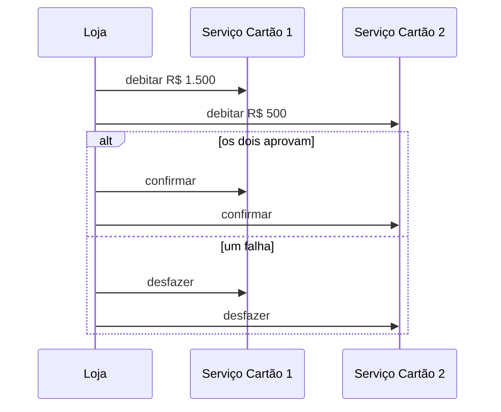

# Microsserviços: Notas de Aula

**Disciplina:** Engenharia de Software II
**Professor:** Mehran Misaghi · IFC Campus Araquari
**Série:** Arquitetura de Software, página 4 de 6

> **Nesta série:** [1. Fundamentos](01-fundamentos.md) · [2. Camadas](02-camadas.md) · [3. MVC](03-mvc.md) · **4. Microsserviços** · [5. Comunicação assíncrona](05-comunicacao-assincrona.md) · [6. Anti-padrões e evolução](06-antipadroes-e-evolucao.md) · [Exercícios](exercicios.md)

---

## Sumário

1. [O problema: o monolito como gargalo](#1-o-problema-o-monolito-como-gargalo)
2. [Microsserviços: processos independentes](#2-microsserviços-processos-independentes)
3. [Vantagens](#3-vantagens)
4. [Lei de Conway](#4-lei-de-conway)
5. [Cada serviço cuida dos seus dados](#5-cada-serviço-cuida-dos-seus-dados)
6. [Quando não usar microsserviços](#6-quando-não-usar-microsserviços)
7. [Pontos-chave para revisão](#7-pontos-chave-para-revisão)
8. [Material para estudar](#8-material-para-estudar)

---

## 1. O problema: o monolito como gargalo

Em um **monolito**, todos os módulos rodam em **um único processo** e compartilham a mesma memória.

O problema:

1. Uma mudança em um módulo pode **quebrar outro** (por variáveis globais, atributos estáticos etc.).
2. Para se proteger, a empresa cria **processos de release lentos e burocráticos**, com testes manuais.
3. Times ágeis querem entregar várias vezes por semana, mas o release vira um **gargalo**.

---

## 2. Microsserviços: processos independentes

Na arquitetura de **microsserviços**, os módulos rodam como **processos independentes**:

- cada serviço roda em um processo separado;
- **não há memória compartilhada**; a comunicação acontece só por **interfaces públicas** (e o sistema operacional garante isso);
- “micro” porque cada serviço é mantido por um **time pequeno** (cerca de cinco pessoas).

A **computação em nuvem** tornou isso viável: empresas alugam máquinas virtuais e adicionam instâncias conforme a demanda.

---

## 3. Vantagens

| Vantagem | Explicação |
|---|---|
| **Evolução independente** | Cada time tem seu próprio ciclo de releases |
| **Escalabilidade sob medida** | Só o serviço que é gargalo é replicado (**escalabilidade horizontal**), em vez do monolito inteiro |
| **Heterogeneidade tecnológica** | Um serviço em Java com banco relacional; outro em Python com NoSQL |
| **Falhas parciais** | Se o serviço de recomendação de um e-commerce cair, a loja continua vendendo |

---

## 4. Lei de Conway

> **Lei de Conway (Melvin Conway, 1968), em paráfrase:** a arquitetura de um sistema tende a copiar a estrutura de comunicação da organização que o constrói.

Por isso os microsserviços são comuns em **grandes empresas de internet**, com muitos times pequenos, distribuídos e autônomos: cada time tende a ser dono de um serviço.

> **Para pensar:** como seria a arquitetura de um sistema feito por três equipes que não conversam entre si?

---

## 5. Cada serviço cuida dos seus dados

Microsserviços devem ser **donos dos seus dados**. Compartilhar um único banco entre serviços é desencorajado.

| Banco compartilhado (desencorajado) | Banco por serviço (recomendado) |
|---|---|
| Toda mudança de esquema passa por um **administrador de dados** | Cada serviço evolui seu esquema sozinho |
| Vira um gargalo e trava a evolução independente | Preserva a autonomia dos times |

---

## 6. Quando não usar microsserviços

Microsserviços **não são bala de prata**: eles formam um **sistema distribuído**, com todos os seus custos.

| Custo | Explicação |
|---|---|
| **Complexidade** | Chamadas de método viram protocolos de rede (HTTP/REST), que o time precisa dominar |
| **Latência** | Uma chamada de rede é muito mais lenta que uma chamada local, às vezes atravessando o planeta |
| **Transações distribuídas** | Operações em vários bancos precisam ser atômicas |

**Exemplo de transação distribuída (do livro):** uma compra de R$ 2.000 paga com dois cartões, R$ 1.500 em um e R$ 500 em outro. Ou se debita nos dois, ou em nenhum.

Esse tipo de coordenação pode exigir protocolos como o **two-phase commit**.

---

## 7. Pontos-chave para revisão

- No monolito, uma mudança pode quebrar módulos vizinhos, o que torna os releases lentos.
- Microsserviços são **processos independentes**, sem memória compartilhada, mantidos por times pequenos.
- Vantagens: evolução independente, escalabilidade sob medida, heterogeneidade e falhas parciais.
- **Lei de Conway:** a arquitetura espelha a comunicação da organização.
- Cada serviço deve ter **seus próprios dados**.
- Custos: complexidade, latência e transações distribuídas.

---

## 8. Material para estudar

- [Engenharia de Software Moderna, cap. 7, seção 7.4 (Microsserviços)](https://engsoftmoderna.info/cap7.html)
- LEWIS, J.; FOWLER, M. [Microservices](https://martinfowler.com/articles/microservices.html), 2014
- CONWAY, M. [How Do Committees Invent?](https://www.melconway.com/Home/Committees_Paper.html), 1968

---

**Página anterior:** [← 3. MVC](03-mvc.md) · **Próxima página:** [5. Comunicação assíncrona →](05-comunicacao-assincrona.md)
