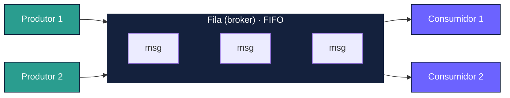
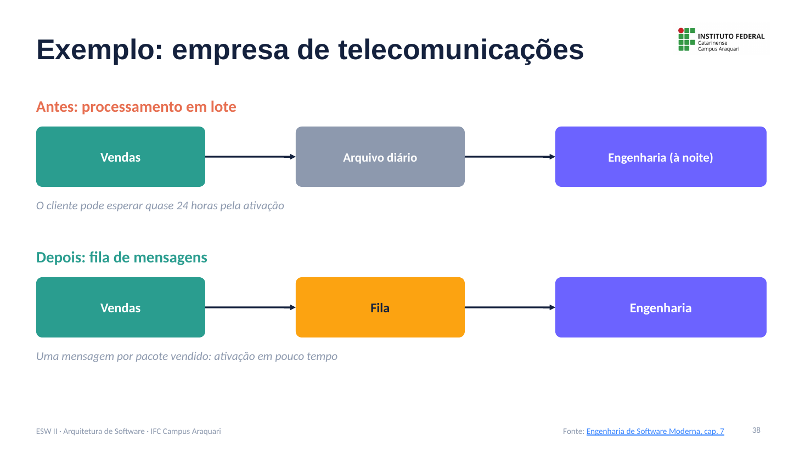
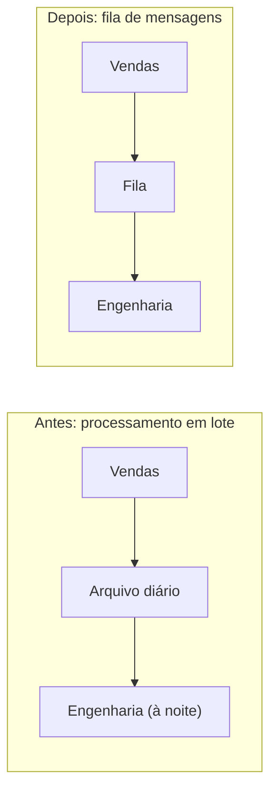
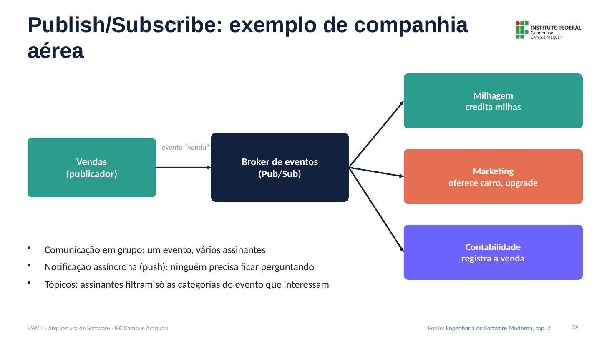
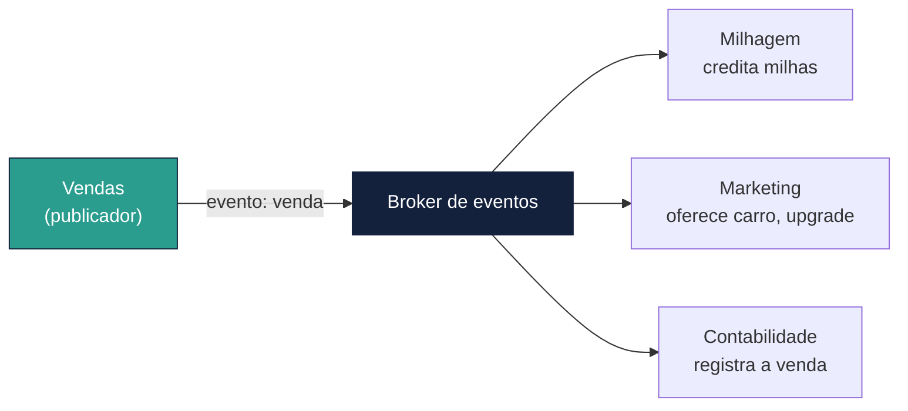
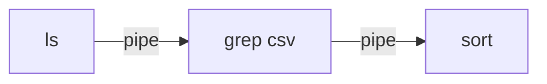
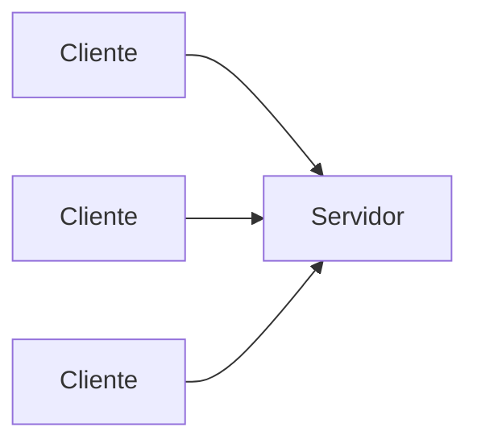
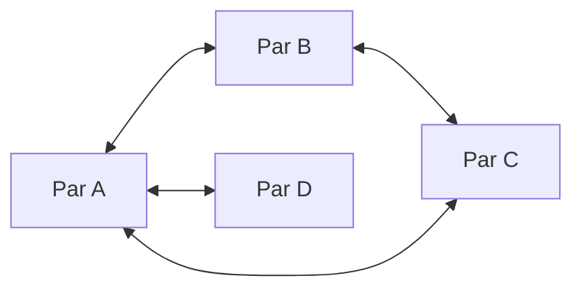

# Comunicação Assíncrona: Notas de Aula

**Disciplina:** Engenharia de Software II
**Professor:** Mehran Misaghi · IFC Campus Araquari
**Série:** Arquitetura de Software, página 5 de 6

> **Nesta série:** [1. Fundamentos](01-fundamentos.md) · [2. Camadas](02-camadas.md) · [3. MVC](03-mvc.md) · [4. Microsserviços](04-microsservicos.md) · **5. Comunicação assíncrona** · [6. Anti-padrões e evolução](06-antipadroes-e-evolucao.md) · [Exercícios](exercicios.md)

---

## Sumário

1. [Arquiteturas orientadas a mensagens](#1-arquiteturas-orientadas-a-mensagens)
2. [Desacoplamento no espaço e no tempo](#2-desacoplamento-no-espaço-e-no-tempo)
3. [Exemplo: empresa de telecomunicações](#3-exemplo-empresa-de-telecomunicações)
4. [Publish/Subscribe](#4-publishsubscribe)
5. [Filas × Publish/Subscribe](#5-filas--publishsubscribe)
6. [Outros padrões arquiteturais](#6-outros-padrões-arquiteturais)
7. [Pontos-chave para revisão](#7-pontos-chave-para-revisão)
8. [Material para estudar](#8-material-para-estudar)

---

## 1. Arquiteturas orientadas a mensagens

Nesse padrão, uma **fila de mensagens** (também chamada de *broker*) intermedeia a comunicação:

- **produtores** (clientes) inserem mensagens na fila;
- **consumidores** (servidores) retiram e processam as mensagens;
- a fila é **FIFO**: a primeira mensagem a entrar é a primeira a ser consumida.



Características:

- **Comunicação assíncrona:** depois de enfileirar a mensagem, o produtor segue trabalhando.
- **Persistência:** a fila precisa ser persistente e rodar em uma máquina estável. Na prática, usa-se uma solução pronta (ex.: RabbitMQ, Amazon SQS, Kafka) em vez de construir uma.
- **Escalabilidade:** vários consumidores podem ler da mesma fila.

---

## 2. Desacoplamento no espaço e no tempo

| Tipo | Significado | Consequência |
|---|---|---|
| **No espaço** | Produtores não conhecem os consumidores, e vice-versa | Dá para trocar, adicionar ou remover consumidores sem mexer em quem produz |
| **No tempo** | Produtor e consumidor não precisam estar no ar ao mesmo tempo | Se o consumidor cair, as mensagens se acumulam na fila e são processadas quando ele voltar |

Filas e Publish/Subscribe oferecem **os dois tipos** de desacoplamento.

---

## 3. Exemplo: empresa de telecomunicações

O sistema de **vendas** vende pacotes (voz, dados, TV a cabo). O sistema de **engenharia** ativa e configura os serviços nos equipamentos.





- **Em lote:** o cliente pode esperar quase **24 horas** pela ativação.
- **Com fila:** vendas publica uma mensagem por pacote vendido e a engenharia ativa em pouco tempo (rápido, embora não necessariamente em tempo real).

---

## 4. Publish/Subscribe

Em **Publish/Subscribe** (pub/sub), as mensagens são chamadas de **eventos**:

- **publicadores** emitem eventos para um serviço de pub/sub (**broker de eventos**);
- **assinantes** registram interesse em certos eventos e são **notificados** quando eles ocorrem.

Essas arquiteturas também são chamadas de **orientadas a eventos** (*event-driven*).

### Exemplo: companhia aérea





O evento de venda carrega data, hora, número do voo e dados do passageiro. Quatro características aparecem no exemplo:

1. **Comunicação em grupo:** um evento, vários assinantes.
2. **Desacoplamento no espaço:** vendas não sabe quem são os assinantes.
3. **Desacoplamento no tempo:** se um assinante estiver fora do ar, o broker entrega o evento depois.
4. **Notificação assíncrona:** ninguém precisa ficar perguntando se há eventos novos.

**Tópicos:** os eventos são agrupados por categoria, e cada assinante recebe só os tópicos que lhe interessam.

> **Pub/sub × Observer:** pub/sub lembra o padrão de projeto *Observer* (capítulo 6 do livro), mas foi pensado para **sistemas distribuídos**; o Observer não.

---

## 5. Filas × Publish/Subscribe

| | Filas de mensagens | Publish/Subscribe |
|---|---|---|
| **Unidade** | Mensagem | Evento |
| **Comunicação** | Ponto a ponto: cada mensagem tem um consumidor | Em grupo: um evento, vários assinantes |
| **Entrega** | O consumidor busca a mensagem (*pull*) | O assinante é notificado (*push*) |
| **Organização** | Uma ou mais filas | Tópicos por categoria de evento |
| **Desacoplamento** | No espaço e no tempo | No espaço e no tempo |
| **Quando usar** | Distribuir tarefas entre trabalhadores | Avisar vários sistemas sobre um fato |

---

## 6. Outros padrões arquiteturais

### Pipes e filtros

Padrão orientado a dados: **filtros** transformam uma entrada em uma saída; **pipes** levam os dados de um filtro ao próximo. Os filtros não conhecem os vizinhos, podem ser combinados de várias formas e podem rodar em paralelo.

```bash
ls | grep csv | sort
```



### Cliente/servidor

Clientes fazem pedidos; servidores atendem pela rede. Exemplos: serviços de impressão, de arquivos, de banco de dados e a Web (o browser pede páginas ao servidor).



### Peer-to-peer (P2P)

Cada nó é, ao mesmo tempo, **cliente e servidor**. Exemplo: o **BitTorrent**, em que cada participante baixa e oferece arquivos.



---

## 7. Pontos-chave para revisão

- Filas: produtores inserem, consumidores retiram; comunicação **assíncrona** e **FIFO**.
- **Desacoplamento no espaço** (não se conhecem) e **no tempo** (não precisam estar no ar juntos).
- Pub/sub: eventos, **comunicação em grupo**, notificação **push** e **tópicos**.
- Use filas para **distribuir tarefas** e pub/sub para **avisar vários interessados**.
- Outros padrões: pipes e filtros, cliente/servidor e peer-to-peer.

---

## 8. Material para estudar

- [Engenharia de Software Moderna, cap. 7, seções 7.5 a 7.7](https://engsoftmoderna.info/cap7.html)
- EUGSTER, P. et al. *The many faces of publish/subscribe*, ACM Computing Surveys, 2003 (citado no livro)

---

**Página anterior:** [← 4. Microsserviços](04-microsservicos.md) · **Próxima página:** [6. Anti-padrões e evolução →](06-antipadroes-e-evolucao.md)
