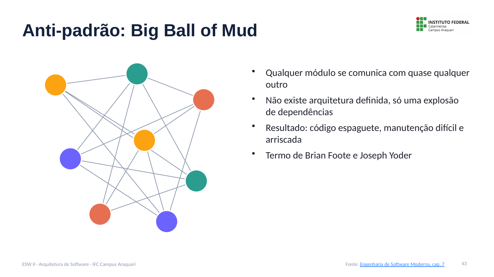
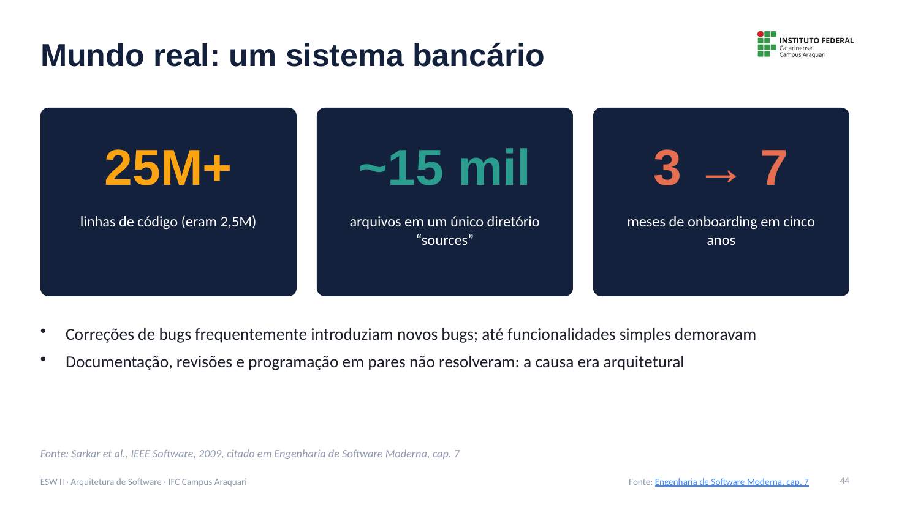
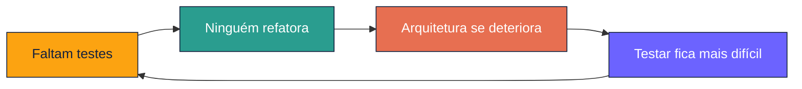
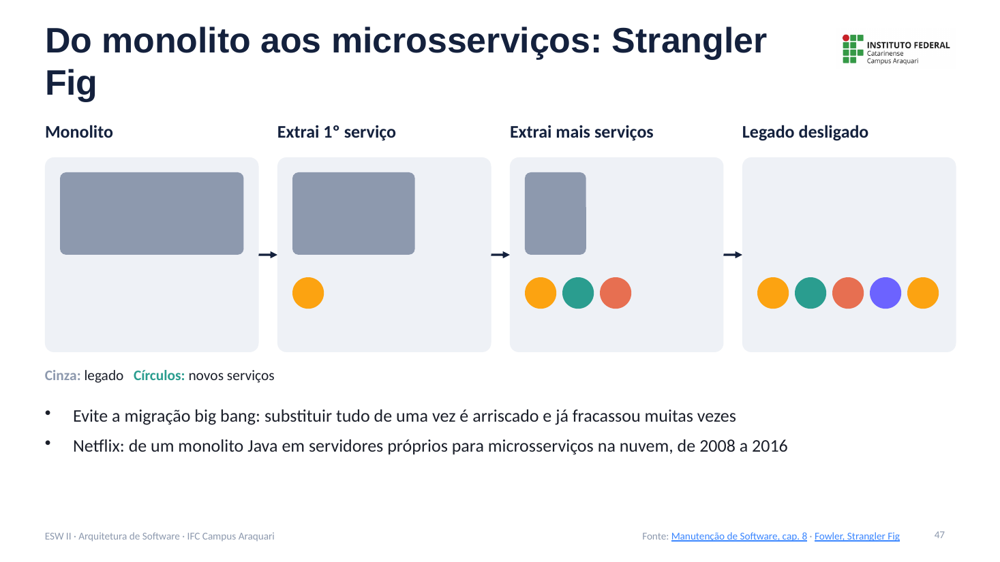
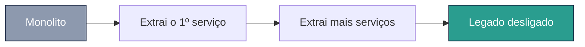
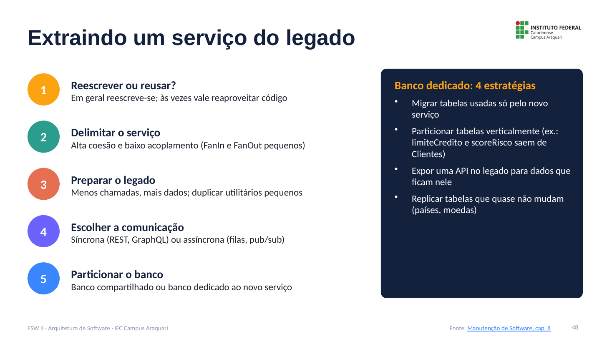
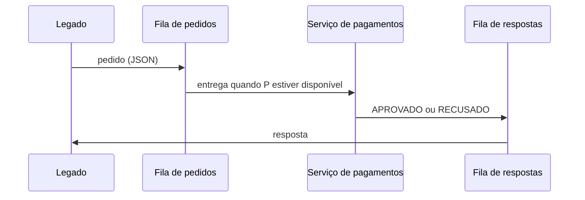
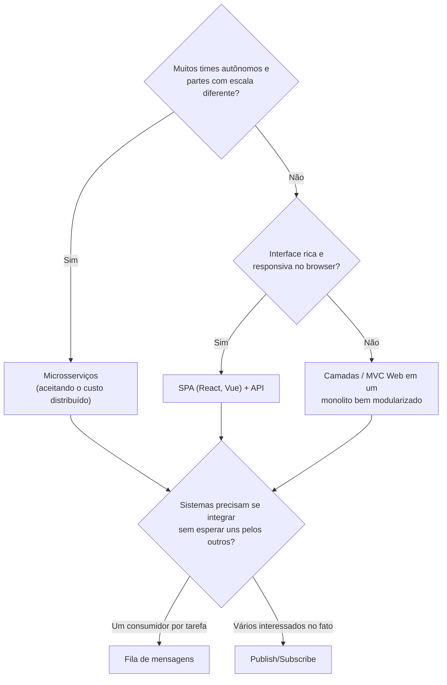

# Anti-padrões e Evolução Arquitetural: Notas de Aula

**Disciplina:** Engenharia de Software II
**Professor:** Mehran Misaghi · IFC Campus Araquari
**Série:** Arquitetura de Software, página 6 de 6

> **Nesta série:** [1. Fundamentos](01-fundamentos.md) · [2. Camadas](02-camadas.md) · [3. MVC](03-mvc.md) · [4. Microsserviços](04-microsservicos.md) · [5. Comunicação assíncrona](05-comunicacao-assincrona.md) · **6. Anti-padrões e evolução** · [Exercícios](exercicios.md)

---

## Sumário

1. [Anti-padrão: Big Ball of Mud](#1-anti-padrão-big-ball-of-mud)
2. [Mundo real: um sistema bancário](#2-mundo-real-um-sistema-bancário)
3. [Dívida técnica arquitetural](#3-dívida-técnica-arquitetural)
4. [Dívida planejada e não planejada](#4-dívida-planejada-e-não-planejada)
5. [Do monolito aos microsserviços: Strangler Fig](#5-do-monolito-aos-microsserviços-strangler-fig)
6. [Extraindo um serviço do legado](#6-extraindo-um-serviço-do-legado)
7. [Como escolher um padrão?](#7-como-escolher-um-padrão)
8. [Pontos-chave para revisão](#8-pontos-chave-para-revisão)
9. [Material para estudar](#9-material-para-estudar)

---

## 1. Anti-padrão: Big Ball of Mud

O termo foi proposto por **Brian Foote e Joseph Yoder**. Descreve sistemas em que **qualquer módulo se comunica com quase qualquer outro**.

- Não existe arquitetura definida, só uma **explosão de dependências**.
- O resultado é **código espaguete**.
- A manutenção fica **difícil e arriscada**.

---

## 2. Mundo real: um sistema bancário

Em artigo publicado na *IEEE Software* (2009), Santonu Sarkar e colegas, então consultores da Infosys, descreveram um grande sistema bancário cuja arquitetura era um big ball of mud.

| Indicador | Valor |
|---|---|
| Tamanho | Cresceu de cerca de **2,5 milhões** para mais de **25 milhões** de linhas de código |
| Equipe | Centenas de engenheiros |
| Organização | Um único diretório `sources` com quase **15 mil arquivos** |
| Onboarding | Subiu de **3 para 7 meses** em cinco anos |

Consequências: correções de bugs frequentemente introduziam novos bugs, e até funcionalidades simples demoravam. Documentação detalhada, revisões de código e programação em pares **não resolveram**, porque a causa era **arquitetural**.

---

## 3. Dívida técnica arquitetural

> **Metáfora de Ward Cunningham (1992):** entregar código ainda “não pronto” é como contrair uma dívida. Acelera o desenvolvimento agora, mas cobra juros depois.

O livro *Manutenção de Software* define três componentes:

| Componente | Significado |
|---|---|
| **Principal inicial** | O tempo economizado agora |
| **Juros** | O esforço extra em cada mudança futura |
| **Principal atual** | O custo para chegar à solução ideal hoje |

**Exemplo do livro:** uma funcionalidade feita às pressas economizou 2 dias (principal inicial). A funcionalidade seguinte levou 5 dias em vez de 4 (1 dia de juros). Quitar a dívida custaria 3 dias (principal atual).

### Dívida de design e arquitetura

É o tipo principal de dívida técnica. Causas comuns: ausência de arquitetura planejada, módulos que não seguem a arquitetura definida, código duplicado, forte acoplamento e falta de documentação.

Ela alimenta um **ciclo vicioso**:

Em uma pesquisa de Ernst et al. (2015), **decisões inadequadas de arquitetura** foram a causa de dívida técnica mais citada: cerca de 55% dos participantes as colocaram entre as três primeiras.

---

## 4. Dívida planejada e não planejada

| | Planejada | Não planejada |
|---|---|---|
| **O que é** | Uma decisão de negócio consciente | Surge quando o mundo muda |
| **Exemplos** | Uma startup lança rápido para ganhar mercado e depois paga a dívida | Banco digital que passa a vender ações e criptomoedas; e-commerce que vira marketplace; cursos presenciais que passam a ser online; sistemas presos a J2EE ou AngularJS 1.0 |

**Como gerenciar:**

- registre a dívida em **issues** com uma etiqueta (ex.: `debt`), dizendo o quê, onde, por quê, quando e quem;
- use comentários `TODO`, `FIXME` e `HACK` só para dívidas locais e pequenas;
- **priorize** pagar a dívida nas partes do sistema que **mudam com frequência**, onde os juros são maiores.

---

## 5. Do monolito aos microsserviços: Strangler Fig

Sistemas legados tendem a ser monolitos. Substituí-los de uma vez (**migração big bang**) é arriscado e já fracassou muitas vezes.

O padrão **Strangler Fig**, proposto por Martin Fowler, faz a substituição **aos poucos**: serviços são extraídos gradualmente até o legado não ter mais funções e poder ser desligado.

**Exemplo:** a Netflix migrou de um monolito Java em servidores próprios para microsserviços na nuvem. A transição começou em 2008 e terminou em 2016, com o desligamento dos últimos servidores.

---

## 6. Extraindo um serviço do legado

Antes de extrair um serviço, é preciso decidir:

1. **Reescrever ou reusar o código?** Em geral, reescreve-se; às vezes vale reaproveitar.
2. **Delimitar o serviço**, buscando alta coesão e baixo acoplamento.
3. **Preparar o legado** com refatorações.
4. **Escolher a comunicação:** síncrona (REST, GraphQL) ou assíncrona (filas, pub/sub).
5. **Particionar o banco de dados.**

### Métricas de acoplamento

| Conjunto | Significado |
|---|---|
| **FanOutSet** | Arquivos do legado usados pelo novo serviço |
| **FanInSet** | Arquivos do novo serviço usados pelo legado |

Quanto menores esses conjuntos, **menor o esforço** de extração.

### Preparando o legado

- **Menos chamadas, mais dados:** em vez de o serviço chamar o legado de volta, o legado envia de uma vez todos os dados necessários. Ex.: `avaliarEmprestimo` recebe renda e idade do cliente como parâmetros.
- **Duplicar utilitários pequenos:** funções genéricas, como validar CPF, podem ser copiadas para o novo serviço. Troca-se acoplamento por um pouco de duplicação.

### Comunicação

| | Síncrona (REST, GraphQL) | Assíncrona (filas, pub/sub) |
|---|---|---|
| **Vantagem** | Simples | Tolera indisponibilidade do outro lado |
| **Desvantagem** | Acoplamento temporal: os dois processos precisam estar no ar | Mais infraestrutura |

### Particionamento do banco de dados

- **Banco compartilhado:** barato, mas acopla os dados e limita a autonomia do novo serviço.
- **Banco dedicado**, com quatro estratégias (que costumam ser combinadas):
  1. migrar as tabelas usadas só pelo novo serviço;
  2. particionar tabelas verticalmente (ex.: os campos `limiteCredito` e `scoreRisco` saem da tabela `Clientes`);
  3. expor uma API no legado para os dados que continuam nele;
  4. replicar tabelas que quase não mudam (países, moedas).

---

## 7. Como escolher um padrão?

Não existe padrão universalmente melhor: **o contexto decide**. Um padrão pode resolver o problema e ainda assim não ser adequado.

---

## 8. Pontos-chave para revisão

- **Big ball of mud:** sem arquitetura, só dependências por toda parte.
- O caso do sistema bancário mostra que o problema arquitetural não se resolve só com processo.
- Dívida técnica tem **principal** e **juros**; a arquitetural é a mais comum e a mais cara.
- **Strangler Fig:** migrar aos poucos, extraindo serviços, em vez de um big bang.
- Extrair um serviço exige decidir sobre código, limites, preparo do legado, comunicação e dados.

---

## 9. Material para estudar

- [Engenharia de Software Moderna, cap. 7, seção 7.8 (Anti-padrões)](https://engsoftmoderna.info/cap7.html)
- [Manutenção de Software, cap. 7: Dívida Técnica](https://manutencaosoftware.org/cap7.html)
- [Manutenção de Software, cap. 8: Sistemas Legados](https://manutencaosoftware.org/cap8.html)
- FOWLER, M. [Strangler Fig Application](https://martinfowler.com/bliki/StranglerFigApplication.html)

---

**Página anterior:** [← 5. Comunicação assíncrona](05-comunicacao-assincrona.md) · **Próxima página:** [Exercícios →](exercicios.md)
