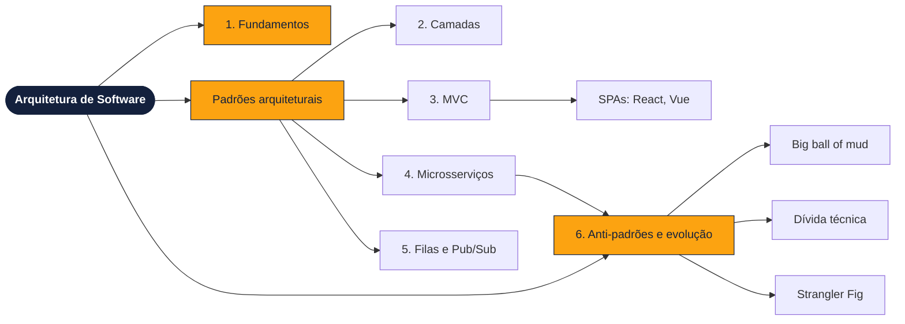

# ESW II - 2026/2
# Arquitetura de Software: Notas de Aula

**Professor:** Mehran Misaghi 

Material de apoio da aula **Arquitetura de Software**, baseado no
[Capítulo 7 do livro *Engenharia de Software Moderna (2021)*](https://engsoftmoderna.info/cap7.html)
e nos capítulos [7 (Dívida Técnica)](https://manutencaosoftware.org/cap7.html) e
[8 (Sistemas Legados)](https://manutencaosoftware.org/cap8.html) do livro
[*Manutenção de Software (2026)*](https://manutencaosoftware.org/), ambos do Prof. Marco Tulio Valente.

>Este material foi elaborado com auxilío de IA e revisado por professor.

## Conteúdo

| Página | Descrição |
|---|---|
| [1. Fundamentos](01-fundamentos.md) | O que é arquitetura, padrões arquiteturais e o debate Tanenbaum × Torvalds |
| [2. Arquitetura em camadas](02-camadas.md) | Camadas, três camadas e duas camadas |
| [3. MVC e suas evoluções](03-mvc.md) | MVC clássico, MVC Web, SPAs e exemplos em React e Vue.js |
| [4. Microsserviços](04-microsservicos.md) | Monolitos, microsserviços, Lei de Conway, dados e custos |
| [5. Comunicação assíncrona](05-comunicacao-assincrona.md) | Filas de mensagens, Publish/Subscribe e outros padrões |
| [6. Anti-padrões e evolução](06-antipadroes-e-evolucao.md) | Big ball of mud, dívida técnica arquitetural, Strangler Fig e extração de serviços |
| [Exercícios](exercicios.md) | 15 exercícios |

## Mapa da aula

## Como usar

1. Leia as notas na ordem: cada página termina com **pontos-chave para revisão** e um link para a próxima.
2. Resolva os [exercícios](exercicios.md) propostos.
4. Para poder estudar melhor, use os links da seção **Material para estudar** de cada página.

## Slides da Aula e Referências

- [Slides da aula](https://canva.link/8nu9yqqlk42dv45)
- VALENTE, M. T. *Engenharia de Software Moderna*. [Cap. 7: Arquitetura](https://engsoftmoderna.info/cap7.html), 2021
- VALENTE, M. T. *Manutenção de Software*. [Cap. 7: Dívida Técnica](https://manutencaosoftware.org/cap7.html) · [Cap. 8: Sistemas Legados](https://manutencaosoftware.org/cap8.html), 2026

