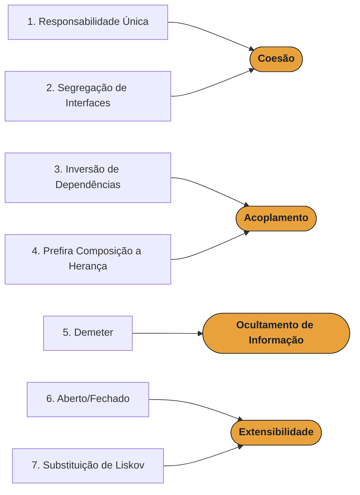

# Propriedades X Princípios de Projeto

## Por que precisamos de estudar princípios de projeto?

Projetar software é decompor um problema grande em partes menores (classes, módulos, pacotes) que possam ser
implementadas, testadas e modificadas com o menor esforço possível. O desafio é que **sistemas mudam o tempo todo**:
novos requisitos chegam, tecnologias são trocadas, regras de negócio evoluem. Um bom projeto é aquele que
**absorve essas mudanças sem efeitos colaterais em cascata**.

Na Parte I estudamos as **propriedades** que caracterizam um bom projeto. Nesta aula estudamos os **princípios**:
recomendações concretas que, quando seguidas, levam a essas propriedades.

## Antes, vamos relembrar: propriedades de projeto

| Propriedade | Ideia 
|---|---|
| **Integridade conceitual** | O sistema oferece um conjunto coerente de ideias e padrões, evitando funcionalidades e convenções desconexas. 
| **Ocultamento de informação** | Cada classe esconde as decisões sujeitas a mudança atrás de uma interface estável. 
| **Coesão** | Cada classe implementa um único serviço ou interesse (separação de interesses). 
| **Acoplamento** | Força da conexão entre classes. A meta é **minimizar**, não eliminar, o acoplamento. 

Lembre-se também da distinção entre tipos de acoplamento:

- **Aceitável:** uma classe usa apenas métodos públicos de uma interface estável de outra.
- **Ruim:** a dependência não é mediada por uma interface (acesso direto a arquivos, banco de dados ou variáveis globais compartilhadas).
- **Estrutural:** existe uma referência explícita no código.
- **Evolutivo (lógico):** mudanças em uma classe se propagam para outra, mesmo sem referência direta.

## Princípios × propriedades

Cada princípio é uma **recomendação mais explícita**; a propriedade correspondente é a **consequência**, ou seja,
o que ganhamos ao seguir o princípio.

## SOLID

Cinco desses princípios formam o acrônimo **SOLID**, popularizado por Robert C. Martin (autor de *Clean Architecture*)
a partir de uma sugestão de Michael Feathers:

| Letra | Em inglês | Em português |
|---|---|---|
| **S** | Single Responsibility Principle | Responsabilidade Única |
| **O** | Open-Closed Principle | Aberto/Fechado |
| **L** | Liskov Substitution Principle | Substituição de Liskov |
| **I** | Interface Segregation Principle | Segregação de Interfaces |
| **D** | Dependency Inversion Principle | Inversão de Dependências |

A esses cinco somamos mais dois: **Prefira Composição a Herança** e **Demeter**.

> ⚠️ **Princípios são recomendações, não leis.** Aplicá-los sem necessidade gera *overengineering*:
> soluções mais complexas do que o problema exige. Ao longo das notas, aponto situações em que cada princípio
> pode ser relaxado.

---

[Índice](aps2.md) · [Próximo: Responsabilidade Única →](01-responsabilidade-unica.md)
