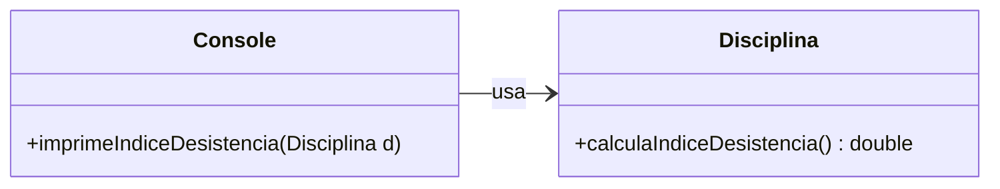
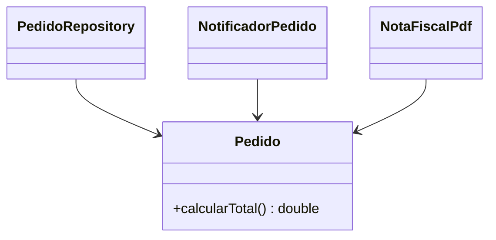

# 1. Princípio da Responsabilidade Única


[← Introdução](00-introducao.md) · [Índice](aps2.md) · [Próximo: Segregação de Interfaces →](02-segregacao-de-interfaces.md)

**Propriedade promovida:** Coesão

---

## Enunciado

> **Toda classe deve ter uma única responsabilidade.**
> Em outras palavras: deve existir **um único motivo** para modificar uma classe.

Uma forma prática de aplicar o princípio é fazer uma **pergunta-teste**: *quem (qual ator ou área da empresa)
pediria mudanças nesta classe?* Se a resposta tiver mais de um "quem" (por exemplo, o time de interface e o time de
regras de negócio), provavelmente a classe acumula mais de uma responsabilidade.

## Exemplo que viola o princípio ❌

```java
class Disciplina {

  void calculaIndiceDesistencia() {
    indice = "calcula índice de desistência";
    System.out.println(indice);
  }

}
```

O método `calculaIndiceDesistencia` tem **duas responsabilidades**:

1. **calcular** o índice de desistência (regra de negócio);
2. **imprimir** o índice de desistência (apresentação).

Se amanhã o índice tiver de aparecer em uma página web em vez do console, precisaremos alterar uma classe de domínio
por um motivo que nada tem a ver com o domínio.

## Versão com separação de responsabilidades ✅

```java
class Console {

  void imprimeIndiceDesistencia(Disciplina disciplina) {
    double indice = disciplina.calculaIndiceDesistencia();
    System.out.println(indice);
  }

}

class Disciplina {

  double calculaIndiceDesistencia() {
    double indice = "calcula índice de desistência";
    return indice;
  }

}
```



Ganhos dessa separação:

- `Console` é uma **classe de apresentação** (interface com o usuário) e pode ficar a cargo de um desenvolvedor **frontend**.
- `Disciplina` é uma **classe de negócio** (ou de domínio) e pode ficar a cargo de um desenvolvedor **backend**.
- `Disciplina` fica **mais fácil de testar** com testes de unidade, pois não depende de entrada e saída.

## Uma analogia: violando o princípio em um único slide

Imagine um restaurante que serve hambúrguer, churrasco, pizza, comida japonesa e comida mineira. Ele tem cinco
motivos diferentes para mudar o cardápio, a cozinha e a equipe. Qualquer mudança em uma das "especialidades" pode
afetar as outras. Com classes acontece o mesmo: **quanto mais responsabilidades, mais motivos para mudança e maior o
risco de efeitos colaterais**.

## Mais um exemplo: a classe "faz-tudo"

```java
// ❌ quatro motivos para mudar
class Pedido {
  double calcularTotal() { ... }
  void salvarNoBanco() { ... }          // SQL
  void enviarEmailConfirmacao() { ... } // SMTP
  String gerarPdfNotaFiscal() { ... }   // layout
}
```

A classe muda se mudar a regra de preço, o banco de dados, o servidor de e-mail ou o layout da nota fiscal.
A refatoração separa cada interesse em sua própria classe:

```java
// ✅ cada classe tem um único motivo para mudar
class Pedido {
  double calcularTotal() { ... }
}
class PedidoRepository {
  void salvar(Pedido p) { ... }
}
class NotificadorPedido {
  void enviarConfirmacao(Pedido p) { ... }
}
class NotaFiscalPdf {
  String gerar(Pedido p) { ... }
}
```



> **Onde aparece no dia a dia:** em *handlers* de interface gráfica, como um método `onClick()` que valida dados,
> calcula juros e grava no banco, tudo no mesmo lugar.


---


**Exercícios relacionados:** [9](../exercicios-parte-2.md#exercício-9-relatório-de-vendas) e
[13 (item d)](../exercicios-parte-2.md#exercício-13-qual-princípio-foi-violado)

[← Introdução](00-introducao.md) · [Índice](aps2.md) · [Próximo: Segregação de Interfaces →](02-segregacao-de-interfaces.md)
