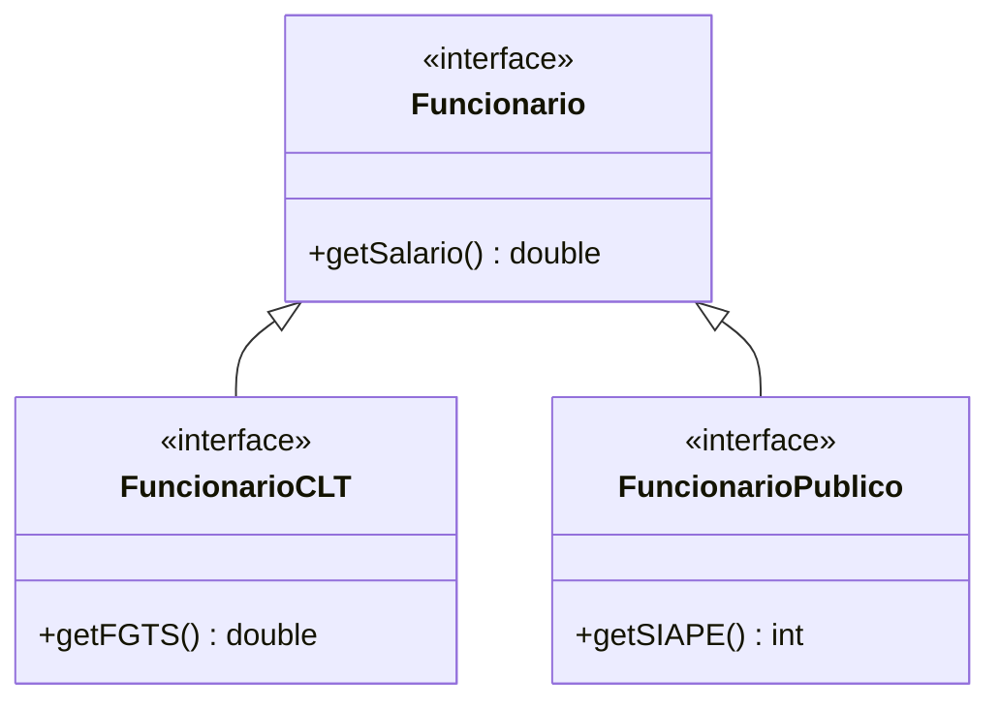
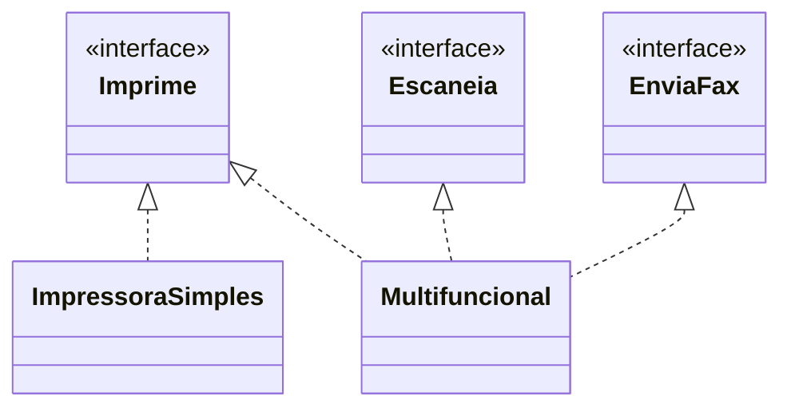

# 2. Princípio da Segregação de Interfaces


[← Responsabilidade Única](01-responsabilidade-unica.md) · [Índice](aps2.md) · [Próximo: Inversão de Dependências →](03-inversao-de-dependencias.md)

**Propriedade promovida:** Coesão

---

## Enunciado

> **Interfaces devem ser pequenas, coesas e específicas para cada tipo de cliente.**

É um **caso particular do princípio anterior** (Responsabilidade Única), mas voltado para interfaces. Um cliente não
deve ser obrigado a depender de métodos que ele não usa.

## Exemplo que viola o princípio ❌

```java
interface Funcionario {

  double getSalario();

  double getFGTS(); // apenas funcionários CLT

  int getSIAPE();   // apenas funcionários públicos

  ...
}
```

**Qual o problema?** Uma classe `FuncionarioCLT` é obrigada a implementar `getSIAPE()`, e um servidor público é
obrigado a implementar `getFGTS()`. São métodos que não fazem sentido para eles e que acabam implementados de forma
artificial (retornando zero, `null` ou lançando exceção).

## Versão que atende à segregação de interfaces ✅

```java
interface Funcionario {
  double getSalario();
  ...
}

interface FuncionarioCLT extends Funcionario {
  double getFGTS();
  ...
}

interface FuncionarioPublico extends Funcionario {
  int getSIAPE();
  ...
}
```



Agora cada cliente depende apenas dos métodos que realmente usa: um módulo de folha de pagamento CLT conhece
`FuncionarioCLT`; um módulo do serviço público conhece `FuncionarioPublico`.

## Mais um exemplo: a impressora multifuncional

```java
// ❌ interface "gorda"
interface Impressora {
  void imprimir(Documento d);
  void escanear(Documento d);
  void enviarFax(Documento d);
}

class ImpressoraSimples implements Impressora {
  public void imprimir(Documento d) { ... }
  public void escanear(Documento d) {
    throw new UnsupportedOperationException();
  }
  public void enviarFax(Documento d) {
    throw new UnsupportedOperationException();
  }
}
```

```java
// ✅ interfaces segregadas
interface Imprime  { void imprimir(Documento d); }
interface Escaneia { void escanear(Documento d); }
interface EnviaFax { void enviarFax(Documento d); }

class ImpressoraSimples implements Imprime {
  public void imprimir(Documento d) { ... }
}

class Multifuncional implements Imprime, Escaneia, EnviaFax {
  ...
}
```



> 🚩 **Sinal de alerta:** métodos que lançam `UnsupportedOperationException` ou têm corpo vazio são um sinal clássico
> de interface "gorda". Note que a versão ruim também prejudica a [Substituição de Liskov](07-substituicao-de-liskov.md):
> um cliente de `Impressora` espera poder chamar `escanear()`.

---


**Exercícios relacionados:** [10](../exercicios-parte-2.md#exercício-10-aves-que-não-voam)

[← Responsabilidade Única](01-responsabilidade-unica.md) · [Índice](aps2.md) · [Próximo: Inversão de Dependências →](03-inversao-de-dependencias.md)
