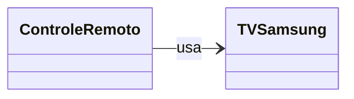
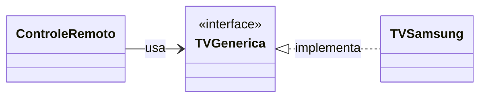
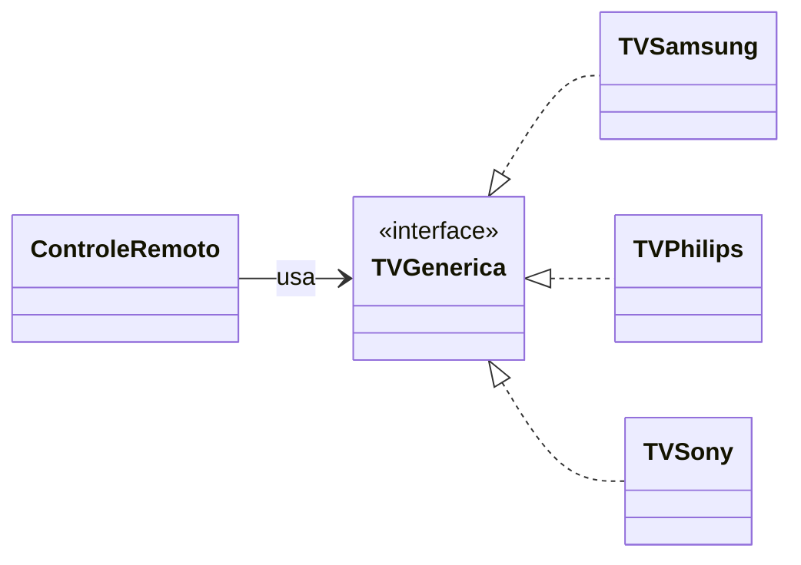

# 3. Princípio da Inversão de Dependências


[← Segregação de Interfaces](02-segregacao-de-interfaces.md) · [Índice](aps2.md) · [Próximo: Composição a Herança →](04-composicao-a-heranca.md)

**Propriedade promovida:** Acoplamento

---

## Enunciado

> **Clientes devem depender de abstrações (interfaces), e não de implementações concretas.**

Na verdade, vamos chamar esse princípio de **"Prefira Interfaces a Classes"**, pois esse nome transmite melhor a sua ideia!

## Exemplo sem Inversão de Dependências

```java
class ControleRemoto {
  TVSamsung tv;
  ...
}

class TVSamsung {
  ...
}
```

❓ **Qual o possível problema de design?** `ControleRemoto` está preso a uma marca específica. Para controlar uma TV
de outra marca, precisaremos editar a classe `ControleRemoto`.

## Exemplo com Inversão de Dependências ✅

```java
class ControleRemoto {
  TVGenerica tv;
  ...
}

interface TVGenerica {
  ...
}

class TVSamsung implements TVGenerica {
  ...
}
```

`ControleRemoto` agora depende de uma abstração, e não de uma marca.

### Sem DIP × com DIP

**Sem DIP:**



**Com DIP:**



**Vantagem:** um controle remoto genérico, para qualquer TV. Posso mudar de TV sem alterar o código da classe
`ControleRemoto`.

### Design após algum tempo



Novas TVs entram no sistema sem nenhuma alteração em `ControleRemoto`.

## Por que "inversão"?

Sem o princípio, a classe de alto nível (`ControleRemoto`) depende diretamente da classe de baixo nível
(`TVSamsung`). Com o princípio, **as duas passam a depender da abstração** (`TVGenerica`): a seta de dependência da
classe concreta passa a apontar "para cima", na direção da interface. É essa mudança de direção que dá nome ao
princípio.

## Mais exemplos

### Recebendo a abstração pelo construtor

```java
interface I { ... }
class C1 implements I { ... }
class C2 implements I { ... }

class Cliente {
  I i;
  Cliente(I i) {   // recebe a abstração
    this.i = i;
  }
}

main() {
  Cliente c1 = new Cliente(new C1());
  Cliente c2 = new Cliente(new C2());
}
```

- **Injeção pelo construtor:** quem cria o `Cliente` decide qual implementação concreta usar.
- **Testabilidade:** em testes, podemos passar um objeto falso (*mock*) que implementa `I`, sem precisar de banco de
  dados, rede ou outros recursos reais.

### Declarando variáveis com o tipo da interface

```java
// Prefira:
List<String> nomes = new ArrayList<>();

// em vez de:
ArrayList<String> nomes = new ArrayList<>();
```

Se no futuro `LinkedList` for mais adequada, basta mudar uma linha.

## Cuidado com o exagero

Criar uma interface para cada classe "por precaução" é *overengineering*. Se um sistema vai controlar apenas uma TV
Samsung e não há perspectiva de mudança, `TVGenerica` adiciona complexidade sem ganho real. Use o princípio onde
existe **variação provável** (fornecedores, bancos de dados, serviços externos) ou necessidade de **testar isoladamente**.

---

**Exercícios relacionados:** [5](../exercicios-parte-1.md#exercício-5-desacoplando-o-serviço-de-pagamento),
[11](../exercicios-parte-2.md#exercício-11-serviço-de-pedidos) e
[13 (item e)](../exercicios-parte-2.md#exercício-13-qual-princípio-foi-violado)

[← Segregação de Interfaces](02-segregacao-de-interfaces.md) · [Índice](aps2.md) · [Próximo: Composição a Herança →](04-composicao-a-heranca.md)
