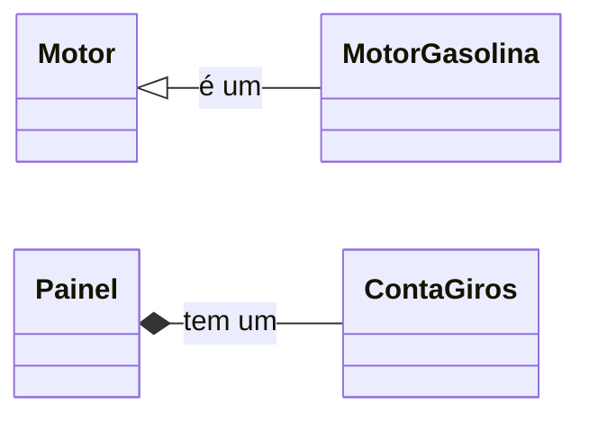
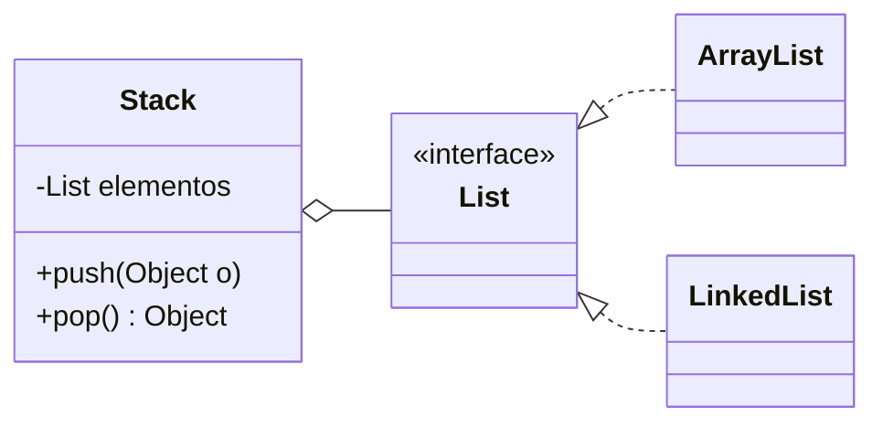

# 4. Prefira Composição a Herança


[← Inversão de Dependências](03-inversao-de-dependencias.md) · [Índice](aps2.md) · [Próximo: Demeter →](05-demeter.md)

**Propriedade promovida:** Acoplamento

---

## Contexto histórico

Na década de 80, quando a orientação a objetos se tornou popular, as pessoas começaram a **abusar de herança**.
Acreditava-se que herança seria uma "bala de prata", capaz de promover reúso em larga escala. A experiência mostrou
que hierarquias profundas e rígidas tornam o código frágil e difícil de evoluir.

## Herança: relação do tipo "é-um" ✅

```java
class MotorGasolina extends Motor {
  ... // herda atributos e métodos de motor
}
```

Um motor a gasolina **é um** motor: a herança expressa uma relação legítima entre tipos.

## Composição: relação do tipo "possui" ✅

```java
class Painel {
  ContaGiros cg;
  ...
}
```

Um painel **possui** um conta-giros: o painel usa o objeto como um componente.



## O princípio

> **Prefira Composição a Herança ⇒ não force o uso de herança.**

Herança expõe detalhes internos da superclasse às subclasses: é um **reúso caixa-branca**. Composição reutiliza um
objeto apenas por meio da sua interface pública: é um **reúso caixa-preta**.

| Característica | Herança | Composição |
|---|---|---|
| Relacionamento | "É um" | "Tem um" |
| Conceito | Uma classe (subclasse) herda atributos e métodos de outra (superclasse). | Uma classe contém uma instância de outra classe como um de seus membros. |
| Acoplamento | Alto. A subclasse é fortemente acoplada à superclasse. Mudanças na superclasse podem quebrar a subclasse. | Baixo. |
| Flexibilidade | Baixa. A hierarquia é definida em tempo de compilação e é rígida. Não se pode mudar a superclasse de um objeto em tempo de execução. | Alta. A classe contida pode ser trocada por outra (que siga a mesma interface) em tempo de execução, permitindo comportamento dinâmico. |
| Reutilização | Reutilização de implementação | Reutilização de funcionalidade |
| Exemplo | Um Gato é um Animal. Um Carro é um Veiculo. | Um Carro tem um Motor. Um Estudante tem um Endereco. |

## Exemplo clássico: uma pilha

```java
// ❌ herança apenas para reaproveitar código
class Stack extends ArrayList {
  void push(Object o) { add(o); }
  Object pop() { return remove(size() - 1); }
}
```

O problema é que o cliente também "ganha" todos os métodos de `ArrayList`: `add(0, x)`, `get(i)`, `remove(i)`,
`clear()`... e pode furar a disciplina LIFO (o último a entrar é o primeiro a sair). Uma pilha **não é** uma lista.

```java
// ✅ composição
class Stack {
  private List elementos;

  Stack(List elementos) {
    this.elementos = elementos;
  }
  void push(Object o) { elementos.add(o); }
  Object pop() {
    int topo = elementos.size() - 1;
    return elementos.remove(topo);
  }
}
```



Com composição, `Stack` expõe só `push` e `pop` e ainda pode receber qualquer implementação de `List`
(`ArrayList`, `LinkedList`...), combinando composição com [Inversão de Dependências](03-inversao-de-dependencias.md).

> 📌 **Curiosidade:** a classe `java.util.Stack` de fato herda de `Vector`, um caso histórico de mau uso de herança
> na própria biblioteca do Java.

## Quando herança é adequada?

Herança continua útil quando existe uma relação "é-um" **verdadeira e estável** e quando as subclasses respeitam o
contrato da superclasse (veja [Substituição de Liskov](07-substituicao-de-liskov.md)). O princípio diz **prefira**,
não **proíba**.

---


**Exercícios relacionados:** [12](../exercicios-parte-2.md#exercício-12-histórico-de-eventos)

[← Inversão de Dependências](03-inversao-de-dependencias.md) · [Índice](aps2.md) · [Próximo: Demeter →](05-demeter.md)
