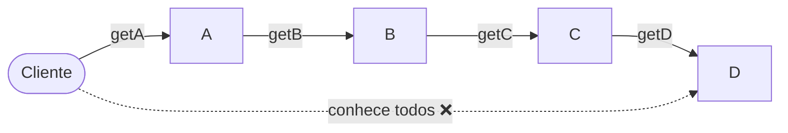

# 5. Princípio de Demeter


**Propriedade promovida:** Ocultamento de Informação

---

## Enunciado

> **Evite longas cadeias de chamadas de métodos.**

O nome **Demeter** vem de um grupo de pesquisa americano (o *Demeter Project*), onde o princípio foi formulado.
Ele também é conhecido como **Princípio do Menor Conhecimento**: *"fale apenas com seus amigos imediatos"*.

```java
obj.getA().getB().getC().getD().getOqueEuPreciso(); // ❌
```

Os objetos retornados por `getA()`, `getB()`, `getC()` e `getD()` são **objetos de passagem**: o cliente só
precisa deles para chegar ao que realmente quer.

## Motivo

- Longas cadeias de chamadas **quebram o encapsulamento**: o cliente passa a conhecer a estrutura interna de vários objetos.
- Não quero passar por A, B, C,… até obter o que eu preciso.
- Se qualquer objeto intermediário mudar sua estrutura, **todos os clientes da cadeia quebram**.



## O que um método pode chamar?

Segundo o princípio, um método só deve chamar métodos:

1. da **própria classe**;
2. de seus **parâmetros**;
3. de **objetos criados pelo próprio método**;
4. de **atributos da classe**.

```java
class PrincipioDemeter {

  T1 attr;

  void f1() {
    ...
  }

  void m1(T2 p) {  // ✅ método que segue Demeter
    f1();            // caso 1: própria classe
    p.f2();          // caso 2: parâmetro
    new T3().f3();   // caso 3: criado pelo método
    attr.f4();       // caso 4: atributo da classe
  }

  void m2(T4 p) {  // ❌ método que viola Demeter
    p.getX().getY().getZ().doSomething();
  }
}
```

## Mais um exemplo: o jornaleiro

Um exemplo clássico da literatura (*The Paperboy, The Wallet, and The Law of Demeter*):

```java
// ❌ Jornaleiro "mexe" na carteira do cliente
class Jornaleiro {
  void cobrar(Cliente c, double preco) {
    Carteira cart = c.getCarteira();
    if (cart.getSaldo() >= preco)
      cart.retirar(preco);
  }
}
```

```java
// ✅ Cliente decide como pagar
class Jornaleiro {
  void cobrar(Cliente c, double preco) {
    c.pagar(preco);
  }
}

class Cliente {
  private Carteira carteira;
  void pagar(double v) {
    carteira.retirar(v);
  }
}
```

Na vida real, ninguém entrega a carteira ao jornaleiro! Além disso, se amanhã o cliente pagar com PIX, só a classe
`Cliente` muda.

## Mas cuidado ⚠️

- Demeter e os demais princípios são **recomendações**.
- Não devemos ser radicais e achar que cadeias de chamadas de métodos são totalmente proibidas.
- Casos isolados podem existir e ter uma boa justificativa.

### Exemplo justificável de cadeia de métodos ✅

```javascript
const numbers = [1, 2, 3, 4, 5, 6];
const result = numbers
  .map(num => num * 2)
  .filter(num => num % 3 === 0)
  .reduce((acc, num) => acc + num, 0);
console.log(result); // Output: 18
```

Por que é aceitável? São **métodos da linguagem ou de sua API**. Cada chamada retorna um novo objeto do mesmo tipo
(uma *interface fluente*): não estamos navegando pela estrutura interna de outros objetos. O mesmo vale para
*builders* (`StringBuilder.append(...).append(...)`) e para a API de *streams* do Java.

---

### Pontos-chave

- Fale apenas com seus "amigos imediatos": própria classe, parâmetros, objetos criados e atributos.
- Cadeias longas expõem a estrutura interna dos objetos e aumentam o acoplamento.
- Interfaces fluentes de APIs são uma exceção aceitável.

### Para refletir

- Em uma cadeia como `conta.getCliente().getEndereco().getCep()`, que método você criaria e em qual classe?

**Exercícios relacionados:** [1](../exercicios-parte-1.md#exercício-1-demeter-na-biblioteca),
[4](../exercicios-parte-1.md#exercício-4-o-certificado-do-curso-de-extensão) e
[13 (item a)](../exercicios-parte-2.md#exercício-13-qual-princípio-foi-violado)

[← Composição a Herança](04-composicao-a-heranca.md) · [Índice](aps2.md) · [Próximo: Aberto/Fechado →](06-aberto-fechado.md)
