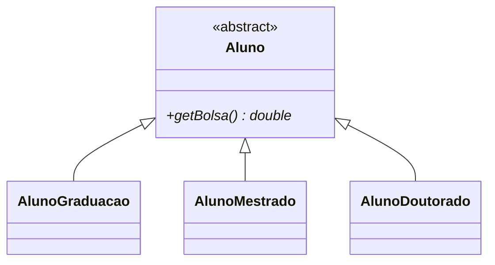

# 6. Princípio Aberto/Fechado


[← Demeter](05-demeter.md) · [Índice](aps2.md) · [Próximo: Substituição de Liskov →](07-substituicao-de-liskov.md)

**Propriedade promovida:** Extensibilidade

---

## Enunciado

Proposto por **Bertrand Meyer** no livro *Object-Oriented Software Construction* (1988).

> **Uma classe deve estar fechada para modificações, mas aberta para extensões.**

| 🟢 **Aberta** | 🔴 **Fechada** |
|---|---|
| para extensões | para modificações |

## Explicando melhor

1. Suponha que você vai implementar uma classe.
2. Usuários ou clientes vão querer usar a classe (óbvio!).
3. Mas vão querer também customizar, parametrizar, configurar, flexibilizar e estender a classe!
4. Você deve se antecipar e tornar possíveis tais extensões...

**...mas sem que os clientes tenham que editar o código da classe.**

## Como tornar uma classe aberta a extensões, mas fechada para modificações?

- **Parâmetros**
- **Funções de mais alta ordem** (funções passadas como parâmetro)
- **Padrões de projeto** (por exemplo, *Strategy* e *Template Method*)
- **Herança**
- etc.

## Exemplo: ordenando uma lista

```java
List<String> nomes;
nomes = Arrays.asList("joao", "maria", "alexandre", "ze");
Collections.sort(nomes); // ordena a lista passada como parâmetro

System.out.println(nomes);
// resultado: ["alexandre","joao","maria","ze"]
```

Por padrão, `sort` usa a ordem alfabética, que é o critério de comparação de `String`.

### Mas agora eu quero ordenar as strings pelo seu tamanho

Isto é, pelo número de caracteres. ❓ **Será que o método `sort` está aberto (preparado) para permitir essa
extensão?** Mas mantendo o seu código fechado, ou seja, sem ter que mexer no seu código.

### Solução ✅

```java
Collections.sort(nomes, (s1, s2) -> s1.length() - s2.length());

System.out.println(nomes);
// result: ["ze", "joao", "maria", "alexandre"]
```

`sort` recebe, além da lista que será ordenada (`nomes`), uma **função usada para comparar** dois elementos `s1` e `s2`:

| Resultado da função | Ordem |
|---|---|
| `result < 0` | `s1`, `s2` |
| `result = 0` | tanto faz a ordem |
| `result > 0` | `s2`, `s1` |

> **Não existe almoço grátis:** o cliente (o código que chama `sort`) teve que implementar e passar como parâmetro
> uma função que define o critério a ser usado na ordenação. O `Comparator` é uma função de mais alta ordem
> funcionando como **ponto de extensão**.

## Exemplo que viola o princípio: `instanceof` ❌

```java
double calcTotalBolsas(Aluno lista[]) {
  double total = 0.0;
  for (Aluno aluno : lista) {
    if (aluno instanceof AlunoGraduacao) {
      AlunoGraduacao ag = (AlunoGraduacao) aluno;
      total += "código que calcula bolsa de ag";
    }
    else if (aluno instanceof AlunoMestrado) {
      AlunoMestrado am = (AlunoMestrado) aluno;
      total += "código que calcula bolsa de am";
    }
  }
  return total;
}
```

E se surgir um `AlunoDoutorado`? Será preciso **editar** `calcTotalBolsas`.

### Versão polimórfica ✅

```java
abstract class Aluno {
  abstract double getBolsa();
}

double calcTotalBolsas(Aluno lista[]) {
  double total = 0.0;
  for (Aluno aluno : lista)
    total += aluno.getBolsa();
  return total;
}
```



Agora basta criar uma nova subclasse: `calcTotalBolsas` permanece fechada.

> 🚩 **Sinais de alerta:** cadeias de `if/else` ou `switch` sobre o "tipo" de algo, uso de `instanceof`, e o mesmo
> `switch` repetido em vários pontos do código.

## Resumindo

> 🔌 **Ao implementar uma classe, pense em pontos de extensão!**

Mas não tente prever todas as extensões possíveis: pontos de extensão desnecessários também são *overengineering*.
Concentre-se nos aspectos que têm **maior probabilidade de variar**.

---

### Pontos-chave

- Adicionar comportamento deve exigir **código novo**, e não alteração de código existente.
- Parâmetros, funções de alta ordem, padrões de projeto e herança são formas de criar pontos de extensão.
- `instanceof` e `switch` por tipo são indícios de violação.

### Para refletir

- Em uma classe `Tabela` que imprime cabeçalho, linhas e rodapé, onde você colocaria pontos de extensão?

**Exercícios relacionados:** [2](../exercicios-parte-1.md#exercício-2-tabela-aberta-a-extensões),
[8](../exercicios-parte-1.md#exercício-8-calculadora-de-frete),
[13 (item b)](../exercicios-parte-2.md#exercício-13-qual-princípio-foi-violado) e
[15](../exercicios-parte-2.md#exercício-15-desafio-integrador-notificações)

[← Demeter](05-demeter.md) · [Índice](aps2.md) · [Próximo: Substituição de Liskov →](07-substituicao-de-liskov.md)
