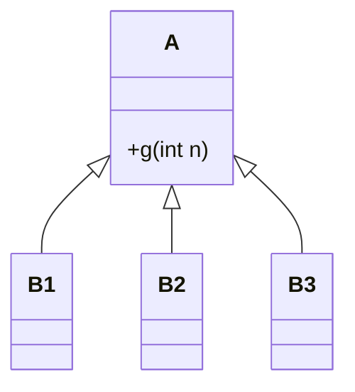

# 7. Princípio de Substituição de Liskov

📁 [`projeto`](../README.md) / [`notas-de-aula`](README.md) / `07-substituicao-de-liskov.md`

[← Aberto/Fechado](06-aberto-fechado.md) · [Índice](README.md) · [Próximo: Métricas →](08-metricas.md)

**Propriedade promovida:** Extensibilidade

---

## Origem

- O nome é uma referência à Profa. **Barbara Liskov** (MIT), vencedora do Prêmio Turing de 2008.
- O princípio define boas práticas para o uso de **herança**.
- Especificamente, boas práticas para a **redefinição de métodos em subclasses**.

## Primeiro: o que significa "substituição"?

```java
void f(A a) {
  ...
  a.g(int n);
  ...
}
```

```java
f(new B1());  // f pode receber objetos da subclasse B1
...
f(new B2());  // e de qualquer outra subclasse de A, como B2
...
f(new B3());  // e B3
```



- O tipo `A` pode ser **substituído** por `B1`, `B2`, `B3`,...
- Desde que eles sejam subclasses de `A`.

## Enunciado

> **Substituições de A por B podem acontecer desde que B ofereça os mesmos serviços de A.**

Ou seja: para um código feito para usar `A`, a substituição de `A` por `B` deve ser **"imperceptível"**.

Em termos de **contratos**:

- a subclasse **não pode exigir mais** que a classe base (não pode fortalecer pré-condições);
- a subclasse **não pode entregar menos** que a classe base (não pode enfraquecer pós-condições).

## Exemplo que segue o princípio ✅

```java
class ControleRemoto {
  // alcance de 10 m
}
class ControleRemotoPremium extends ControleRemoto {
  // alcance de 20 m
}
```

Quem usava um controle de 10 m continua satisfeito com um de 20 m: a subclasse entrega **mais**, nunca menos.

## Exemplo que não segue o princípio ❌

```java
class ControleRemoto {
  // alcance de 10 m
}
class ControleRemotoXYZ extends ControleRemoto {
  // alcance de 5 m
}
```

Quem esperava 10 m de alcance tem uma surpresa desagradável com 5 m.

## Mais um exemplo: quebrando o contrato ❌

```java
class A {
  int soma(int a, int b) {
    return a + b;
  }
}

class B extends A {
  int soma(int a, int b) {
    String r = String.valueOf(a) + String.valueOf(b);
    return Integer.parseInt(r);
  }
}

class Cliente {
  void f(A a) {
    a.soma(1, 2);   // A: 3   |   B: 12
  }
}
```

O código **compila e "funciona"**, mas `B` redefine `soma` como concatenação. Um cliente feito para `A` recebe 12 em
vez de 3: a substituição deixou de ser imperceptível. O compilador verifica **assinaturas**, mas não verifica
**comportamento**; o princípio de Liskov trata justamente do comportamento.

## O caso clássico: Quadrado × Retângulo

Na matemática, todo quadrado é um retângulo. Então `Quadrado extends Retangulo` parece natural:

```java
class Retangulo {
  protected int largura, altura;
  void setLargura(int l) { largura = l; }
  void setAltura(int a)  { altura = a; }
  int area() { return largura * altura; }
}

class Quadrado extends Retangulo {
  void setLargura(int l) { largura = l; altura = l; }
  void setAltura(int a)  { largura = a; altura = a; }
}

void teste(Retangulo r) {
  r.setLargura(5);
  r.setAltura(4);
  assert r.area() == 20;   // falha se r for um Quadrado (área = 16)
}
```

A relação "é-um" da matemática **não garante** a substituibilidade em software. Aqui, a herança viola o contrato
implícito de `Retangulo`: alterar a altura não deveria alterar a largura.

> 🚩 **Sinais de alerta:** métodos sobrescritos vazios, métodos que lançam `UnsupportedOperationException`, e clientes
> que precisam de `instanceof` para "tratar" uma subclasse específica.

---

### Pontos-chave

- Uma subclasse deve poder substituir a classe base **sem que o cliente perceba**.
- Não fortaleça pré-condições nem enfraqueça pós-condições.
- "É-um" no mundo real não basta: o que importa é o **comportamento** esperado pelo cliente.

### Para refletir

- Uma subclasse que aceita um intervalo **menor** de valores de entrada viola o princípio? E uma que aceita um intervalo **maior**?

**Exercícios relacionados:** [3](../exercicios-parte-1.md#exercício-3-calculadora-rápida),
[7](../exercicios-parte-1.md#exercício-7-frota-de-veículos),
[10](../exercicios-parte-2.md#exercício-10-aves-que-não-voam) e
[13 (item c)](../exercicios-parte-2.md#exercício-13-qual-princípio-foi-violado)

[← Aberto/Fechado](06-aberto-fechado.md) · [Índice](README.md) · [Próximo: Métricas →](08-metricas.md)
