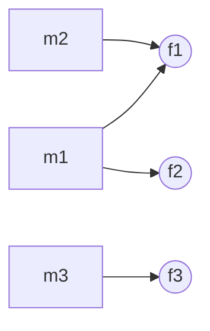
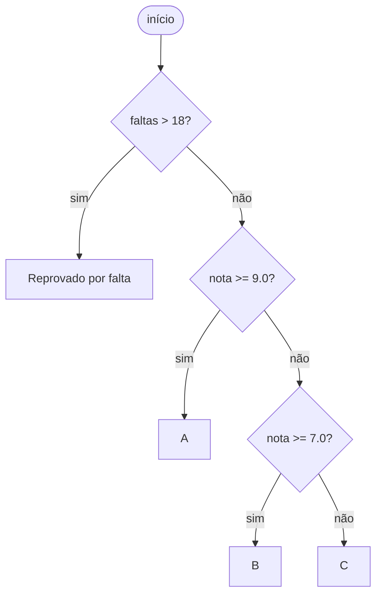

# 8. Métricas de código-fonte

📁 [`projeto`](../README.md) / [`notas-de-aula`](README.md) / `08-metricas.md`

[← Substituição de Liskov](07-substituicao-de-liskov.md) · [Índice](README.md) · [Próximo: Síntese →](09-sintese.md)

---

## Por que medir?

As propriedades de projeto (coesão, acoplamento, complexidade) podem ser avaliadas de forma subjetiva, em revisões de
código. Métricas oferecem uma avaliação **quantitativa** que ajuda a localizar classes problemáticas em sistemas
grandes. Elas não substituem o julgamento do desenvolvedor, mas **apontam onde olhar**.

| Métrica | Nome | O que mede | Interpretação |
|---|---|---|---|
| **LOC** | *Lines of Code* | Tamanho | Não use para medir produtividade nem como meta |
| **LCOM** | *Lack of Cohesion of Methods* | Falta de coesão | Quanto maior, **menor** a coesão |
| **CBO** | *Coupling Between Objects* | Acoplamento | Quanto maior, maior o acoplamento |
| **CC** | Complexidade Ciclomática | Complexidade | Decisões + 1; McCabe sugere no máximo 10 |

LCOM e CBO fazem parte do conjunto de métricas **CK**, proposto por Chidamber e Kemerer.

## LOC: tamanho

Conta as linhas de código (normalmente excluindo comentários e linhas em branco). É útil para ter uma noção da
dimensão de um sistema ou de uma classe, mas **não deve ser usada para medir produtividade**: um bom desenvolvedor
pode resolver um problema com menos linhas, e transformar LOC em meta incentiva código inchado.

## LCOM: falta de coesão

Na versão de Chidamber e Kemerer (LCOM1):

1. liste todos os **pares de métodos** da classe;
2. para cada par, verifique se os conjuntos de atributos acessados pelos dois métodos são **disjuntos** (sem atributos em comum);
3. LCOM é o número de pares disjuntos.

Construtores, *getters* e *setters* normalmente são desconsiderados.

### Exemplo

```java
class Exemplo {
  int f1, f2, f3;

  void m1() { f1++; f2++; }
  void m2() { f1--; }
  void m3() { f3 = 0; }
}
```



| Par | Atributos em comum | Conta? |
|---|---|---|
| (m1, m2) | `f1` | não |
| (m1, m3) | nenhum | **+1** |
| (m2, m3) | nenhum | **+1** |

**LCOM = 2**. Observe que `m3` não compartilha nada com os demais métodos: talvez `f3` e `m3` pertençam a outra classe.

> Por que a métrica mede a **ausência** de coesão? Porque conta pares de métodos que **não** têm nada em comum:
> quanto mais pares desconectados, menos coesa é a classe.

## CBO: acoplamento

CBO conta o **número de classes das quais uma classe depende** sintaticamente: por chamadas de métodos, herança,
tipos de atributos, parâmetros, variáveis locais, exceções, criação de objetos etc.

```java
class PedidoService {                       // depende de:
  private PedidoRepository repo;           // PedidoRepository
  void finalizar(Pedido p) {               // Pedido
    if (!p.valido())
      throw new PedidoInvalidoException(); // PedidoInvalidoException
    repo.salvar(p);
  }
}
```

**CBO(PedidoService) = 3.**

## Complexidade Ciclomática (CC)

Proposta por Thomas McCabe (1976):

> **CC = número de comandos de decisão (`if`, `while`, `for`, `case` etc.) + 1**

McCabe sugere **10** como limite superior "razoável, mas não mágico".

```java
String conceito(double nota, int faltas) {
  if (faltas > 18)               // +1
    return "Reprovado por falta";
  if (nota >= 9.0)               // +1
    return "A";
  else if (nota >= 7.0)          // +1
    return "B";
  return "C";
}
```

3 comandos de decisão + 1 ⇒ **CC = 4**. Isso também indica que são necessários pelo menos 4 casos de teste para
percorrer todos os caminhos independentes do método.



---

### Pontos-chave

- Métricas apontam **onde olhar**; não são metas em si.
- LCOM alto ⇒ baixa coesão; CBO alto ⇒ alto acoplamento; CC alta ⇒ método difícil de entender e testar.
- Um código com CC = 1 não tem nenhum comando de decisão.

### Para refletir

- A complexidade ciclomática é independente de linguagem de programação? Por quê?

**Exercícios relacionados:** [14](../exercicios-parte-2.md#exercício-14-calculando-métricas)

[← Substituição de Liskov](07-substituicao-de-liskov.md) · [Índice](README.md) · [Próximo: Síntese →](09-sintese.md)
