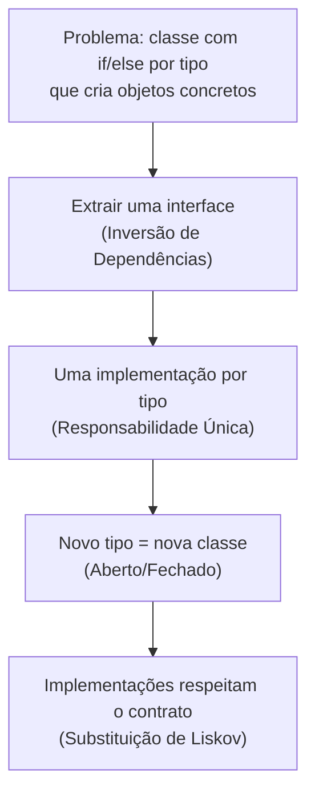

# 9. Síntese e próximos passos

📁 [`projeto`](../README.md) / [`notas-de-aula`](README.md) / `09-sintese.md`

[← Métricas](08-metricas.md) · [Índice](README.md)

---

## Os sete princípios em uma página

| Princípio | Ideia central | Propriedade | Sinal de alerta |
|---|---|---|---|
| [Responsabilidade Única](01-responsabilidade-unica.md) | Um único motivo para mudar | Coesão | Classe "faz-tudo"; UI misturada com regra de negócio |
| [Segregação de Interfaces](02-segregacao-de-interfaces.md) | Interfaces pequenas, por tipo de cliente | Coesão | Métodos vazios ou que lançam exceção |
| [Inversão de Dependências](03-inversao-de-dependencias.md) | Dependa de abstrações | Acoplamento | Atributos de tipos concretos; `new` espalhado |
| [Composição a Herança](04-composicao-a-heranca.md) | Reúso caixa-preta ("tem um") | Acoplamento | Herança só para reaproveitar código |
| [Demeter](05-demeter.md) | Fale só com amigos imediatos | Ocultamento de Informação | `a.getB().getC().getD()` |
| [Aberto/Fechado](06-aberto-fechado.md) | Estenda sem modificar | Extensibilidade | `if/else` ou `switch` por tipo; `instanceof` |
| [Substituição de Liskov](07-substituicao-de-liskov.md) | Subclasse honra o contrato da base | Extensibilidade | Subclasse que surpreende o cliente |

## Como os princípios se relacionam

Os princípios raramente aparecem isolados. Uma mesma refatoração costuma atender a vários deles:

Um exemplo concreto é o [Exercício 15](../exercicios-parte-2.md#exercício-15-desafio-integrador-notificações):
um `Notificador` com `if/else` por canal viola ao mesmo tempo Aberto/Fechado, Inversão de Dependências e
Responsabilidade Única, e uma única refatoração resolve os três.

## Equilíbrio: evitando o *overengineering*

Em Engenharia de Software, às vezes usamos soluções mais complexas em contextos nos quais isso não é necessário.
Esse problema é chamado de *overengineering* ou otimização prematura. Algumas perguntas ajudam a decidir se vale a
pena aplicar um princípio:

- Existe uma **variação provável** nesse ponto do sistema (novo fornecedor, novo tipo, nova regra)?
- O código precisa ser **testado isoladamente**?
- Mais de uma pessoa ou equipe vai **mexer nessa classe**?
- O custo de mudar depois é **alto** (código público, biblioteca, API)?

Se todas as respostas forem "não", a solução mais simples provavelmente é a melhor.

## Checklist para revisão de código

- [ ] Cada classe tem um único motivo para mudar?
- [ ] Alguma interface obriga implementações a ter métodos vazios ou que lançam exceção?
- [ ] As dependências importantes são declaradas por interfaces e recebidas de fora?
- [ ] Alguma herança existe apenas para reaproveitar código?
- [ ] Há cadeias longas de `get()` navegando pela estrutura de outros objetos?
- [ ] Adicionar um novo "tipo" exige editar `if/else` ou `switch` existentes?
- [ ] Alguma subclasse muda o comportamento esperado pelos clientes da classe base?

## Próximos passos

- **Próxima aula:** Arquitetura de Software.
- **Exercícios:** [Parte 1](/projeto/exercicios-parte-1.md) e [Parte 2](/projeto//exercicios-parte-2.md).
- **Leitura recomendada:** [Engenharia de Software Moderna, Cap. 5](https://engsoftmoderna.info/cap5.html).

## Referências

- VALENTE, Marco Tulio. *Engenharia de Software Moderna*, Cap. 5: Princípios de Projeto. Disponível em: <https://engsoftmoderna.info/cap5.html>
- MARTIN, Robert C. *Clean Architecture*. Prentice Hall, 2017.

[← Métricas](08-metricas.md) · [Índice](aps2.md)
