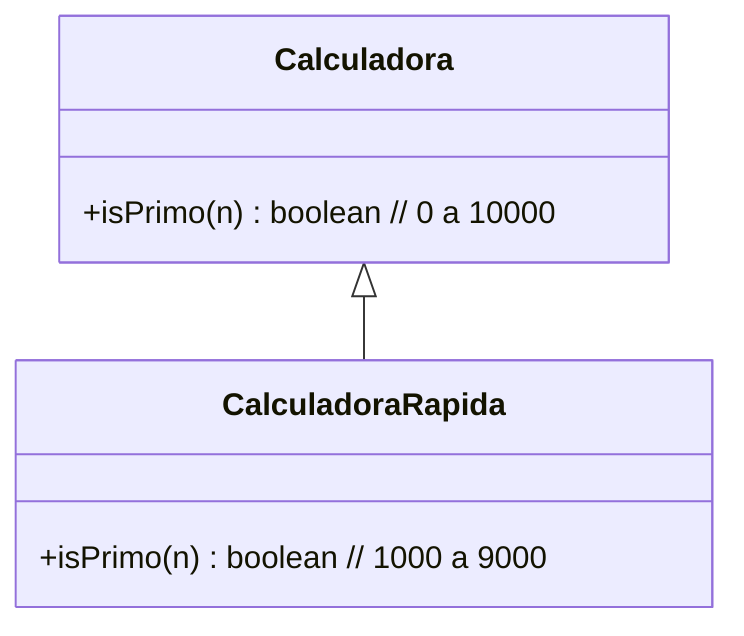
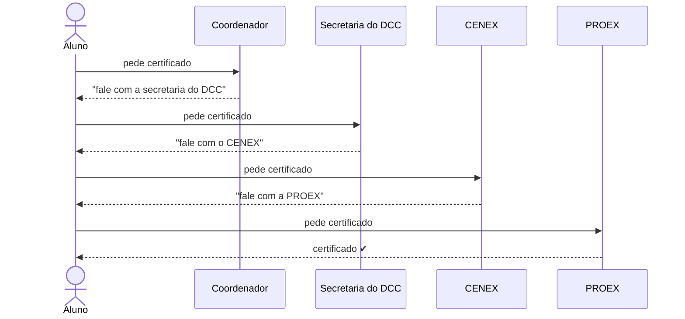
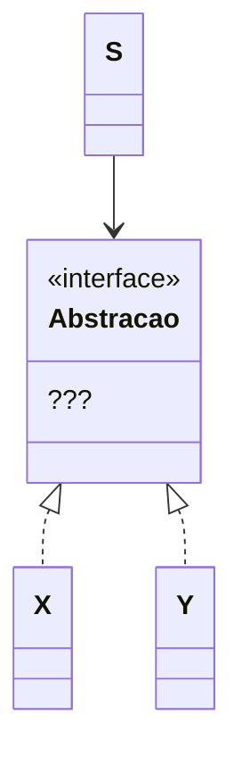
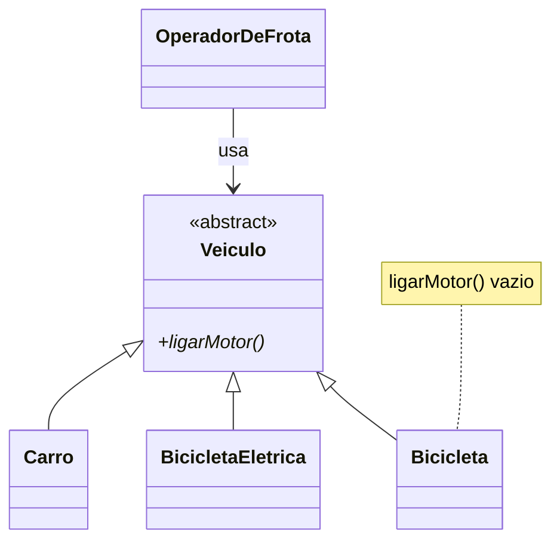

# Exercícios sobre Princípios de Projeto: Parte 1 (1 a 8)

[← Voltar ao índice](README.md) · [Parte 2 →](exercicios-parte-2.md) 

---

## Exercício 1: Demeter na biblioteca

Qual princípio de projeto é violado por uma chamada como a mostrada abaixo? Qual mudança de projeto você faria na classe `Biblioteca` (tipo de `bib`) para remover essa violação?

```java
bib.getAcervo().getAreaConhecimento("ES").
    getLivros().find("ESM").getNumExemplares();
```


---

## Exercício 2: Tabela aberta a extensões

Suponha a seguinte classe:

```java
class Tabela {
  ...
  void imprime() {
    // código que imprime cabeçalho
    // código que imprime cada linha da tabela
    // código que imprime rodapé
  }
  ...
}
```

Esse código não segue o Princípio Aberto/Fechado, pois no nosso sistema é importante poder variar as mensagens de cabeçalho e rodapé. Como você mudaria a implementação dessa classe para atender ao Princípio Aberto/Fechado?

---

## Exercício 3: Calculadora rápida

Suponha uma classe `Calculadora` com um método que verifica se um número entre 0 e 10000 é primo. Suponha ainda que um algoritmo mais eficiente para essa tarefa foi implementado em uma subclasse `CalculadoraRapida`. No entanto, ele somente é capaz de trabalhar com números entre 1000 e 9000.

```java
class Calculadora {
  boolean isPrimo(n) {
    // 0 <= n < 10000
  }
}

class CalculadoraRapida extends Calculadora {
  boolean isPrimo(n) {
    // 1000 <= n < 9000
  }
}
```



Qual princípio de projeto é violado nessa implementação? Justifique.

---

## Exercício 4: O certificado do curso de extensão

Suponha que você concluiu um curso de extensão oferecido pela UFMG e quer receber seu certificado. Para isso, você teve que:

- Mandar uma msg para o coordenador do curso, que te pediu para mandar uma msg para secretaria do DCC.
- Então, você mandou uma msg para a secretaria do DCC, que te pediu para mandar uma mensagem para o CENEX.
- Então, você mandou uma msg para o CENEX, que te pediu para mandar uma msg para a PROEX.
- Então, você mandou uma msg para a PROEX, que finalmente retornou o seu certificado.



Essa sequência de passos ilustra uma violação de qual princípio de projeto? Além de ter que mandar várias mensagens, qual um outro problema dessa "solução"?

---

## Exercício 5: Desacoplando o serviço de pagamento

Suponha que você está implementando um sistema **S** e precisa usar um serviço de processamento de pagamentos **X** para, por exemplo, aceitar pagamentos via cartões de crédito.

No entanto, você não quer acoplar S a X, pois futuramente você pode optar por um outro serviço **Y**.



1. Explique como você faria para desacoplar S de X.
2. Qual princípio de projeto você usou para garantir esse desacoplamento?

---

## Exercício 6: Overengineering

Em Engenharia de Software, às vezes usamos soluções mais complexas em contextos nos quais isso não é necessário. Esse problema é chamado de *overengineering* ou otimização prematura.

Então crie e descreva um contexto no qual o uso de um dos princípios de projeto que estudamos é uma otimização prematura.

Se quiser, você pode criar e explicar esse contexto usando o mesmo exemplo que usamos na explicação do princípio.

---

## Exercício 7: Frota de veículos

Uma empresa de logística precisa gerenciar sua frota. Existe uma classe base abstrata `Veiculo` com um método `ligarMotor()`. Existem duas implementações concretas: `Carro`, que liga um motor a combustão, e `BicicletaEletrica`, que ativa um motor elétrico.

Considere as seguintes classes:

```java
// Classe Base (Abstração)
public abstract class Veiculo {
  public abstract void ligarMotor();
}

// Implementação 1
public class Carro extends Veiculo {
  @Override
  public void ligarMotor() {
    System.out.println("Motor a combustão ligado. Vrum Vrum!");
  }
}

// Implementação 2 (Problemática)
public class Bicicleta extends Veiculo {
  @Override
  public void ligarMotor() {
    // Uma bicicleta comum não tem motor.
    // O programador deixou o método vazio para o código compilar.
  }
}

// Classe "Cliente" que opera sobre a abstração Veiculo
public class OperadorDeFrota {
  public void iniciarOperacao(Veiculo v) {
    System.out.println("Iniciando checagem do veículo...");
    // A lógica do Operador CONFIA que todo Veiculo
    // tem um motor que pode ser ligado.
    v.ligarMotor();
    System.out.println("Veículo pronto para operar!");
  }
}
```



Um novo requisito pede a inclusão de uma `Bicicleta` comum na frota, que não possui motor. Para reutilizar a estrutura, um programador fez a classe `Bicicleta` herdar de `Veiculo` e deixou o método `ligarMotor()` vazio.

**Pergunta:** Analisando o cenário, qual alternativa descreve corretamente a violação do Princípio da Substituição de Liskov (LSP)?

- **A)** A classe `Carro` viola o LSP porque sua implementação de `ligarMotor()` é muito específica ("Vrum Vrum!") e difere da abstração, que não define um som.
- **B)** O `OperadorDeFrota` viola o LSP porque deveria usar `instanceof Bicicleta` para checar o tipo do veículo e evitar chamar `ligarMotor()` em uma bicicleta, tornando o código mais seguro.
- **C)** A classe `Bicicleta` viola o LSP porque, ao ser substituída por `Veiculo`, ela altera o comportamento esperado pelo `OperadorDeFrota`. O cliente espera que `ligarMotor()` tenha um efeito (ligar um motor), mas a implementação da bicicleta não faz nada, quebrando silenciosamente o contrato da classe pai.
- **D)** Nenhuma classe viola o LSP. A herança foi usada corretamente e o polimorfismo garante que cada veículo se comporte de sua maneira, sendo responsabilidade do `OperadorDeFrota` saber lidar com cada tipo.
- **E)** A classe `Veiculo` viola o LSP porque, como classe abstrata, não deveria ter métodos concretos ou abstratos que não se aplicam a 100% de todos os possíveis subtipos, como é o caso da bicicleta.

---

## Exercício 8: Calculadora de frete

Você faz parte de uma equipe que desenvolveu um sistema de e-commerce. Atualmente, existe uma classe chamada `CalculadoraDeFrete` responsável por calcular o custo de envio de um pedido. A versão inicial da classe suporta apenas dois métodos de envio: "Normal" e "Expresso".

```java
public class CalculadoraDeFrete {

  // Método que calcula o frete com base no tipo e no peso
  public double calcular(String tipoDeFrete, double pesoEmKg) {

    if ("Normal".equalsIgnoreCase(tipoDeFrete)) {
      // Regra para frete normal: R$ 1.5 por kg
      return pesoEmKg * 1.5;

    } else if ("Expresso".equalsIgnoreCase(tipoDeFrete)) {
      // Regra para frete expresso: R$ 3.0 por kg + taxa fixa de R$ 10
      return (pesoEmKg * 3.0) + 10;

    } else {
      // Lança um erro se o tipo for desconhecido
      throw new IllegalArgumentException("Tipo de frete desconhecido.");
    }
  }
}
```

Recentemente, a equipe de negócios decidiu adicionar um novo método de envio: "Retirada Local", que deve ter custo zero. Para o futuro, já planejam adicionar "Frete Internacional" e "Entrega por Drone", cada um com sua própria lógica de cálculo.

Com base neste cenário, responda às seguintes questões:

1. Explique detalhadamente por que a classe `CalculadoraDeFrete`, em seu formato atual, viola o Princípio Aberto/Fechado. Aponte qual parte do código é o principal indicativo dessa violação.
2. Descreva dois riscos ou desvantagens principais de manter esse design à medida que os novos métodos de envio ("Retirada Local", "Internacional", etc.) forem adicionados.

---

[← Voltar ao índice](README.md) · [Parte 2 →](exercicios-parte-2.md)
