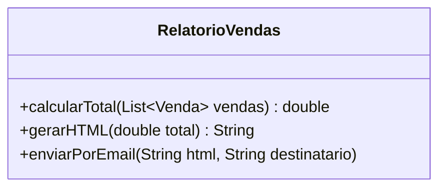
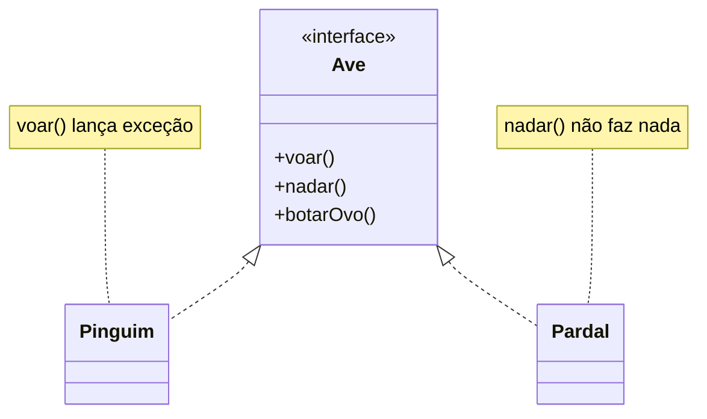
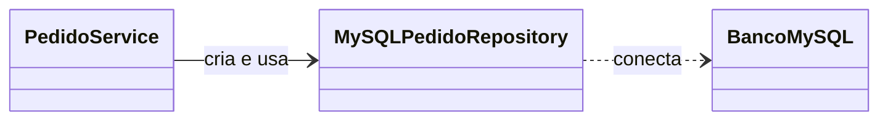
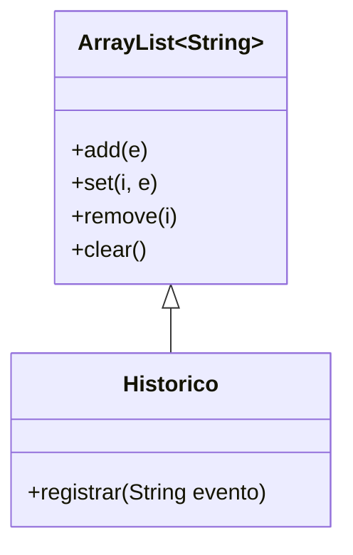
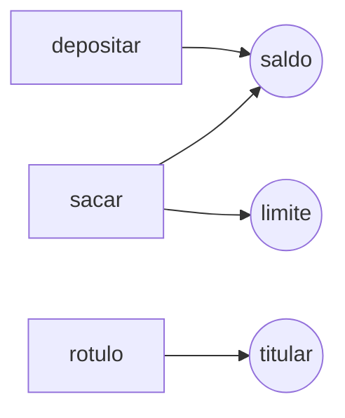
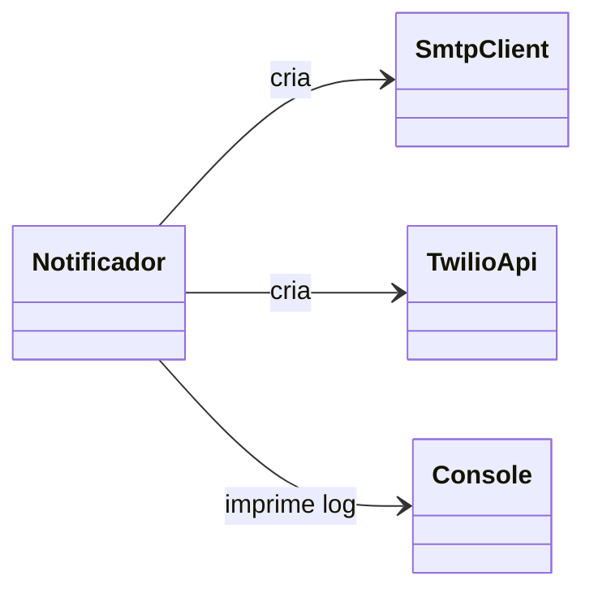

# Exercícios sobre Princípios de Projeto: Parte 2 (9 a 15)

[← Parte 1](exercicios-parte-1.md) · [Voltar ao índice](README.md)

---

## Exercício 9: Relatório de vendas

```java
class RelatorioVendas {

  double calcularTotal(List<Venda> vendas) { ... }

  String gerarHTML(double total) { ... }

  void enviarPorEmail(String html, String destinatario) { ... }
}
```



1. Quantos motivos diferentes para mudança essa classe possui? Quais são?
2. Qual princípio de projeto está sendo violado?
3. Proponha uma nova divisão de classes e indique qual delas seria a mais fácil de testar com testes de unidade.

---

## Exercício 10: Aves que não voam

```java
interface Ave {
  void voar();
  void nadar();
  void botarOvo();
}

class Pinguim implements Ave {
  public void voar() {
    throw new UnsupportedOperationException();
  }
  public void nadar()    { ... }
  public void botarOvo() { ... }
}

class Pardal implements Ave {
  public void voar()     { ... }
  public void nadar()    { /* não faz nada */ }
  public void botarOvo() { ... }
}
```



1. Quais **dois** princípios de projeto são violados por esse design? Justifique cada um.
2. Redesenhe as interfaces para que `Pinguim` e `Pardal` implementem apenas o que realmente fazem.
3. Um método `void soltarNoCeu(Ave a) { a.voar(); }` funciona para qualquer `Ave`? O que isso revela?

---

## Exercício 11: Serviço de pedidos

```java
class PedidoService {

  private MySQLPedidoRepository repo =
          new MySQLPedidoRepository();

  void finalizar(Pedido p) {
    p.validar();
    p.calcularTotal();
    repo.salvar(p);
  }
}
```



1. Por que é difícil escrever um teste de unidade para `finalizar()` sem um banco MySQL rodando?
2. Qual princípio de projeto resolve esse problema?
3. Refatore a classe usando uma interface `PedidoRepository` e injeção de dependência pelo construtor.
4. Desenhe o diagrama de classes antes e depois da refatoração.

---

## Exercício 12: Histórico de eventos

```java
class Historico extends ArrayList<String> {

  void registrar(String evento) {
    add(LocalDate.now() + " " + evento);
  }
}

// Uso
Historico h = new Historico();
h.registrar("Login do usuário");
h.clear();           // ???
h.set(0, "forjado"); // ???
```



1. O requisito diz que eventos registrados **nunca** podem ser alterados ou apagados. O design atual garante isso? Por quê?
2. Qual princípio de projeto foi ignorado?
3. Reescreva `Historico` usando composição, expondo apenas `registrar()` e `listar()`.

---

## Exercício 13: Qual princípio foi violado?

Associe cada trecho ao princípio de projeto que ele viola:

| Item | Trecho |
|---|---|
| a) | `cliente.getCarrinho().getItens().get(0).getProduto().getPreco()` |
| b) | `switch (tipoPagamento) { case PIX: ... case BOLETO: ... }` repetido em várias classes |
| c) | `class Poupanca extends Conta { void sacar(double v) { throw new RuntimeException(); } }` |
| d) | `class TelaCadastro { void onClick() { /* valida CPF, calcula juros, grava no banco */ } }` |
| e) | `class Relatorio { private ImpressoraHP impressora = new ImpressoraHP(); }` |

- ( ) Responsabilidade Única
- ( ) Inversão de Dependências
- ( ) Demeter
- ( ) Aberto/Fechado
- ( ) Substituição de Liskov

**Bônus:** para cada item, escreva em uma frase como corrigir o problema.

---

## Exercício 14: Calculando métricas

```java
class Conta {
  private double saldo;
  private double limite;
  private String titular;

  void depositar(double v) {
    saldo += v;
  }
  void sacar(double v) {
    if (v <= saldo + limite)
      saldo -= v;
    else
      throw new SaldoInsuficienteException();
  }
  String rotulo() {
    return titular.toUpperCase();
  }
}
```



*Figura: atributos acessados por cada método.*

1. Calcule o **LCOM** da classe `Conta`, listando todos os pares de métodos.
2. Calcule a **complexidade ciclomática** do método `sacar`.
3. Calcule o **CBO** de `Conta` (considere `String` e `SaldoInsuficienteException`).
4. O valor de LCOM sugere algum problema? O que você faria?

> **Lembrete:** LCOM conta os pares de métodos que **não** acessam atributos em comum. CC = número de comandos de decisão + 1.

---

## Exercício 15: Desafio integrador (notificações)

```java
class Notificador {

  void enviar(String tipo, String destino, String msg) {
    if (tipo.equals("EMAIL")) {
      SmtpClient smtp = new SmtpClient("smtp.empresa.com");
      smtp.connect();
      smtp.send(destino, msg);
    } else if (tipo.equals("SMS")) {
      TwilioApi api = new TwilioApi("chave-secreta");
      api.sms(destino, msg);
    }
    System.out.println("Notificação enviada: " + msg);
  }
}
```



1. Identifique **pelo menos três** princípios de projeto violados.
2. Proponha um design que permita adicionar **WhatsApp** sem alterar a classe `Notificador`.
3. Esboce o diagrama de classes da sua solução.
4. Em que contexto essa refatoração seria *overengineering*?

> 💡 Sugestão: trabalhe em duplas e compare as soluções.

---

[← Parte 1](exercicios-parte-1.md) · [Voltar ao índice](aps2.md) 
