# Princípios de Projeto - Parte II: Exercícios

**Engenharia de Software II** · Prof. Mehran Misaghi

Material de apoio da aula **Princípios de Projeto – Parte II**, baseado no
[Capítulo 5 do livro *Engenharia de Software Moderna*](https://engsoftmoderna.info/cap5.html)
(Prof. Marco Tulio Valente).

## Conteúdo

| Página | Descrição |
|---|---|
| [Resumo dos princípios](resumo.md) | Os 7 princípios, a propriedade que cada um promove e sinais de alerta |
| [Exercícios 1 a 8](exercicios-parte-1.md) | Exercícios trabalhados em sala (do livro)|
| [Exercícios 9 a 15](exercicios-parte-2.md) | Exercícios complementares|

## Os princípios do Projeto

```mermaid
flowchart LR
    SRP["1. Responsabilidade Única"] --> COE(["Coesão"])
    ISP["2. Segregação de Interfaces"] --> COE
    DIP["3. Inversão de Dependências"] --> ACO(["Acoplamento"])
    CMP["4. Prefira Composição a Herança"] --> ACO
    DEM["5. Demeter"] --> OCU(["Ocultamento de Informação"])
    OCP["6. Aberto/Fechado"] --> EXT(["Extensibilidade"])
    LSP["7. Substituição de Liskov"] --> EXT

    classDef prop fill:#E9A23B,stroke:#1B1F2A,color:#1B1F2A,font-weight:bold
    class COE,ACO,OCU,EXT prop
```

> **Princípio** = recomendação mais explícita · **Propriedade** = consequência (o que ganhamos seguindo o princípio)

## Referências

- VALENTE, Marco Tulio. *Engenharia de Software Moderna*, [Cap. 5](https://engsoftmoderna.info/)
- VALENTE, Marco Tulio. *Engenharia de Software Moderna*, [Cap5. Slides da aula](https://docs.google.com/presentation/d/1QK9PNf7F4jv4cNDEGdB54z7YZV7uOYg-QO6FN2YUYtk/edit?slide=id.g72139a2ac2_0_0#slide=id.g72139a2ac2_0_0)
- MARTIN, Robert C. *Clean Architecture*. Prentice Hall, 2017.
- [Slides de Princípios do Projeto - Parte II- 2026/2](https://canva.link/ox0y1qonetj2xx0).
