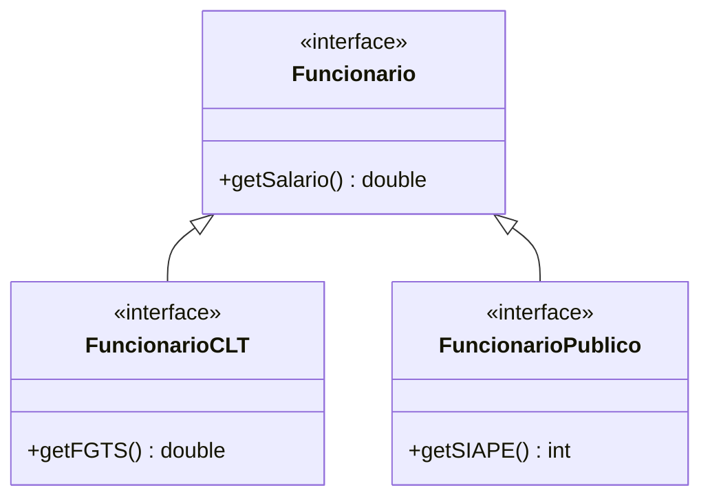
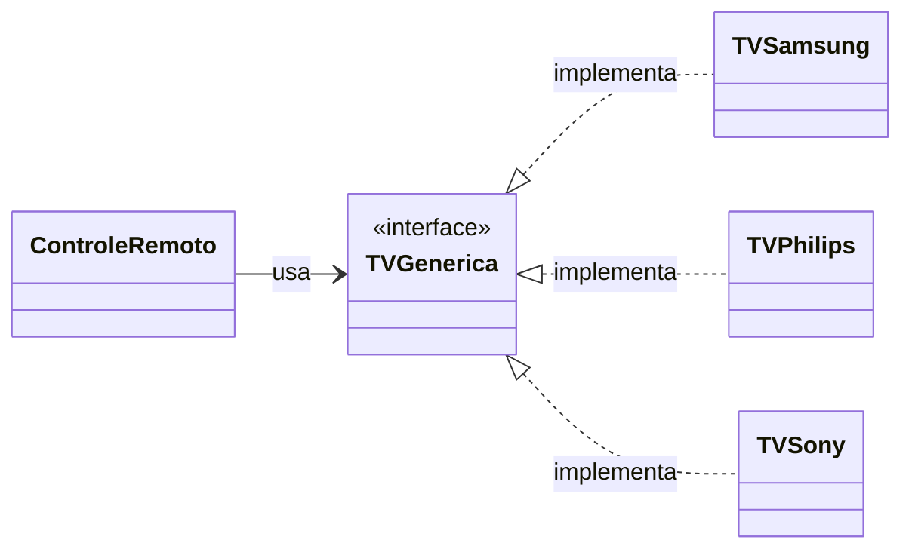
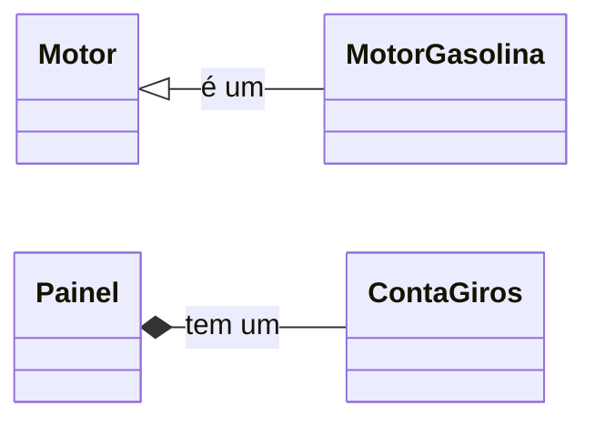
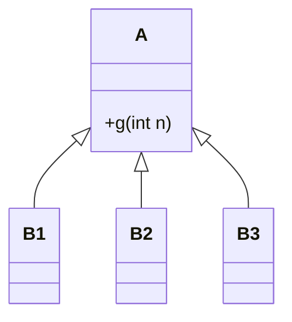

# Resumo dos Princípios de Projeto

[← Voltar ao índice](README.md)

| # | Princípio | Ideia central | Propriedade | Sinal de alerta |
|---|---|---|---|---|
| 1 | Responsabilidade Única | Uma classe deve ter um único motivo para mudar | Coesão | Classe "faz-tudo"; UI misturada com regra de negócio |
| 2 | Segregação de Interfaces | Interfaces pequenas, coesas e específicas por tipo de cliente | Coesão | Métodos vazios ou que lançam exceção |
| 3 | Inversão de Dependências | Dependa de abstrações ("Prefira Interfaces a Classes") | Acoplamento | Atributos de tipos concretos; `new` espalhado |
| 4 | Prefira Composição a Herança | Reúso caixa-preta, relação "tem um" | Acoplamento | Herança usada só para reaproveitar código |
| 5 | Demeter | Fale apenas com seus "amigos imediatos" | Ocultamento de Informação | `a.getB().getC().getD()` |
| 6 | Aberto/Fechado | Aberta para extensões, fechada para modificações | Extensibilidade | `if/else` ou `switch` por tipo; `instanceof` |
| 7 | Substituição de Liskov | Subclasses respeitam o contrato da classe base | Extensibilidade | Subclasse que "surpreende" o cliente |

---

## 1. Responsabilidade Única

Toda classe deve ter uma única responsabilidade, ou seja, deve existir um único motivo para modificá-la.

```java
// ❌ calcula E imprime
class Disciplina {
  void calculaIndiceDesistencia() {
    indice = "calcula índice de desistência";
    System.out.println(indice);
  }
}
```

```java
// ✅ apresentação separada da regra de negócio
class Console {
  void imprimeIndiceDesistencia(Disciplina disciplina) {
    double indice = disciplina.calculaIndiceDesistencia();
    System.out.println(indice);
  }
}

class Disciplina {
  double calculaIndiceDesistencia() {
    double indice = "calcula índice de desistência";
    return indice;
  }
}
```

## 2. Segregação de Interfaces

Interfaces devem ser pequenas, coesas e específicas para cada tipo de cliente.



## 3. Inversão de Dependências

Clientes devem depender de abstrações, e não de implementações concretas.



Novas TVs entram no sistema sem nenhuma alteração em `ControleRemoto`.

## 4. Prefira Composição a Herança

| Característica | Herança | Composição |
|---|---|---|
| Relacionamento | "É um" | "Tem um" |
| Acoplamento | Alto: mudanças na superclasse podem quebrar a subclasse | Baixo |
| Flexibilidade | Baixa: hierarquia rígida, definida em tempo de compilação | Alta: o objeto contido pode ser trocado em tempo de execução |
| Reutilização | De implementação | De funcionalidade |
| Exemplo | Um Gato é um Animal | Um Carro tem um Motor |



## 5. Demeter

Um método só deve chamar métodos:

1. da própria classe;
2. de seus parâmetros;
3. de objetos que ele próprio criou;
4. de atributos da sua classe.

```java
obj.getA().getB().getC().getD().getOqueEuPreciso(); // ❌ objetos de passagem
```

> Cadeias com métodos da própria linguagem ou API (por exemplo `stream().map().filter()`) são justificáveis: cada chamada retorna um novo objeto, sem navegar pela estrutura interna de outros objetos.

## 6. Aberto/Fechado

Proposto por Bertrand Meyer (1988). Uma classe deve estar **fechada** para modificações, mas **aberta** para extensões. Pontos de extensão comuns são parâmetros, funções de mais alta ordem, padrões de projeto e herança.

```java
// sort está aberto a extensões: o critério de ordenação é um parâmetro
Collections.sort(nomes, (s1, s2) -> s1.length() - s2.length());
```

## 7. Substituição de Liskov

Substituições de `A` por uma subclasse `B` podem acontecer desde que `B` ofereça os mesmos serviços de `A`. Para um código feito para usar `A`, a substituição deve ser **imperceptível**.



A subclasse **não pode** fortalecer pré-condições nem enfraquecer pós-condições.

## Métricas de código-fonte

| Métrica | Mede | Interpretação |
|---|---|---|
| **LOC** | Tamanho | Não use como medida de produtividade |
| **LCOM** | Falta de coesão | Pares de métodos sem atributos em comum. Quanto maior, pior |
| **CBO** | Acoplamento | Número de classes das quais uma classe depende |
| **CC** | Complexidade | Comandos de decisão + 1 (McCabe sugere no máximo 10) |
