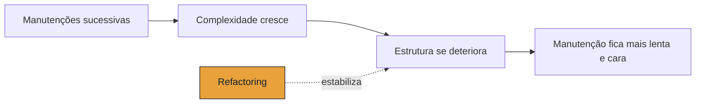
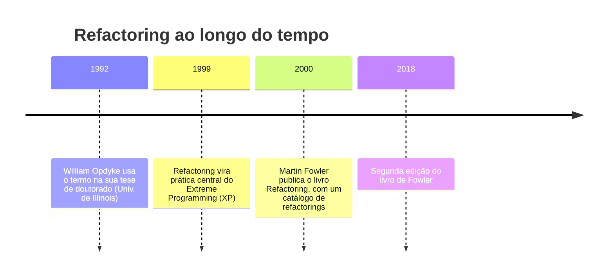

# Introdução ao Refactoring: Notas de Aula

**Disciplina:** Engenharia de Software II
**Professor:** Mehran Misaghi · IFC Campus Araquari
**Série:** Refactoring, página 1 de 5

> **Nesta série:** **1. Introdução** · [2. Catálogo](02-catalogo.md) · [3. Prática](03-pratica.md) · [4. Code smells](04-code-smells.md) · [5. Dívida técnica](05-divida-tecnica.md) · [Exercícios](exercicios.md)

---

## Sumário

1. [Manutenção de software](#1-manutenção-de-software)
2. [As Leis de Lehman](#2-as-leis-de-lehman)
3. [O que é refactoring?](#3-o-que-é-refactoring)
4. [O que não é refactoring?](#4-o-que-não-é-refactoring)
5. [Um pouco de história](#5-um-pouco-de-história)

---

## 1. Manutenção de software

Um sistema de software nunca fica "pronto". Depois de implantado, ele continua mudando, e essas mudanças são chamadas de **manutenção**. Nos slides, usamos cinco categorias:

| Tipo | Objetivo | Quem motiva |
|---|---|---|
| **Preventiva** | Retirar bugs antes que eles se manifestem | O próprio programador |
| **Corretiva** | Retirar bugs reportados | Os usuários |
| **Adaptativa** | Customizações, novas versões de sistema operacional, de linguagem de programação ou de regras de negócio | O ambiente do sistema |
| **Evolutiva** | Implementar novas funcionalidades | Os clientes |
| **Refactoring** | Melhorar o código ou o design | A equipe de desenvolvimento |

> As quatro primeiras mudam **o que** o sistema faz (ou o ambiente em que ele roda). O refactoring muda **como** o código está organizado, sem mudar o que ele faz.

---

## 2. As Leis de Lehman

No início da década de 1970, **Meir Lehman**, então na IBM, observou a evolução de sistemas reais e formulou um conjunto de leis. Duas delas explicam por que precisamos de refactoring:

1. **Mudança contínua:** um sistema em uso precisa ser mantido continuamente; caso contrário, ele se torna cada vez menos útil, até o ponto de ser substituído.
2. **Complexidade crescente:** à medida que um sistema é mantido, sua complexidade aumenta e sua estrutura se deteriora, **a não ser que seja feito um trabalho para estabilizá-la**.

O "trabalho para estabilizar" a estrutura da segunda lei é, essencialmente, **refactoring**.

---

## 3. O que é refactoring?

> **Refactoring** são transformações de código que **melhoram a manutenibilidade** de um sistema, mas **sem afetar o seu funcionamento externo**.

Duas ideias estão nessa definição:

- **Preserva o comportamento (a semântica):** para quem usa o sistema, nada muda. As mesmas entradas produzem as mesmas saídas.
- **Melhora a manutenibilidade:** o código fica mais fácil de entender, modificar, testar e evoluir.

Exemplos de melhorias: dividir um método grande, dar um nome melhor a uma variável, mover um método para a classe certa, eliminar código duplicado.

> **Sobre os termos:** em português, mantemos o substantivo em inglês (**um refactoring**) e usamos o verbo **refatorar**.

### Atenção ao escopo

No livro (e nesta disciplina), o termo refactoring é usado **apenas** para mudanças que melhoram a manutenibilidade. Mudanças que melhoram **desempenho**, **concorrência** ou **usabilidade** também preservam a funcionalidade, mas não são chamadas de refactoring aqui.

---

## 4. O que não é refactoring?

| Não é refactoring | Por quê |
|---|---|
| Implementar novas funcionalidades | Muda o comportamento externo do sistema |
| Integrar o código com outras partes do mesmo sistema | Também altera o que o sistema faz |
| Otimizar o desempenho | Objetivo diferente de manutenibilidade |
| Corrigir um bug | Muda o comportamento (de errado para certo) |

Na prática, é comum alternar: primeiro refatoramos para **preparar** o código, depois implementamos a funcionalidade. O importante é não misturar os dois no mesmo passo.

---

## 5. Um pouco de história

No livro de Fowler, cada refactoring do catálogo tem **nome**, **motivação**, **mecânica** (passo a passo para aplicá-lo) e **exemplos**. Esse formato é seguido na [próxima página](02-catalogo.md).

---

**Próxima página:** [2. Catálogo de refactorings →](02-catalogo.md)
