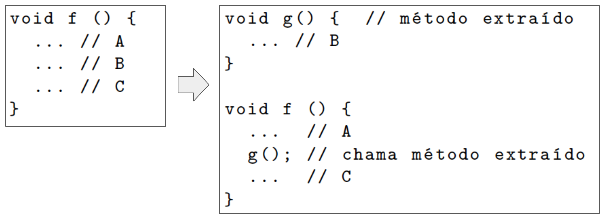
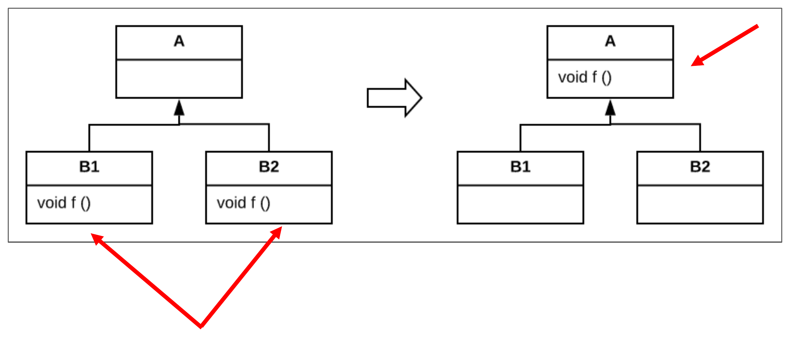
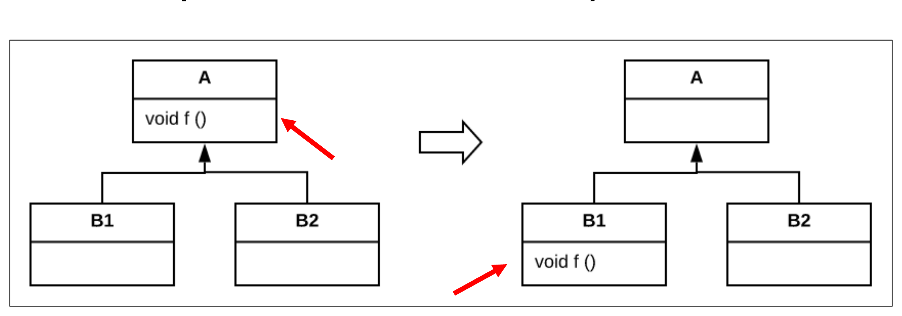
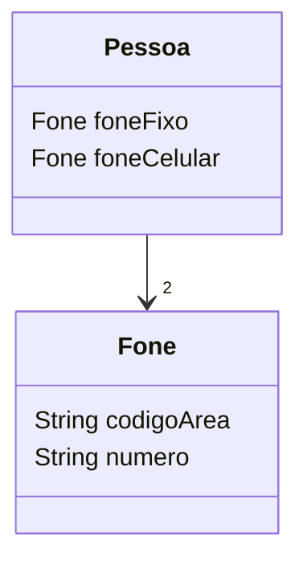
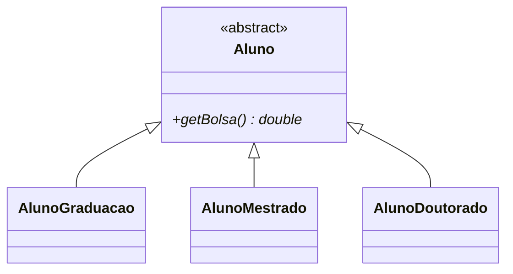

# Catálogo de Refactorings: Notas de Aula

**Disciplina:** Engenharia de Software II
**Professor:** Mehran Misaghi · IFC Campus Araquari
**Série:** Refactoring, página 2 de 5

> **Nesta série:** [1. Introdução](01-introducao.md) · **2. Catálogo** · [3. Prática](03-pratica.md) · [4. Code smells](04-code-smells.md) · [5. Dívida técnica](05-divida-tecnica.md) · [Exercícios](exercicios.md)

---

## Sumário

1. [Extração de Método](#1-extração-de-método)
2. [Motivações para extrair métodos](#2-motivações-para-extrair-métodos)
3. [Inline de Método](#3-inline-de-método)
4. [Movimentação de Método](#4-movimentação-de-método)
5. [Extração de Classes e de Interfaces](#5-extração-de-classes-e-de-interfaces)
6. [Renomeação](#6-renomeação)
7. [Outros refactorings](#7-outros-refactorings)

---

## 1. Extração de Método

**Ideia:** um trecho de código de um método `f` é movido para um novo método `g`, e `f` passa a chamar `g`.



```java
// Antes
void f() {
  ... // A
  ... // B
  ... // C
}

// Depois
void g() {   // método extraído
  ... // B
}

void f() {
  ... // A
  g();       // chama o método extraído
  ... // C
}
```

**Variações:**

- extrair **vários** métodos de um mesmo `f`;
- extrair o **mesmo trecho** que aparece em vários métodos, eliminando duplicação;
- quando o trecho usa variáveis locais de `f`, elas viram **parâmetros** de `g`; quando o trecho altera uma variável usada depois, ela vira o **retorno** de `g`.

A Extração de Método é tão versátil que é chamada de **"canivete suíço" dos refactorings**.

### Um exemplo real

Em um aplicativo Android de código aberto, o método `onCreate` tinha **mais de 200 linhas**, quase todas com comandos SQL para criar tabelas (`// cria tabela 1`, `// cria tabela 2`...). Um desenvolvedor, usando o IntelliJ, fez **sete extrações**:

```java
public void onCreate(SQLiteDatabase database) {
  createCellSignalTable(database);
  createSilentSmsTable(database);
  createLocationTable(database);
  createCellTable(database);
  createOpenCellIDTable(database);
  createDefaultMCCTable(database);
  createEventLogTable(database);
}
```

O método passou a ter **sete linhas**, e cada nome explica o que o trecho faz. Repare que os antigos comentários `// cria tabela X` viraram **nomes de métodos**.

---

## 2. Motivações para extrair métodos

Em 2016, **Danilo Silva, Nikolaos Tsantalis e Marco Tulio Valente** perguntaram a desenvolvedores do GitHub, logo após eles realizarem um refactoring, **por que** o fizeram. Para a Extração de Método foram identificadas 11 motivações. As mais citadas:

| Motivação | Ocorrências |
|---|---|
| Extrair um método que será **reusado** | 43 |
| Introduzir uma **assinatura alternativa** para um método existente | 25 |
| **Dividir** um método grande para melhorar o entendimento | 21 |
| **Remover duplicação** de código | 15 |
| Facilitar uma **nova funcionalidade** ou a correção de um bug | 14 |

### Exemplo: assinatura alternativa

```java
// Antes
void log(String msg) {
  // grava msg em arquivo
}

// Depois: nova assinatura, e a antiga delega para ela
void log(String msg, boolean console) {
  if (console) System.out.println(msg);
  // grava msg em arquivo
}

void log(String msg) {
  log(msg, false);
}
```

### O que se ganha ao extrair um método?

- Métodos menores e mais fáceis de entender.
- Menos código duplicado.
- O método extraído pode ser **reusado**, **testado de forma isolada**, **redefinido em subclasses** e até **chamado recursivamente**.

---

## 3. Inline de Método

É o **contrário** da Extração: um método pequeno e pouco usado é removido, e o seu corpo é copiado para os pontos de chamada. É uma operação mais rara e menos importante que a extração.

**Exemplo real (IntelliJ):** `writeContentToFile` tinha **uma linha** e era chamado em **um único lugar**, o método `write`. Não fazia sentido manter um método só para isso:

```java
// Antes
private void writeContentToFile(final byte[] revision) {
  getVirtualFile().setBinaryContent(revision);
}

private void write(byte[] revision) {
  VirtualFile virtualFile = getVirtualFile();
  ...
  if (document == null) {
    writeContentToFile(revision);   // única chamada
  }
  ...
}

// Depois
private void write(byte[] revision) {
  VirtualFile virtualFile = getVirtualFile();
  ...
  if (document == null) {
    virtualFile.setBinaryContent(revision);   // após o inline
  }
  ...
}
```

---

## 4. Movimentação de Método

**Ideia:** mover um método para a classe cujos dados ele mais usa. O resultado é **mais coesão** (o método fica junto dos dados) e **menos acoplamento** (a classe original deixa de depender da outra).

**Exemplo real (IntelliJ):** o método estático `averageAmongMedians` estava em `PlatformTestUtil`, mas não usava nada dessa classe. Ele foi movido para `ArrayUtil`. Como era estático, nas chamadas bastou trocar o nome da classe:

```diff
- PlatformTestUtil.averageAmongMedians(time, 3)
+ ArrayUtil.averageAmongMedians(time, 3)
```

### E se não der para atualizar os clientes?

Se o método `f` for movido de `A` para `B` e houver muitos clientes (ou clientes externos), `A` pode manter um `f` que apenas **delega**:

```java
class A {
  B b = new B();
  void f() { b.f(); }   // só delega; clientes de A não mudam
}

class B {
  void f() { ... }      // implementação movida para cá
}
```

### Casos particulares: movimentação em hierarquias

| Refactoring | O que faz | Quando usar |
|---|---|---|
| **Pull Up Method** | Sobe um método das subclasses para a superclasse | O mesmo método aparece em várias subclasses (duplicação) |
| **Push Down Method** | Desce um método da superclasse para uma subclasse | O método só interessa a uma subclasse e não precisa ser herdado pelas outras |





> **Refactorings em sequência:** é comum combinar operações. Por exemplo, primeiro **extrair** `g` de `f`, depois **mover** `g` para a classe `B`, que é onde estão os dados que ele usa.

---

## 5. Extração de Classes e de Interfaces

**Extração de Classe:** quando uma classe acumula responsabilidades, um grupo de atributos relacionados (e os métodos que os usam) vai para uma nova classe.

```java
// Antes
class Pessoa {
  String codigoArea;
  String fone;
  String codigoAreaCelular;
  String celular;
  ...
}

// Depois
class Fone {              // classe extraída
  String codigoArea;
  String numero;
}

class Pessoa {
  Fone foneFixo;
  Fone foneCelular;
  ...
}
```



**Extração de Interface:** cria uma interface a partir de classes concretas. Por exemplo, extrair a interface `List` a partir de `ArrayList` e `LinkedList`. Esse refactoring aplica o princípio **"Prefira Interfaces a Classes Concretas"**, visto no [capítulo de Princípios de Projeto](https://engsoftmoderna.info/cap5.html).

---

## 6. Renomeação

**Qual o refactoring mais comum?** A **renomeação** de variáveis, parâmetros, métodos, classes, exceções etc. Ela responde por **mais de 50% das operações de refactoring**.

> "Dar bons nomes a variáveis é um dos problemas mais difíceis em programação!"
> Há uma frase famosa, atribuída a Phil Karlton, de que só existem duas coisas difíceis em computação: **invalidar caches** e **dar nomes às coisas**.

Trocar o nome é fácil; a parte difícil é **atualizar todas as referências**. Quando o método faz parte de uma API usada por outros sistemas, uma estratégia segura é:

1. criar o novo método `g` com o código de `f`;
2. fazer `f` apenas chamar `g`;
3. marcar `f` como **deprecated**, dando tempo para os clientes migrarem;
4. remover `f` numa versão futura.

```java
@Deprecated
void f() { g(); }   // mantido por compatibilidade

void g() { ... }    // novo nome
```

> Mudanças devem ser feitas em **"baby steps"**: passos pequenos, um de cada vez, testando a cada passo.

---

## 7. Outros refactorings

### Extração de Variável

Dá nome a uma expressão complicada:

```java
// Antes
x1 = (-b + sqrt(b*b - 4*a*c)) / (2*a);

// Depois
double delta = b*b - 4*a*c;
x1 = (-b + sqrt(delta)) / (2*a);
```

### Remoção de Flags

Substitui variáveis de controle (flags) por comandos como `return` ou `break`:

```java
// Antes
boolean search(int[] v, int x) {
  boolean achou = false;
  int i = 0;
  while (!achou && i < v.length) {
    if (v[i] == x) achou = true;
    i++;
  }
  return achou;
}

// Depois
boolean search(int[] v, int x) {
  for (int i = 0; i < v.length; i++) {
    if (v[i] == x) return true;
  }
  return false;
}
```

### Substituição de Condicional por Polimorfismo

Um `switch` sobre o "tipo" de um objeto é substituído por um método redefinido em subclasses:

```java
// Antes
switch (aluno.type) {
  case GRADUACAO: bolsa = 500;  break;
  case MESTRADO:  bolsa = 1500; break;
  case DOUTORADO: bolsa = 2500; break;
}

// Depois
bolsa = aluno.getBolsa();
```



Cada subclasse implementa `getBolsa()`. Para criar um novo tipo de aluno, basta uma nova subclasse; nenhum `switch` precisa ser alterado (princípio Aberto/Fechado).

### Remoção de Código Morto

Remove métodos, classes, atributos ou variáveis que não são mais usados. É mais comum do que se imagina. Veja o estudo de caso da Meta na [página 3](03-pratica.md#4-remoção-de-código-morto-em-escala).

---


**Página anterior:** [← 1. Introdução](01-introducao.md) · **Próxima página:** [3. Prática de refactoring →](03-pratica.md)
