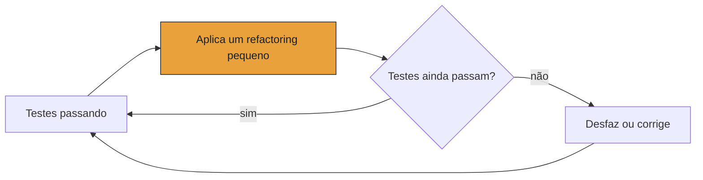
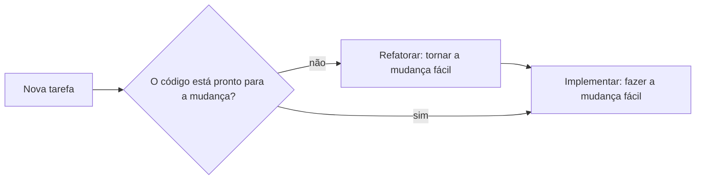
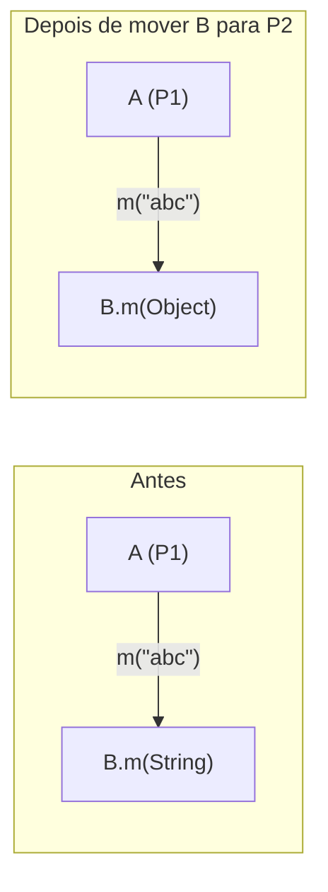

# Prática de Refactoring: Notas de Aula

**Disciplina:** Engenharia de Software II
**Professor:** Mehran Misaghi · IFC Campus Araquari
**Série:** Refactoring, página 3 de 5

> **Nesta série:** [1. Introdução](01-introducao.md) · [2. Catálogo](02-catalogo.md) · **3. Prática** · [4. Code smells](04-code-smells.md) · [5. Dívida técnica](05-divida-tecnica.md) · [Exercícios](exercicios.md)

---

## Sumário

1. [Testes: a rede de segurança](#1-testes-a-rede-de-segurança)
2. [Quando refatorar?](#2-quando-refatorar)
3. [Refactorings automatizados](#3-refactorings-automatizados)
4. [Remoção de código morto em escala](#4-remoção-de-código-morto-em-escala)

---

## 1. Testes: a rede de segurança

Um refactoring **não pode mudar o comportamento** do sistema. Como garantir isso? Com **testes**, principalmente **testes de unidade**.



John Ousterhout, autor de *A Philosophy of Software Design*, observa que, sem uma boa suíte de testes, o desenvolvedor tem medo de refatorar. Ele evita mexer no que funciona, e a complexidade vai se acumulando.

> Refactoring e testes andam juntos: os testes dão **coragem** para refatorar.

---

## 2. Quando refatorar?

| | **Refactorings oportunistas** | **Refactorings planejados** |
|---|---|---|
| **Quando** | No meio de outra tarefa de programação (corrigir um bug, implementar uma funcionalidade) | Em uma sessão dedicada apenas a refactoring |
| **Tamanho** | Pequenos: renomear, extrair um método, mover um método | Grandes: corrigir um problema de design mais complexo, como quebrar um pacote em subpacotes |
| **Frequência** | **O tipo mais comum** | Devem ser raros |

### Refactorings oportunistas

Kent Beck resume a ideia: primeiro **torne a mudança fácil**; depois **faça a mudança fácil**. Ao receber uma tarefa, o desenvolvedor percebe que o código não está bem preparado para ela, refatora e só então implementa.



Também vale a "regra do escoteiro": deixar o código um pouco melhor do que estava ao encontrá-lo.

### Refactorings planejados

São necessários quando o problema é maior e não cabe dentro de uma tarefa comum. Martin Fowler argumenta que eles devem ser **raros**: se a equipe faz refactorings oportunistas com frequência, o código não chega a um estado que exija grandes sessões de correção.

---

## 3. Refactorings automatizados

As IDEs modernas (IntelliJ, Eclipse, VS Code, NetBeans) automatizam vários refactorings. O desenvolvedor:

1. **seleciona** o trecho de código (por exemplo, o método `m1`);
2. **escolhe** o refactoring no menu *Refactor* (por exemplo, *Rename*);
3. **informa** os dados necessários (por exemplo, o novo nome `m11`).

A IDE então faz a mudança **e atualiza todas as referências**:

```java
// Antes                              // Depois (Rename m1 → m11)
class A {                             class A {
  void m1() {}                          void m11() {}
  void m2() {}                          void m2() {}
  void m3() { m1(); }                   void m3() { m11(); }
}                                     }

class B {                             class B {
  void m4() { new A().m1(); }           void m4() { new A().m11(); }
}                                     }
```

### Os desenvolvedores usam a automação?

No estudo de Silva, Tsantalis e Valente (FSE 2016), apenas uma parte dos refactorings foi feita com o apoio da IDE. A maioria foi feita **manualmente**:

| Refactoring | Ocorrências | Automatizados |
|---|---|---|
| Extract Method | 118 | 29% |
| Move Class | 36 | 50% |
| Move Attribute | 21 | 24% |
| Move Method | 19 | 26% |
| Inline Method | 17 | 18% |
| Rename Package | 12 | 58% |
| Extract Superclass | 9 | 11% |
| Pull Up Method | 9 | 11% |
| Pull Up Attribute | 7 | 14% |
| Extract Interface | 3 | 0% |

### Verificação de pré-condições

Antes de aplicar o refactoring, a IDE verifica **pré-condições**: a mudança não pode gerar **erro de compilação** nem **mudar o comportamento**. Por exemplo, renomear `m1` para `m2` deve ser recusado, porque a classe `A` já tem um método `m2`.

Algumas pré-condições são sutis. Um exemplo de **Friedrich Steimann e Andreas Thies**:

```java
// Antes: tudo no pacote P1
package P1;
public class A {
  void g() {
    new B().m("abc");   // chama m(String)
  }
}

package P1;
public class B {
  public void m(Object o) { ... }
  void m(String s) { ... }   // visível só dentro do pacote P1
}
```

Se a classe `B` for **movida para o pacote P2**, o código continua compilando, mas `m(String)` deixa de ser visível para `A`. A chamada `m("abc")` passa a executar **`m(Object)`**. O comportamento mudou, então essa movimentação **não é um refactoring**, e a IDE deveria alertar o desenvolvedor.



---

## 4. Remoção de código morto em escala

Código morto é código que **não é mais usado**. Parece raro, mas é mais comum do que se imagina, principalmente em sistemas grandes e antigos.

**Estudo de caso: Meta/Facebook.** A empresa possui uma **ferramenta interna** que identifica código morto e gera automaticamente as mudanças (diffs) que o removem; os engenheiros responsáveis apenas revisam e aprovam. Detalhes no artigo [Automating dead code cleanup](https://engineering.fb.com/2023/10/24/data-infrastructure/automating-dead-code-cleanup/) (2023).

---

**Página anterior:** [← 2. Catálogo](02-catalogo.md) · **Próxima página:** [4. Code smells →](04-code-smells.md)
