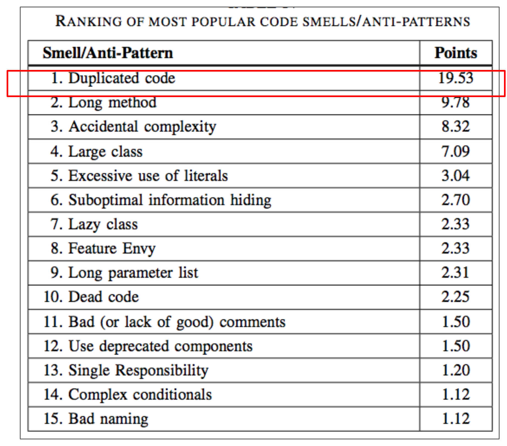
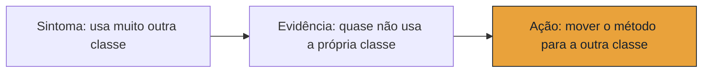
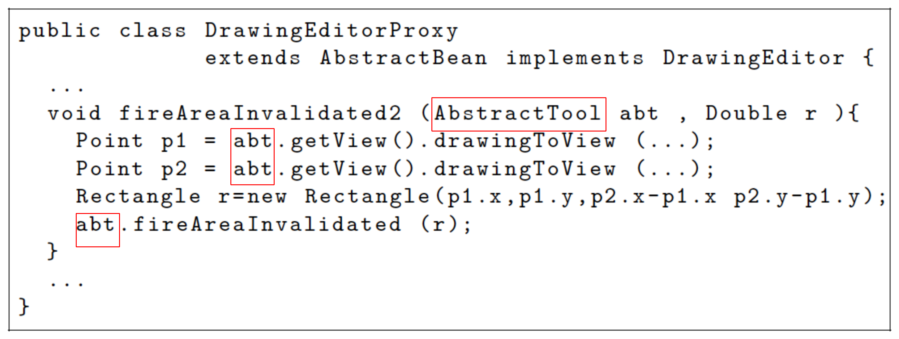

# Code Smells: Notas de Aula

**Disciplina:** Engenharia de Software II
**Professor:** Mehran Misaghi · IFC Campus Araquari
**Série:** Refactoring, página 4 de 5

> **Nesta série:** [1. Introdução](01-introducao.md) · [2. Catálogo](02-catalogo.md) · [3. Prática](03-pratica.md) · **4. Code smells** · [5. Dívida técnica](05-divida-tecnica.md) · [Exercícios](exercicios.md)

---

## Sumário

1. [O que são code smells?](#1-o-que-são-code-smells)
2. [Código Duplicado](#2-código-duplicado)
3. [Métodos Longos e Classes Grandes](#3-métodos-longos-e-classes-grandes)
4. [Feature Envy](#4-feature-envy)
5. [Métodos com Muitos Parâmetros](#5-métodos-com-muitos-parâmetros)
6. [Variáveis Globais](#6-variáveis-globais)
7. [Obsessão por Tipos Primitivos](#7-obsessão-por-tipos-primitivos)
8. [Objetos Mutáveis](#8-objetos-mutáveis)
9. [Classes de Dados](#9-classes-de-dados)
10. [Comentários](#10-comentários)

---

## 1. O que são code smells?

**Code smells** (ou *bad smells*) são **indicadores de código de baixa qualidade**: código difícil de manter, entender, modificar ou testar. Por isso, são **candidatos a refatoração**.

> Um smell é um **indício**, não uma regra. Ele não obriga a refatorar imediatamente; cabe ao desenvolvedor avaliar o contexto.

O termo foi popularizado por Kent Beck e Martin Fowler no capítulo 3 do livro *Refactoring* ("Bad Smells in Code").

### Catálogo

| Smell | Refactoring típico | Visto nesta aula |
|---|---|---|
| Código Duplicado | Extração de Método, Extração de Classe, Pull Up Method | ✔ |
| Métodos Longos | Extração de Método | |
| Classes Grandes | Extração de Classe | |
| Feature Envy | Movimentação de Método | ✔ |
| Métodos com Muitos Parâmetros | Introduzir objeto-parâmetro | |
| Variáveis Globais | Passar dados por parâmetros, encapsular | ✔ |
| Obsessão por Tipos Primitivos | Criar classes próprias (Value Objects) | ✔ |
| Objetos Mutáveis | Tornar classes imutáveis | ✔ |
| Classes de Dados | Mover comportamento para a classe | |
| Comentários | Extração de Método, Renomeação | ✔ |

---

## 2. Código Duplicado

É o **principal** code smell. Código duplicado:

- **dificulta a manutenção:** a mesma mudança precisa ser feita em vários lugares;
- aumenta o risco de **alterações incompletas** (corrigir o bug em uma cópia e esquecer as outras).

Refactorings que eliminam duplicação: **Extração de Método**, **Extração de Classe** e **Pull Up Method**.

### Os desenvolvedores se importam?

Em 2013, **Aiko Yamashita e Leon Moonen** fizeram um survey com **85 desenvolvedores**. O código duplicado ficou em **1º lugar** no ranking de smells que mais preocupam, seguido de métodos longos.



### Clones

Trechos de código duplicados são chamados de **clones**. Eles são classificados em quatro tipos, cada um incluindo as diferenças do anterior:

| Tipo | Diferenças em relação ao original |
|---|---|
| **Tipo 1** | Apenas comentários e espaços |
| **Tipo 2** | Tipo 1 + nomes diferentes (variáveis, parâmetros) |
| **Tipo 3** | Tipo 2 + mudanças em comandos (inseridos, removidos ou alterados) |
| **Tipo 4** | Algoritmos diferentes, mas semanticamente equivalentes |

Exemplo com a função `fatorial`:

```java
// Original
int fatorial(int n) {
  fat = 1;
  for (i = 1; i <= n; i++)
    fat = fat * i;
  return fat;
}

// Clone tipo 1: espaços e um comentário
int fatorial(int n) {
  fat=1;
  for (i=1; i<=n; i++)
     fat=fat*i;
  return fat;  // retorna fatorial
}

// Clone tipo 2: nomes diferentes (f, j)
int fatorial(int n) {
  f = 1;
  for (j = 1; j <= n; j++)
    f = f * j;
  return f;
}

// Clone tipo 3: um comando novo
int fatorial(int n) {
  fat = 1;
  for (j = 1; j <= n; j++)
    fat = fat * j;
  System.out.println(fat);  // novo comando
  return fat;
}

// Clone tipo 4: outro algoritmo (recursivo)
int fatorial(int n) {
  if (n == 0)
    return 1;
  else return n * fatorial(n-1);
}
```

> Clones dos tipos 1 e 2 são fáceis de detectar por ferramentas. Os de tipo 4 são os mais difíceis, porque exigem entender o que o código faz.

---

## 3. Métodos Longos e Classes Grandes

**Métodos Longos** dificultam o entendimento e a manutenção. A solução é a **Extração de Método**. Não existe um limite fixo, mas a tendência atual é escrever métodos pequenos, com menos de cerca de 20 linhas.

**Classes Grandes** têm muitos atributos, muitos métodos e **baixa coesão** (fazem coisas demais). A solução é a **Extração de Classe**.

> **Aprofundamento:** uma classe que concentra boa parte da lógica do sistema é chamada de **God Class** ou **Blob**. Nomes genéricos como `Manager`, `System` ou `Subsystem` podem ser um sinal de alerta.

---

## 4. Feature Envy

**Feature Envy** é um método que **"inveja" os dados e métodos de outra classe**: usa mais membros dessa outra classe do que da sua própria.



**Exemplo real:** o método `fireAreaInvalidated2`, da classe `DrawingEditorProxy`, faz várias chamadas ao mesmo objeto `abt`, do tipo `AbstractTool`, e não usa nada da própria classe. Ele é um forte candidato a ser movido para `AbstractTool`.



**Refactoring:** Movimentação de Método.

---

## 5. Métodos com Muitos Parâmetros

Muitos parâmetros tornam o método difícil de chamar e de entender. Duas soluções:

1. **Obter o valor dentro do método:** se `p2` pode ser calculado a partir de `p1`, não é preciso passá-lo.

   ```java
   // Antes: g(p1, p2), com p2 = p1.f() calculado por quem chama
   // Depois: g(p1), e dentro de g fazemos p2 = p1.f()
   ```

2. **Agrupar parâmetros relacionados em um tipo:**

   ```java
   // Antes
   void f(Date inicio, Date fim) { ... }

   // Depois
   void f(DateRange periodo) { ... }
   ```

---

## 6. Variáveis Globais

Variáveis globais geram **acoplamento ruim** e **dificultam o entendimento** de um método isoladamente:

```java
void f(...) {
  // computa um determinado valor x
  return x + g;   // onde g é uma variável global
}
```

> Dependendo de quem chamou `f` (e de quem alterou `g` antes), o resultado pode ser diferente!

Em Java não existem variáveis globais propriamente ditas, mas **atributos estáticos públicos** têm o mesmo efeito e também são um smell.

---

## 7. Obsessão por Tipos Primitivos

É usar tipos primitivos (`int`, `float`, `String`) para representar conceitos do domínio. Em resumo: gostar de Java por ter tipos e classes, mas colocar tudo como `String`, `int` ou `float`.

CEP, Moeda, Data, Hora, Cor, Email etc. **não devem ser tipos primitivos**, mas sim **tipos próprios**, com alguns métodos, por exemplo para **validar** os valores. Esses tipos são chamados de **Value Objects**.

```java
// Com obsessão por primitivos
String cep = "89245-000";   // qualquer texto é aceito

// Com um tipo próprio
class CEP {
  private final String valor;

  CEP(String valor) {
    if (!valor.matches("\\d{5}-\\d{3}"))
      throw new IllegalArgumentException("CEP inválido: " + valor);
    this.valor = valor;
  }
}
```

---

## 8. Objetos Mutáveis

| | **Mutáveis** | **Imutáveis** |
|---|---|---|
| Estado | Pode mudar depois da criação | Uma vez criado, não muda |
| Exemplo em Java | `StringBuilder`, `ArrayList` | `String`, `Integer`, `LocalDate` |

Martin Fowler incluiu objetos mutáveis como smell na **segunda edição** do livro *Refactoring* (2018).

### Exercício de aquecimento

O que será impresso? Strings em Java são imutáveis ou não?

```java
class Main {
  public static void main(String[] args) {
    String s1 = "Hello";
    String s2 = s1.toUpperCase();
    System.out.println(s1);
    System.out.println(s2);
  }
}
```

<details>
<summary>Resposta</summary>

Imprime `Hello` e depois `HELLO`. `toUpperCase()` **não altera** `s1`: ele cria e retorna uma **nova** string. Strings em Java são **imutáveis**.

</details>

### Por que objetos imutáveis são "bons"?

- **Dão mais segurança a quem criou o objeto:** pode-se passá-lo para outros métodos com a certeza de que eles não vão alterar o seu estado.
- **Não estão sujeitos a problemas de concorrência:** como ninguém altera o estado, não são necessárias sincronizações, *locks*, *mutex* etc.

### Como criar uma classe imutável em Java

- atributos `private final`;
- classe `final` (ninguém cria subclasses mutáveis);
- sem *setters*;
- validação no construtor;
- operações que "alteram" o objeto retornam **uma nova instância**.

```java
final class Data {
  private final int dia;
  private final int mes;
  private final int ano;

  Data(int dia, int mes, int ano) {
    // valida a data; lança exceção se for inválida
    this.dia = dia;
    this.mes = mes;
    this.ano = ano;
  }

  int getDia() { return dia; }
  int getMes() { return mes; }
  int getAno() { return ano; }
}
```

### Como interpretar esse smell

- **Sempre que possível**, implemente objetos imutáveis, principalmente objetos simples (CEP, Data, Hora etc.).
- **Por outro lado**, em linguagens imperativas é natural ter um bom número de objetos mutáveis. Em linguagens funcionais, esse smell praticamente não existe.

---

## 9. Classes de Dados

São classes que têm **apenas atributos**, com *getters* e *setters*, e nenhum comportamento. Não são necessariamente um erro, mas vale perguntar: existe lógica espalhada em outras classes que deveria estar **dentro** desta? Se sim, o ideal é movê-la para cá.

---

## 10. Comentários

> "Não comente código ruim, reescreva-o."
> B. Kernighan & P. J. Plauger, *The Elements of Programming Style*

Comentários são um smell quando servem para **explicar código confuso**. Em vez de comentar, extraia métodos com bons nomes:

```java
// Antes: um método "organizado" por comentários
void f() {
  // task1
  ...
  // task2
  ...
  // taskn
  ...
}

// Depois: cada comentário vira um método extraído
void task1() { ... }
void task2() { ... }
void taskn() { ... }

void f() {
  task1();
  task2();
  ...
  taskn();
}
```

### Comentários "ruído"

São comentários que **nada acrescentam**, pois apenas repetem o que o código já diz:

```java
/** The day of the month. */
private int dayOfMonth;

// this function sends an email
void sendEmail() { ... }

// this class holds data for an employee
public class Employee { ... }
```

John Ousterhout dá exemplos semelhantes no capítulo 13 de *A Philosophy of Software Design*.

### Nem todo comentário é um code smell

Comentários são úteis para:

1. **Documentar APIs** (Javadoc): explicam o contrato do método para quem vai usá-lo, sem precisar ler a implementação.

   ```java
   /**
    * Returns a string that is a substring of this string.
    * The substring begins at beginIndex and extends to
    * the character at index endIndex - 1.
    *
    * @param  beginIndex  the beginning index, inclusive.
    * @param  endIndex    the ending index, exclusive.
    * @return the specified substring.
    * @throws IndexOutOfBoundsException if beginIndex is negative,
    *         or endIndex is larger than the length of this String,
    *         or beginIndex is larger than endIndex.
    */
   public String substring(int beginIndex, int endIndex) { ... }
   ```

2. **Documentar código complexo por natureza**, como uma expressão regular:

   ```java
   // format matched kk:mm:ss EEE, MMM dd, yyy
   Pattern timePattern = Pattern.compile("\\d*:\\d*:\\d* \\w*, \\w*, \\d*, \\d*");
   ```

---

**Página anterior:** [← 3. Prática](03-pratica.md) · **Próxima página:** [5. Dívida técnica →](05-divida-tecnica.md)
