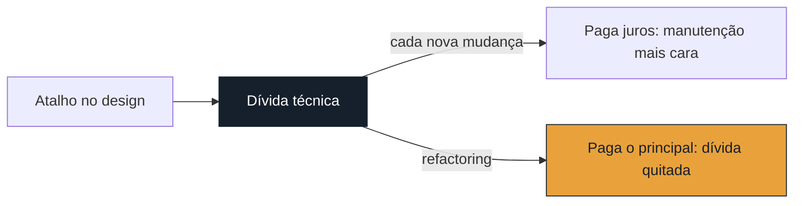
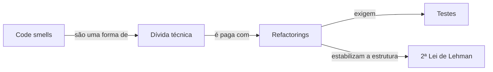

# Dívida Técnica: Notas de Aula

**Disciplina:** Engenharia de Software II
**Professor:** Mehran Misaghi · IFC Campus Araquari
**Série:** Refactoring, página 5 de 5

> **Nesta série:** [1. Introdução](01-introducao.md) · [2. Catálogo](02-catalogo.md) · [3. Prática](03-pratica.md) · [4. Code smells](04-code-smells.md) · **5. Dívida técnica** · [Exercícios](exercicios.md)

---

## Sumário

1. [A metáfora](#1-a-metáfora)
2. [Juros e principal](#2-juros-e-principal)
3. [Exemplos de dívida técnica](#3-exemplos-de-dívida-técnica)
4. [Dívida técnica e refactoring](#4-dívida-técnica-e-refactoring)

---

## 1. A metáfora

**Dívida técnica** (ou débito técnico, *technical debt*) é uma **metáfora** para explicar a importância de boas práticas e princípios de Engenharia de Software. Ela foi proposta por **Ward Cunningham** em **1992**.

> Dívida técnica são as **soluções não-ótimas de design** que dificultam a manutenção e a evolução de um sistema.

Assim como uma dívida financeira, a dívida técnica pode ser contraída **de propósito** (para entregar mais rápido) ou **sem perceber** (por falta de conhecimento ou de cuidado).

---

## 2. Juros e principal

| Termo financeiro | Em software |
|---|---|
| **Dívida** | O código ou o design de baixa qualidade |
| **Juros** | O custo extra de cada manutenção: entender, alterar e testar fica mais difícil |
| **Principal** | O esforço para eliminar a dívida (por exemplo, com refactorings) |

**Vale a pena pagar o principal?** Depende. Se ainda serão implementadas **muitas funcionalidades** naquela parte do sistema, os juros vão se acumular, e quitar a dívida compensa. Se o código raramente muda, pode ser aceitável conviver com ela.

---

## 3. Exemplos de dívida técnica

- Falta de testes
- Não obediência a padrões arquiteturais
- Alto acoplamento e baixa coesão
- Code smells
- Falta de documentação
- Código que não segue o layout pré-definido
- etc.

> Repare que **code smells** (página 4) são uma das formas mais comuns de dívida técnica no nível do código.

---

## 4. Dívida técnica e refactoring

O ciclo da aula se fecha aqui: as **Leis de Lehman** mostram que a estrutura de um sistema se deteriora; os **code smells** indicam onde isso aconteceu; a **dívida técnica** explica o custo de não agir; e os **refactorings**, protegidos por **testes**, são a forma de pagar essa dívida.

---

**Página anterior:** [← 4. Code smells](04-code-smells.md) · **Próxima:** [Exercícios →](exercicios.md)
