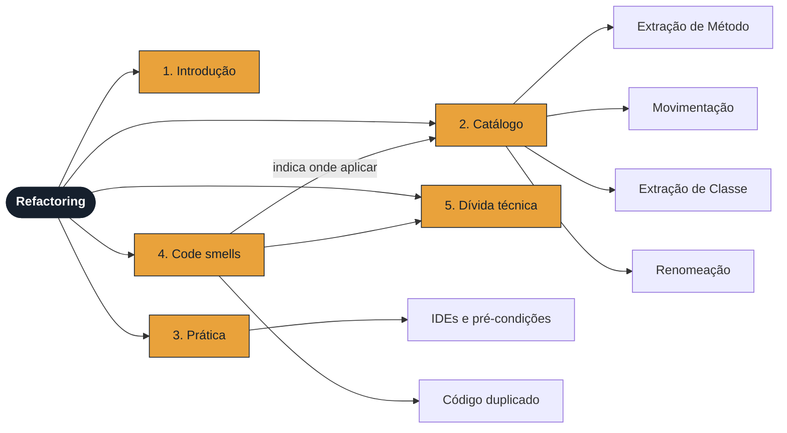

# Refactoring: Notas de Aula

>Material de apoio da **Refactoring**, baseado no
[Capítulo 9 do livro *Engenharia de Software Moderna*](https://engsoftmoderna.info/cap9.html),
do Prof. Marco Tulio Valente.

## Conteúdo

| Página | Descrição |
|---|---|
| [1. Introdução](01-introducao.md) | Tipos de manutenção, Leis de Lehman, definição e histórico de refactoring |
| [2. Catálogo de refactorings](02-catalogo.md) | Extração, inline e movimentação de métodos, extração de classes, renomeação e outros |
| [3. Prática de refactoring](03-pratica.md) | Testes, refactorings oportunistas e planejados, refactorings automatizados e pré-condições |
| [4. Code smells](04-code-smells.md) | Código duplicado e clones, métodos longos, Feature Envy, objetos mutáveis, comentários e outros |
| [5. Dívida técnica](05-divida-tecnica.md) | A metáfora de Ward Cunningham, juros, principal e exemplos |
| [Exercícios](exercicios.md) | 12 exercícios de fixação |

## Mapa da aula

## Material consultado

- VALENTE, M. T. *Engenharia de Software Moderna*. [Cap. 9: Refactoring](https://engsoftmoderna.info/cap9.html)
---
**Créditos:** slides originais de Marco Tulio Valente sob licença CC-BY, adaptados por Mehran Misaghi.

## Slides desta aula

- [Slides da aula](https://canva.link/8s6xm1cevzbswev)
