# Testes de Software - Notas da Aula


> Baseado no livro de *Engenharia de Software Moderna*, de Marco Tulio Valente ([Capítulo 8](https://engsoftmoderna.info/cap8.html)), licença CC-BY.

---

## Sumário

1. [Conceitos básicos](#1-conceitos-básicos)
2. [Mapa dos tipos de testes](#2-mapa-dos-tipos-de-testes)
3. [Testes de unidade](#3-testes-de-unidade)
4. [Cobertura de testes](#4-cobertura-de-testes)
5. [Testabilidade e mocks](#5-testabilidade-e-mocks)
6. [Desenvolvimento dirigido por testes (TDD)](#6-desenvolvimento-dirigido-por-testes-tdd)
7. [Testes de integração](#7-testes-de-integração)
8. [Testes de sistema (E2E)](#8-testes-de-sistema-e2e)
9. [Outros tipos de testes](#9-outros-tipos-de-testes)
10. [Resumo e exercícios](#10-resumo-e-exercícios)
11. [Slides da aula](#11-slides-de-aula)

---

## 1. Conceitos básicos

### 1.1 O que é testar

**Testes de software** verificam se um programa produz o resultado esperado quando executado com alguns **casos de teste**. Eles podem ser:

| | Testes manuais | Testes automatizados (nosso foco) |
|---|---|---|
| Quem executa | Uma pessoa usa o sistema e confere o resultado | Um programa testa outro programa |
| Custo de repetir | Alto: lento e cansativo | Baixo: roda em segundos, quantas vezes quisermos |
| Uso típico hoje | Aceitação e usabilidade | Unidade, integração, sistema e regressão |

### 1.2 O limite fundamental

> “Testes de software mostram a presença de bugs, mas não a sua ausência.” (Edsger W. Dijkstra)

A frase resume o **objetivo** dos testes, que é encontrar bugs antes que cheguem aos usuários. Também resume a sua **limitação**: uma suíte que passa não prova que o programa está correto. Ela mostra apenas que o programa funciona **nos casos testados**.

### 1.3 Defeito, bug e falha

- **Defeito** (*defect*) ou **bug**: um erro no código-fonte.
- **Falha** (*failure*): o resultado errado que aparece quando o código defeituoso é executado.

```java
// cálculo da área de um círculo
if (condition)
    area = pi * raio * raio * raio;   // defeito: deveria ser raio ao quadrado
```

O defeito só vira falha se essa linha for executada, ou seja, quando `condition` for verdadeira. Por isso um bom conjunto de testes precisa **exercitar os diferentes caminhos** do código.

### 1.4 Verificação × validação

| | Verificação | Validação |
|---|---|---|
| Pergunta | Estamos fazendo o sistema **corretamente**? | Estamos fazendo o sistema **correto**? |
| Referência | Requisitos e especificações | O que o cliente realmente quer |
| Exemplos | Testes de unidade, integração e sistema | Testes de aceitação com usuários |

### 1.5 De cascata para ágil

No **modelo em cascata**, testar era uma fase separada no fim do projeto. Um time específico fazia os testes, quase sempre manuais, e os bugs eram descobertos tarde, quando corrigir custa caro.

Nos **métodos ágeis**, a maioria dos testes é **automatizada** e escrita pelo próprio desenvolvedor, junto com o código ou até antes dele (TDD). Não é preciso esperar todas as partes ficarem prontas. Os testes rodam a cada mudança e protegem o sistema contra **regressões**.

---

## 2. Mapa dos tipos de testes

### 2.1 A pirâmide de testes

Mike Cohn propôs organizar os testes automatizados em uma **pirâmide**, de acordo com o tamanho do trecho do sistema que cada teste exercita.

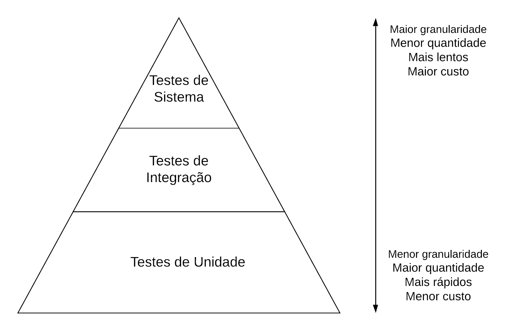

*Figura 1. Pirâmide de testes. Na base estão os testes de escopo pequeno, rápidos e baratos. No topo, os de escopo grande, lentos e caros.*

Uma recomendação frequente para a proporção entre os níveis:

| Nível | Proporção sugerida |
|---|---|
| Sistema (topo) | ≈ 10% |
| Integração (meio) | ≈ 20% |
| Unidade (base) | ≈ 70% |

### 2.2 O que cada tipo exercita

| Unidade | Integração | Sistema |
|:---:|:---:|:---:|
| 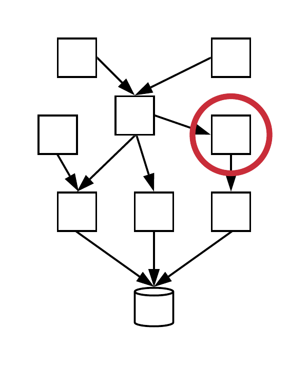 | 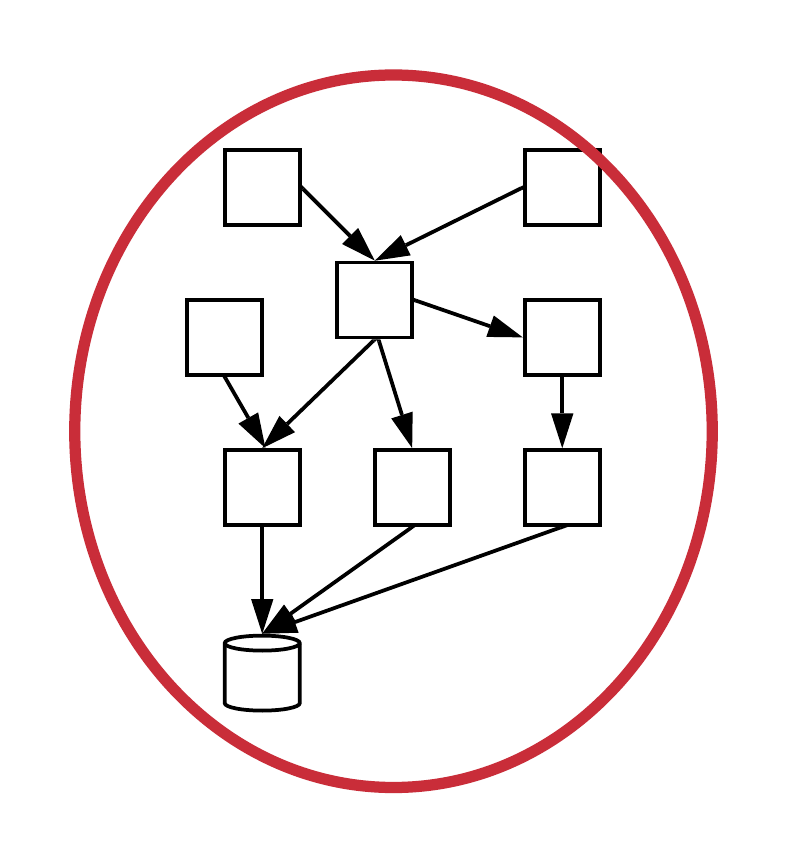 | 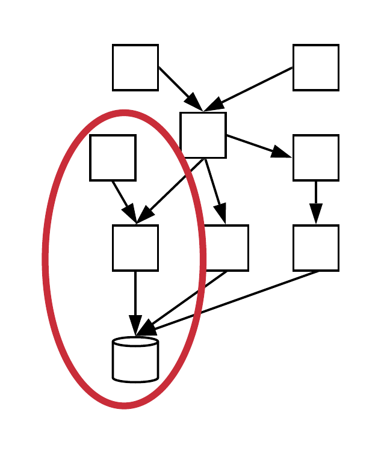 |
| Uma classe isolada | Várias classes juntas, com BD ou serviços externos | O sistema inteiro, pela interface |

*Figura 2. Escopo de cada tipo de teste. O círculo vermelho marca o trecho exercitado.*

### 2.3 Comparação lado a lado

| | **Unidade** | **Integração** | **Sistema (E2E)** |
|---|---|---|---|
| O que testa | Uma classe ou método | Uma funcionalidade com várias classes | O sistema completo, pela interface |
| Dependências | Simuladas (mocks) | Reais: BD, serviços, arquivos | Todas reais, como em produção |
| Velocidade | Milissegundos | Segundos | Segundos a minutos |
| Custo e fragilidade | Baixos | Médios | Altos (mudar a interface quebra testes) |
| Localizar o bug | Fácil: a falha aponta a classe | Médio | Difícil: muitos lugares possíveis |
| Ferramentas | JUnit, pytest, Jest | JUnit, Jest + BD de teste | Selenium, Cypress |
| Quantidade | Muitos | Alguns | Poucos |

### 2.4 Outras classificações

A pirâmide não é a única forma de classificar testes. Algumas classificações cruzam os níveis da pirâmide. Um teste de unidade, por exemplo, pode ser caixa-preta ou caixa-branca. As classificações estão detalhadas na Seção 9.

- **Caixa-preta × caixa-branca**: o teste é escrito a partir da especificação ou a partir do código?
- **Aceitação (alfa e beta)**: o cliente valida o sistema com dados reais.
- **Não-funcionais**: desempenho, usabilidade e tolerância a falhas.
- **Regressão**: reexecutar a suíte após cada mudança para garantir que o que funcionava continua funcionando.

---

## 3. Testes de unidade

### 3.1 Definição

**Testes de unidade** são testes automatizados de pequenas unidades de código, normalmente classes, executadas **de forma isolada**. Eles são:

- **isolados**: não dependem de banco de dados, rede ou interface;
- **rápidos**: uma suíte inteira roda em segundos;
- **escritos pelo próprio desenvolvedor**, junto com o código;
- **executados com frequência**, a cada alteração.

Na indústria, eles são prática consolidada. No Google, todo código de produção deve ter testes de unidade. No Facebook, cada engenheiro é responsável pelos testes do código que escreve. Michael Feathers resume a ideia: “código sem testes é código ruim”.

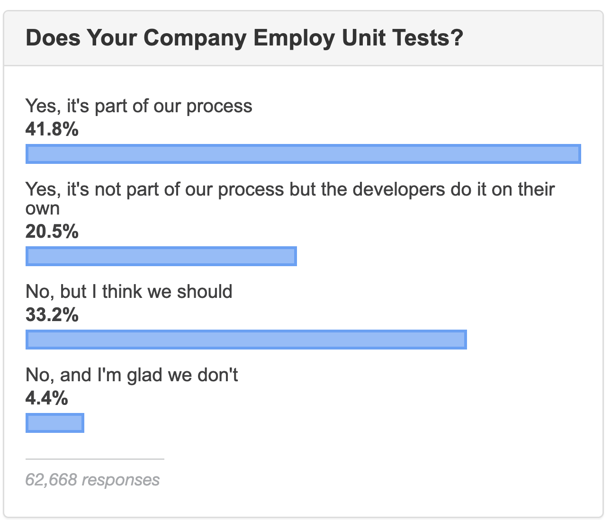

*Figura 3. Stack Overflow Developer Survey 2019. Cerca de 62% dos respondentes usam testes de unidade, seja como parte do processo, seja por iniciativa dos desenvolvedores.*

### 3.2 Classes e classes de teste

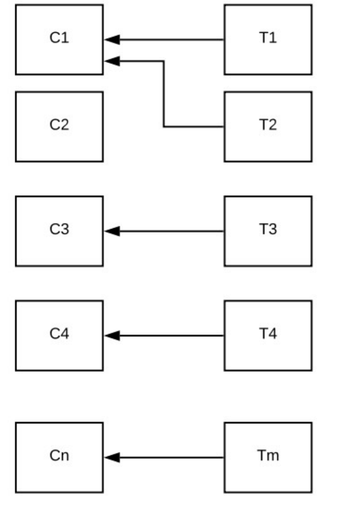

Em geral, cada classe de produção `C` tem uma classe de teste `T` (por exemplo, `StackTest` testa `Stack`). **Não é uma regra 1:1**: uma classe de teste pode exercitar várias classes, e classes triviais podem não ter testes. Por convenção, o código de teste fica separado do código de produção (ex.: `src/test/java`) e o nome da classe de teste termina em `Test`.

<br clear="right">

### 3.3 Anatomia de um teste (JUnit)

Um método de teste segue três passos:

1. **criar o contexto** (*fixture*): instanciar o objeto testado e preparar os dados;
2. **chamar o método** que está sendo testado;
3. **verificar o resultado** com um comando `assert`.

```java
import org.junit.Test;
import static org.junit.Assert.assertTrue;

public class StackTest {

  @Test                                  // método de teste: público, sem parâmetros
  public void testEmptyStack() {
    Stack<Integer> stack = new Stack<Integer>();  // 1. fixture
    boolean empty = stack.isEmpty();              // 2. chama o método testado
    assertTrue(empty);                            // 3. verifica o resultado
  }
}
```

Se o `assert` não for satisfeito, o framework registra uma **falha** e mostra a barra vermelha. Se todos passarem, a barra fica verde.

**Padrão AAA.** Os três passos também são conhecidos como **Arrange** (preparar), **Act** (agir) e **Assert** (verificar). Separar visualmente essas etapas deixa o teste fácil de ler. Se um teste precisa de vários *Act* diferentes, provavelmente deveria ser dividido em mais testes.

### 3.4 Mais recursos do JUnit

**`@Before`: fixture compartilhada.** O método anotado com `@Before` executa **antes de cada** método `@Test`. Cada teste roda em uma nova instância da classe, então um teste não enxerga o estado deixado por outro.

```java
public class StackTest {
  Stack<Integer> stack;

  @Before
  public void init() {
    stack = new Stack<Integer>();
  }

  @Test
  public void testNotEmptyStack() {
    stack.push(10);
    assertFalse(stack.isEmpty());
  }
}
```

**`assertEquals(esperado, encontrado)`.** A ordem dos parâmetros importa: primeiro o valor esperado, depois o encontrado. Se a ordem for trocada, a mensagem de erro (`expected:<3> but was:<2>`) fica confusa.

```java
@Test
public void testSizeStack() {
  stack.push(10);
  stack.push(20);
  stack.push(30);
  assertEquals(3, stack.size());
}
```

**Testando exceções.** O teste passa somente se a exceção indicada for lançada. Não usamos `assert`, pois a exceção interrompe o método antes de qualquer `assert` ser alcançado.

```java
@Test(expected = java.util.EmptyStackException.class)
public void testEmptyStackException() {
  stack.push(10);
  stack.pop();
  stack.pop();   // pilha vazia: lança exceção
}
```

**Outras linguagens.** Todos os frameworks da família xUnit seguem a mesma ideia: pytest e unittest (Python), Jest (JavaScript), RSpec (Ruby), CUnit (C), CppUnit (C++) e NUnit (C#).

### 3.5 Vocabulário

| Termo | Significado |
|---|---|
| Teste | Método que testa um requisito ou comportamento |
| Fixture | Estado ou contexto preparado antes do teste |
| Caso de teste | Classe com métodos de teste (ex.: `StackTest`) |
| Suíte de testes | Conjunto de casos de teste executados juntos |
| SUT | *System Under Test*, a classe ou sistema sendo testado |
| Código de produção | Código que vai para o usuário |

### 3.6 Benefícios e quando escrever

Os testes de unidade:

- **detectam bugs cedo**, na classe que está sendo implementada;
- **evitam regressões**: uma mudança em `C` pode quebrar `C′`, e a suíte avisa na hora;
- **servem de documentação**, pois mostram com exemplos executáveis como usar a classe.

Testes podem ser escritos logo após implementar uma classe, antes dela (TDD), ao reproduzir um bug reportado ou durante a depuração, no lugar de `System.out.println`. O que não se recomenda é deixar tudo para o fim do projeto.

### 3.7 Princípios FIRST

| Letra | Princípio | Significado |
|:---:|---|---|
| **F** | *Fast* | Rápidos: rodam em milissegundos |
| **I** | *Independent* | Independentes: a ordem de execução não importa |
| **R** | *Repeatable* | Determinísticos: sempre o mesmo resultado |
| **S** | *Self-checking* | Auto-verificáveis: barra verde ou vermelha, sem análise manual |
| **T** | *Timely* | Escritos o quanto antes, idealmente antes do código |

Um teste que às vezes passa e às vezes falha, sem mudança no código, é chamado de **flaky**. Uma causa comum é usar `sleep` em código assíncrono. O Google estimou que cerca de 16% dos seus testes eram flaky.

### 3.8 Test smells

*Test smells* são sinais de testes mal escritos:

- **teste obscuro**: longo, complexo e difícil de entender;
- **lógica condicional**: `if` ou laços dentro do teste (testes devem ser lineares);
- **código duplicado**: a mesma preparação copiada em vários testes (use `@Before`).

Smells são alertas para refatorar, não regras absolutas. A recomendação geral é **um assert por teste**, com exceções justificadas, como verificar vários campos de um mesmo objeto.

---

## 4. Cobertura de testes

“Quantos testes devo escrever?” A **cobertura** ajuda a responder, pois mede o quanto do código os testes exercitam.

### 4.1 Cobertura de comandos (C0)

$$\text{Cobertura de comandos} = \frac{\text{comandos executados pelos testes}}{\text{total de comandos do programa}}$$

Ferramentas como JaCoCo, EclEmma, coverage.py e `jest --coverage` calculam esse valor automaticamente e colorem o código-fonte:

| Cor | Significado |
|---|---|
| 🟩 Verde | Comando executado pelos testes |
| 🟨 Amarelo | Comando de decisão em que só um dos branches foi avaliado |
| 🟥 Vermelho | Comando não executado por nenhum teste |

| Suíte completa: 100% | Sem `testEmptyStackException`: 92,9% |
|:---:|:---:|
| 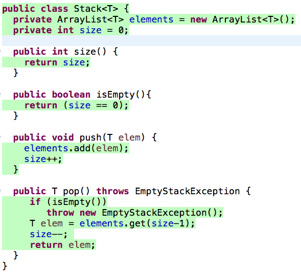 | 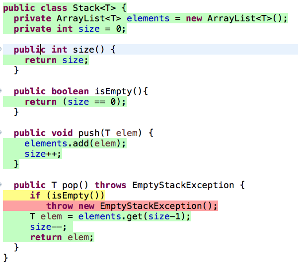 |

*Figura 4. Cobertura da classe `Stack`. Sem o teste da exceção, o `throw` fica vermelho e o `if (isEmpty())` fica amarelo.*

> ⚠️ Cobertura mostra o que **não** foi testado. Ela não garante que o que foi testado está correto.

### 4.2 Cobertura de branches (C1)

Todo `if` gera dois *branches*: verdadeiro (V) e falso (F).

$$\text{Cobertura de branches} = \frac{\text{branches executados pelos testes}}{\text{total de branches do programa}}$$

Essa medida é mais rigorosa que a cobertura de comandos. Veja um exemplo:

```java
double calcularDesconto(double preco) {
  if (preco > 1000)
     desconto = 0.1;
  return desconto;
}
// Regra esquecida: se preco <= 1000, desconto = 0.05
```

Se o teste usar apenas `preco > 1000`, a cobertura de **comandos** é de **100%**, o que dá a falsa sensação de que está tudo certo. Já a de **branches** é de **50%**, pois o branch falso nunca foi exercitado. Ao escrever um teste com `preco < 1000`, o bug aparece.

### 4.3 Qual a cobertura ideal?

Não existe número mágico, e **100% não é necessário**: getters, setters, código de interface e código assíncrono raramente compensam o esforço. É mais útil **acompanhar a evolução** da cobertura do que fixar uma meta rígida. Alguns valores de referência:

| Referência | Valor |
|---|---|
| Times que valorizam testes | ≈ 70% |
| Valor preocupante | abaixo de 50% |
| Projetos que usam TDD | acima de 90% |
| Mediana no Google (2014) | 78% (recomendação interna: 85%) |

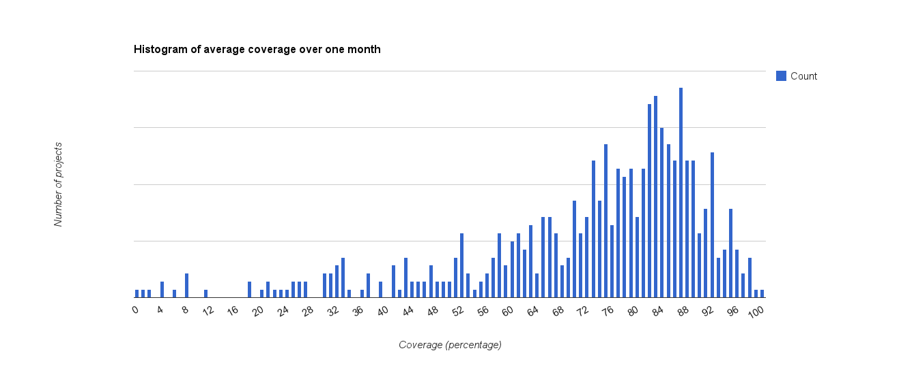

*Figura 5. Histograma da cobertura média dos projetos do Google em um mês. Mediana de 78%.*

---

## 5. Testabilidade e mocks

### 5.1 Testabilidade

**Testabilidade** é a facilidade de testar um código. Ela depende do **projeto** do código de produção, e os princípios de projeto já estudados (alta coesão, baixo acoplamento, responsabilidade única, inversão de dependências) a melhoram.

**Exemplo: um Servlet que calcula o IMC.**

```java
public class IMCServlet extends HttpServlet {
  public void doGet(HttpServletRequest req, HttpServletResponse res) {
    res.setContentType("text/html");
    PrintWriter out = res.getWriter();
    String peso = req.getParameter("peso");
    String altura = req.getParameter("altura");
    try {
      double p = Double.parseDouble(peso);
      double a = Double.parseDouble(altura);
      double imc = p / (a * a);                  // regra de negócio
      out.println("Índice de Massa Corporal (IMC): " + imc);
    } catch (NumberFormatException e) { ... }
  }
}
```

Para testar `doGet()`, precisamos criar `HttpServletRequest` e `HttpServletResponse`, que por sua vez exigem outros objetos. A **testabilidade é baixa**.

**Solução:** extrair a regra de domínio para uma classe separada, que não depende de Servlets:

```java
class IMCModel {
  public double calculaIMC(String p1, String a1) {
    double p = Double.parseDouble(p1);
    double a = Double.parseDouble(a1);
    return p / (a * a);
  }
}
```

Agora `IMCModel` pode ser testada com um teste de unidade comum, e o Servlet fica “fino”: só lê parâmetros e escreve a resposta.

### 5.2 Mocks

Considere uma classe que pesquisa livros em um **serviço remoto**:

```java
public interface BookService {
  String search(int isbn);
}

public class BookSearch {
  BookService rbs;
  public BookSearch(BookService rbs) { this.rbs = rbs; }

  public Book getBook(int isbn) {
    String json = rbs.search(isbn);              // acesso remoto
    JSONObject obj = new JSONObject(json);
    return new Book((String) obj.get("titulo"));
  }
}
```

Testar `getBook()` com o serviço real torna o teste lento e dependente da rede, e ele deixa de ser um teste de unidade.

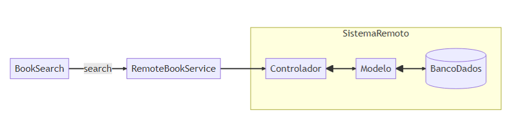

*Figura 6. Sem mock, o teste atravessa a rede até o sistema remoto.*

Um **mock** é um objeto que **emula** um objeto real. Ele implementa a mesma interface, mas é muito mais simples e devolve respostas controladas pelo teste.

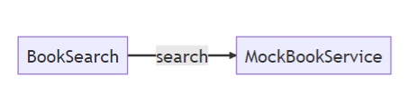

*Figura 7. Com mock, `BookSearch` conversa com um objeto local que conhece apenas dois livros.*

```java
class MockBookService implements BookService {
  public String search(int isbn) {
    if (isbn == 1234)
      return BookConst.ESM;       // "{ \"titulo\": \"Eng Soft Moderna\" }"
    return BookConst.NULLBOOK;
  }
}

public class BookSearchTest {
  private BookService service;

  @Before
  public void init() {
    service = new MockBookService();          // injeta o mock
  }

  @Test
  public void testGetBook() {
    BookSearch bs = new BookSearch(service);
    String titulo = bs.getBook(1234).getTitulo();
    assertEquals("Eng Soft Moderna", titulo);
  }
}
```

Graças à **injeção de dependência** pelo construtor, `BookSearch` não sabe que está falando com um mock.

**Mockito.** Frameworks de mocks dispensam a classe escrita à mão. O comportamento do mock é programado por uma DSL:

```java
@Before
public void init() {
  service = Mockito.mock(BookService.class);                        // cria o mock
  when(service.search(anyInt())).thenReturn(BookConst.NULLBOOK);    // programa
  when(service.search(1234)).thenReturn(BookConst.ESM);             // respostas
}
```

### 5.3 Objetos dublês

Gerard Meszaros chama de **dublês** (*test doubles*) os objetos que substituem dependências reais:

| Dublê | O que faz |
|---|---|
| **Dummy** | É passado como argumento, mas nunca é usado |
| **Fake** | Implementação funcional simplificada (ex.: BD em memória com tabelas hash) |
| **Stub** | Retorna respostas prontas; o teste verifica o **estado** |
| **Mock** | Também verifica o **comportamento**, isto é, quais métodos foram chamados (`verify`) |

O livro usa “mock” em sentido amplo, sem distinguir mock de stub.

**Cuidados com mocks:**

- eles **acoplam** o teste à implementação, e mudanças internas podem quebrar testes;
- sem extensões, o Mockito não simula métodos estáticos, construtores e classes finais;
- um mock pode **esconder bugs** que só aparecem na integração com o objeto real.

Para explorar o exemplo completo, acesse [repl.it/@mtvalente/ExemploMocks](https://repl.it/@mtvalente/ExemploMocks).

---

## 6. Desenvolvimento dirigido por testes (TDD)

### 6.1 Ideia

**TDD** (*Test-Driven Development*) é uma prática da Extreme Programming (XP), proposta por Kent Beck. A ideia é simples: **escrever o teste antes da classe**. A prática traz alguns benefícios:

- os desenvolvedores não esquecem de escrever testes;
- o código já nasce com boa testabilidade;
- o design melhora, pois o desenvolvedor é o primeiro “cliente” da própria classe;
- a cobertura costuma passar de 90%.

### 6.2 O ciclo vermelho → verde → refatorar

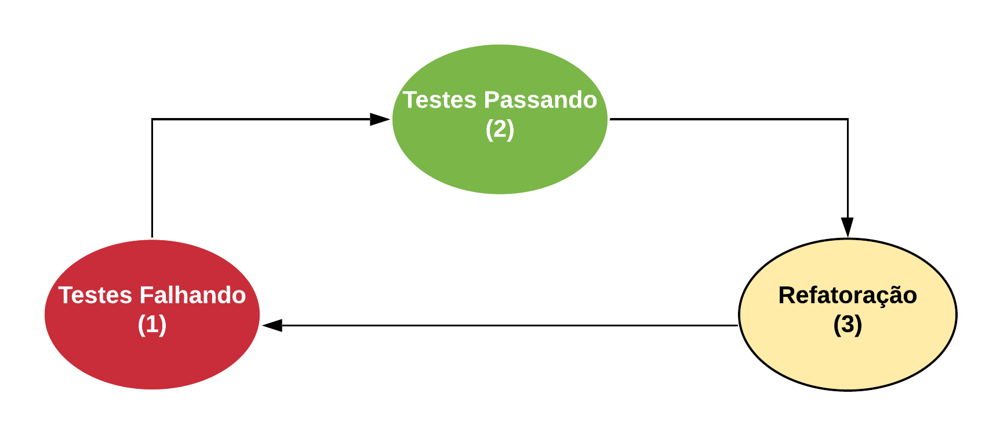

*Figura 8. Ciclo do TDD: (1) escrever um teste que falha, (2) fazê-lo passar com o mínimo de código, (3) refatorar sem mudar o comportamento.*

O ciclo avança em **baby steps**, ou seja, um teste pequeno de cada vez.

### 6.3 Exemplo: carrinho de compras

**① Vermelho.** Escrevemos o teste antes que `Book` e `ShoppingCart` existam. O teste nem compila.

```java
@Test
void testAddGetTotal() {
  Book b1 = new Book("book1", 10, "1");
  Book b2 = new Book("book2", 20, "2");
  ShoppingCart cart = new ShoppingCart();
  cart.add(b1);
  cart.add(b2);
  assertEquals(30.0, cart.getTotal());
}
```

Em seguida, criamos um esqueleto que **compila**, mas em que `getTotal()` retorna `0.0`. O teste continua vermelho.

**② Primeiro verde (*fake it*).** Retornar a constante esperada só para obter uma pequena vitória:

```java
double getTotal() { return 30.0; }
```

**③ Verde real.** Implementação que funciona para qualquer livro:

```java
public class ShoppingCart {
  private ArrayList<Book> items = new ArrayList<Book>();
  private double total = 0.0;

  public void add(Book b) {
    items.add(b);
    total += b.price;
  }

  double getTotal() { return total; }
}
```

**④ Refatorar.** Melhorar o código sem mudar o comportamento, por exemplo encapsulando os campos de `Book` (`public` → `private`, com getters). Os testes devem continuar verdes.

Se precisarmos de mais alguma funcionalidade, começa um novo ciclo. Para praticar, use o roteiro [github.com/mtov/AulaPraticaTDD](https://github.com/mtov/AulaPraticaTDD).

---

## 7. Testes de integração

### 7.1 Definição

**Testes de integração**, também chamados de **testes de serviço**:

- testam uma **funcionalidade completa**, envolvendo várias classes e pacotes;
- usam **dependências reais**, como banco de dados e serviços externos;
- **não usam mocks**, porque o objetivo é justamente testar as partes funcionando juntas;
- são mais lentos que os de unidade, por isso existem em menor número e rodam com menos frequência.

O próprio JUnit (ou Jest, em JavaScript) pode ser usado para escrevê-los.

### 7.2 Exemplo: ESM Forum

O **ESM Forum** é um fórum simples de perguntas e respostas, com código em [github.com/mtov/esmforum](https://github.com/mtov/esmforum).

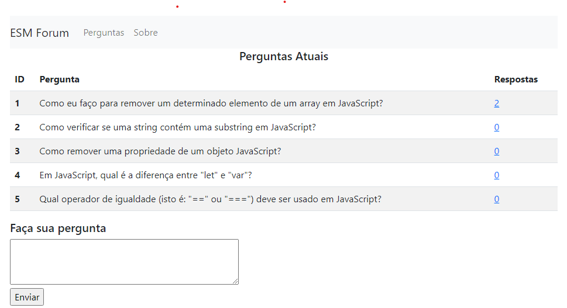

*Figura 9. Tela do ESM Forum.*

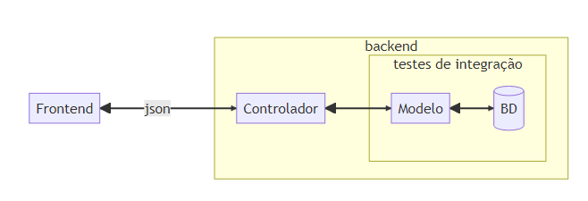

*Figura 10. O teste de integração exercita o **Modelo** junto com o **banco de dados real**. Frontend (React) e Controlador (Express.js) ficam de fora.*

Antes de cada teste, apontamos para um **banco exclusivo de testes** e apagamos os dados. Assim, cada teste começa do mesmo estado e os testes ficam independentes e repetíveis, como pedem os princípios FIRST.

```javascript
const bd = require('../bd/bd_utils.js');
const modelo = require('../modelo.js');

beforeEach(() => {
  bd.reconfig('./bd/esmforum-teste.db');
  // limpa dados de todas as tabelas
  bd.exec('delete from perguntas', []);
  bd.exec('delete from respostas', []);
});

test('Testando banco de dados vazio', () => {
  expect(modelo.listar_perguntas().length).toBe(0);
});

test('Testando cadastro de três perguntas', () => {
  modelo.cadastrar_pergunta('1 + 1 = ?');
  modelo.cadastrar_pergunta('2 + 2 = ?');
  modelo.cadastrar_pergunta('3 + 3 = ?');
  const perguntas = modelo.listar_perguntas();
  expect(perguntas.length).toBe(3);
  expect(perguntas[0].texto).toBe('1 + 1 = ?');
  expect(perguntas[2].num_respostas).toBe(0);
});
```

### 7.3 Para discutir

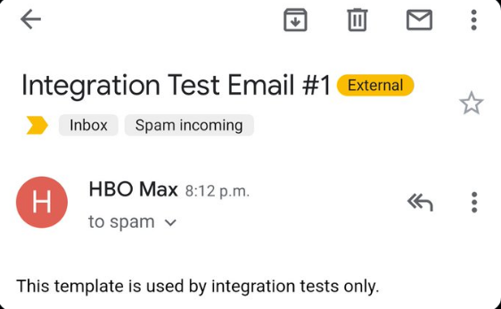

*Figura 11. Em junho de 2021, este e-mail de teste foi enviado por engano a milhares de assinantes da HBO Max.*

O que deve ter acontecido para que um e-mail de teste de integração chegasse aos usuários finais? Como o ambiente de testes deveria estar configurado para evitar isso?

---

## 8. Testes de sistema (E2E)

### 8.1 Definição

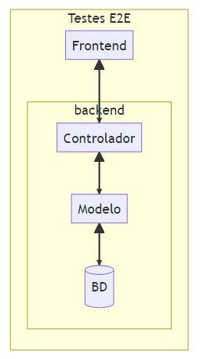

**Testes de sistema** ficam no topo da pirâmide. Eles:

- testam o **sistema inteiro**, por meio da sua interface externa;
- simulam o comportamento de um **usuário real**;
- também são chamados de testes **ponta a ponta** (*end-to-end*, E2E), de interface ou de frontend;
- são os **mais caros, lentos e frágeis**, pois uma mudança na interface pode quebrar vários testes;
- quando falham, tornam mais difícil descobrir onde está o defeito.

<br clear="right">

### 8.2 Exemplo: TodoMVC com Cypress

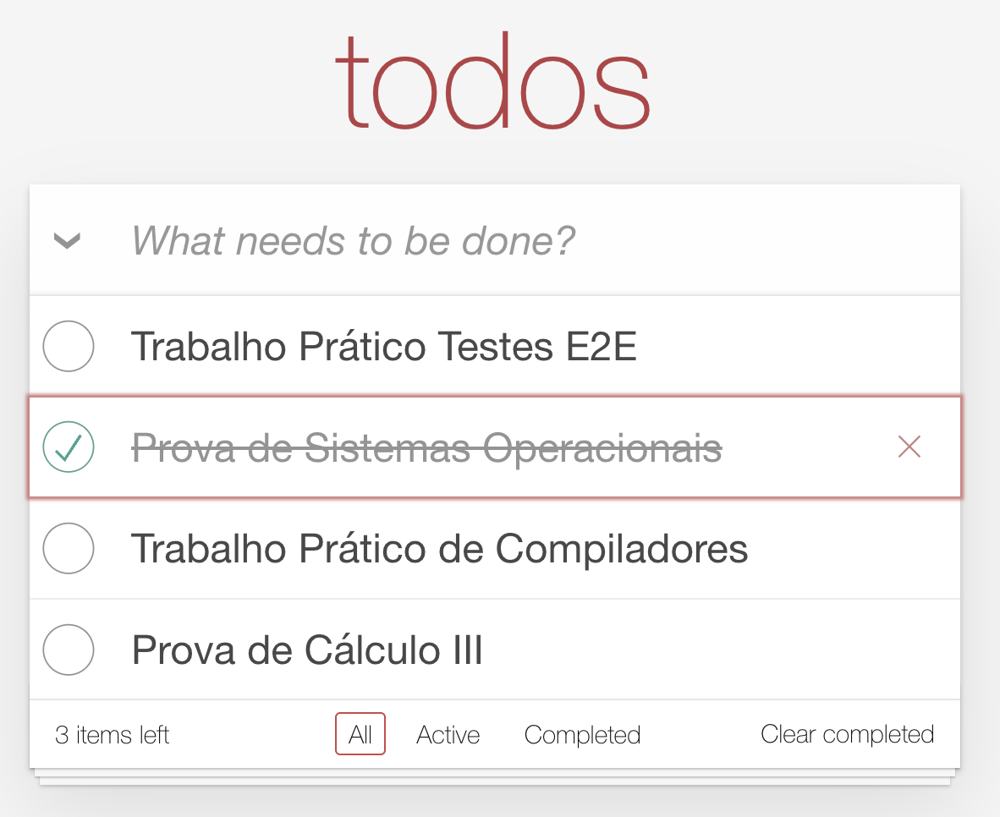

O **TodoMVC** ([todomvc.com](https://todomvc.com)) é uma lista de tarefas implementada em vários frameworks. O **Cypress** é uma ferramenta que abre o navegador, executa ações e verifica a página. Outra ferramenta muito usada para esse fim é o **Selenium**.

O teste encontra os elementos da página por **seletores CSS**:

| Seletor | Elemento |
|---|---|
| `.new-todo` | campo para nova tarefa |
| `.todo-list li` | item da lista |
| `.todo-list li .toggle` | checkbox de tarefa concluída |
| `.todo-list li .destroy` | botão de apagar (aparece com o mouse em cima) |
| `.todo-count` | contador de tarefas |
| `.clear-completed` | limpar concluídas |

<br clear="right">

```javascript
it('Insere uma tarefa', () => {
  cy.visit('http://127.0.0.1:7001');

  cy.get('.new-todo')                       // localiza o campo
    .type('Trabalho Prático Testes E2E{enter}');   // digita

  cy.get('.todo-list li')
    .should('have.length', 1)               // should = assert do Cypress
    .first()
    .should('have.text', 'Trabalho Prático Testes E2E');
});

it('Insere e deleta uma tarefa', () => {
  cy.visit('http://127.0.0.1:7001');
  cy.get('.new-todo').type('Trabalho Prático Testes E2E{enter}');

  cy.get('.todo-list li .destroy')
    .invoke('show')                         // torna visível o botão escondido
    .click();

  cy.get('.todo-list li').should('have.length', 0);
});
```

Um único teste E2E pode percorrer um fluxo inteiro de uso, como cadastrar tarefas, concluir uma e usar os filtros *Active*, *Completed* e *All*. Para praticar, use o roteiro [github.com/mtov/roteiro-cypress](https://github.com/mtov/roteiro-cypress).

---

## 9. Outros tipos de testes

### 9.1 Caixa-preta × caixa-branca

| | Caixa-preta (funcionais) | Caixa-branca (estruturais) |
|---|---|---|
| Base | Interface e requisitos | Estrutura interna do código |
| Olha o código? | Não, só entradas e saídas esperadas | Sim |
| Objetivo | Cobrir os comportamentos especificados | Exercitar comandos e branches |
| Técnicas | Classes de equivalência, valores limite | Testes guiados por cobertura |

Um teste de unidade pode ser de qualquer um dos dois tipos, conforme foi pensado. Para Kent Beck, o TDD não se encaixa bem nessa divisão, pois o próximo teste se inspira no código já escrito.

### 9.2 Seleção de dados de teste

Testar **todas** as entradas possíveis (**teste exaustivo**) é inviável. Testes **randômicos** também não são recomendados na maioria dos casos, porque podem repetir classes de entrada e deixar outras sem teste. Usamos duas técnicas.

**Classes de equivalência.** Agrupamos as entradas em classes com a mesma chance de revelar bugs e testamos **um valor de cada classe**. O exemplo do livro usa as faixas de uma tabela de imposto de renda:

| Classe (salário, R$) | Alíquota | Valor a testar |
|---|---|---|
| até 1.903,98 | isento | 1.500,00 |
| 1.903,99 a 2.826,65 | 7,5% | 2.400,00 |
| 2.826,66 a 3.751,05 | 15% | 3.300,00 |
| 3.751,06 a 4.664,68 | 22,5% | 4.200,00 |
| acima de 4.664,68 | 27,5% | 6.000,00 |

Cinco testes cobrem todas as faixas, em vez de milhares de salários.

**Análise de valor limite.** Bugs costumam aparecer nas **fronteiras** (usar `>` em vez de `>=`, por exemplo). Por isso testamos os limites de cada classe e os valores imediatamente vizinhos:

```
        isento          |          7,5%            |      15%
 ───────────────────────●●────────────────────────●●──────────────
                 1.903,98  1.903,99        2.826,65  2.826,66
```

### 9.3 Testes de aceitação

Os testes de aceitação são realizados **pelo cliente**, com dados reais, e em geral são manuais. São uma atividade de **validação** (estamos fazendo o sistema certo?) e não apenas de verificação. Em métodos ágeis, uma história só é considerada pronta depois de aceita pelo cliente, ao final da sprint.

| Teste alfa | Teste beta |
|---|---|
| Poucos usuários | Grupo maior de usuários |
| Ambiente controlado, próximo do time | Ambiente real, antes do lançamento geral |

### 9.4 Testes de requisitos não-funcionais

Esses testes verificam **como** o sistema se comporta, e não apenas **o que** ele faz:

- **Desempenho**: submetem o sistema a uma carga de usuários ou requisições e medem o tempo de resposta. Exemplo: um e-commerce na Black Friday.
- **Usabilidade**: observam usuários reais usando o sistema para encontrar pontos de confusão na interface.
- **Falhas**: simulam a queda de serviços, ou até de um data center inteiro, para ver se o sistema se recupera.

---

## 10. Resumo e exercícios

### 10.1 Quadro-resumo

| Tipo | Pergunta que responde | Quem faz | Automatizado? |
|---|---|---|---|
| **Unidade** | Esta classe funciona isoladamente? | Desenvolvedor | Sim |
| **Integração** | As partes funcionam juntas (com BD, serviços)? | Desenvolvedor | Sim |
| **Sistema (E2E)** | O sistema funciona do ponto de vista do usuário? | Desenvolvedor / QA | Sim (Cypress, Selenium) |
| **Aceitação (alfa/beta)** | É o sistema que o cliente queria? | Cliente / usuários | Em geral, manual |
| **Não-funcionais** | É rápido, usável e tolerante a falhas? | Equipe especializada | Parcialmente |
| **Regressão** | O que funcionava continua funcionando? | Integração contínua | Sim |

### 10.2 Exercícios

**1.** Para a função abaixo, preencha a tabela com as coberturas de comandos e de branches. O programa tem quatro comandos e quatro branches.

```java
void f(int x, int y) {
  if (x > 0) {
     x = 2 * x;
     if (y > 0) {
        y = 2 * y;
     }
  }
}
```

| Teste | Comandos | Branches |
|---|---|---|
| `f(0, 0)` | | |
| `f(1, 1)` | | |
| `f(0, 0)` e `f(1, 1)` | | |

**2.** Os alunos recebem conceito A se tiverem nota maior ou igual a 90. A função abaixo implementa esse requisito:

```java
boolean isConceitoA(int nota) {
  if (nota > 90)
    return true;
  else return false;
}
```

a) Essa implementação possui um bug? Se sim, quando ele resulta em falha?
b) Se a função for testada com as notas 95 e 85, qual a cobertura de comandos? E a de branches?

**3.** Verdadeiro ou falso? Justifique: “Se um programa possui 100% de cobertura de testes, em nível de comandos, ele está livre de bugs.”

**4.** Por que normalmente não é necessário nem obrigatório atingir 100% de cobertura de comandos?

**5.** Escreva um teste de unidade para uma função `fib(n)` que retorna o n-ésimo termo da sequência de Fibonacci.

**6.** Descreva um cenário em que um mock `B′` esconde um bug de uma classe `A`, bug que só aparece quando `A` é integrada com a classe real `B`.

**7.** Classifique cada teste como unidade, integração, sistema ou aceitação e justifique:
a) um teste Cypress que faz login e finaliza uma compra;
b) um teste JUnit de `IMCModel.calculaIMC`;
c) um teste Jest que grava e lê perguntas no banco do ESM Forum;
d) o cliente usando a nova versão por uma semana antes de aprová-la.

---
## 11. Slides da Aula

Após a leitura do capítulo 8 e notas da aula, você poderá verificar os [slides da aula](https://canva.link/rf1r1b4n75llm8s).

--- 

### Referências

- VALENTE, Marco Tulio. *Engenharia de Software Moderna*, Cap. 8: Testes. Disponível em: <https://engsoftmoderna.info/cap8.html>.
---

